# Azentio Onboard: AI HR Onboarding Agent

This app coordinates a new joiner's onboarding from offer to day one:
- It works out which documents and tasks apply to each person, and records why.
- It emails requests through Gmail, reads the replies, and checks each attachment with a vision LLM.
- It flags mismatches and builds the HR record.
- It raises IT, Facilities and Compliance requests automatically.
- It recalculates the plan when the joining date or role changes.
- It answers employee questions from approved policies, with citations.

## Screenshots

**Sign in**: Staff sign in with an invited work email. Joiners never sign in; they use the secure link in their email.

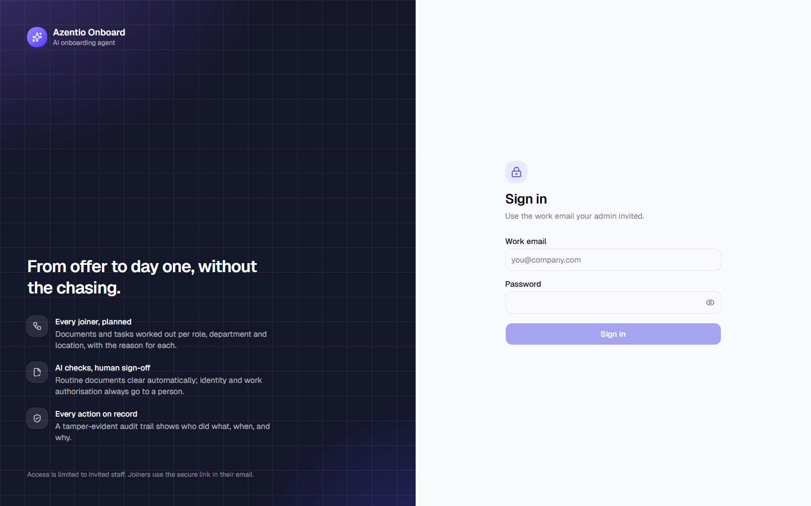

**Dashboard**: Every new joiner, readiness, overdue and blocked items at a glance (shown here for HR Ops).

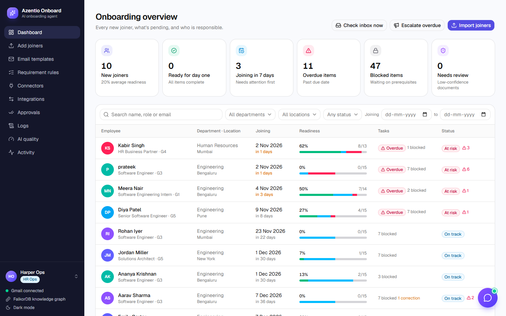

**Users and roles** (admin): Five roles, each limited to its own job. Admins add people, change roles, reset passwords and deactivate accounts.

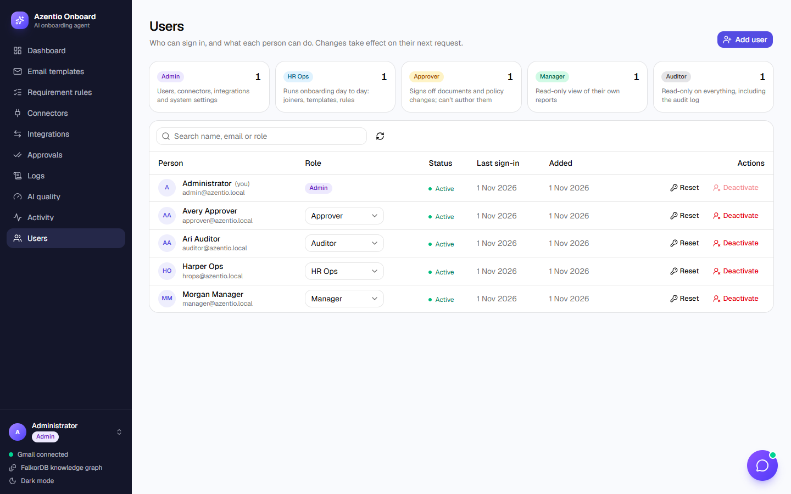

**Manager view**: Managers see only their own reports, read-only.

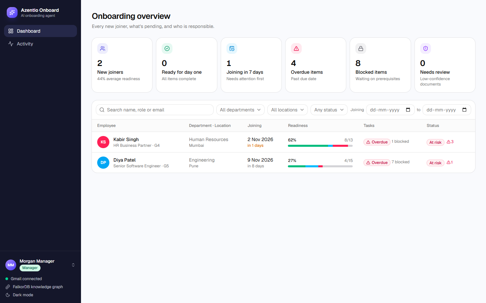

**Document request**: HR Ops previews the templated email before sending it through Gmail.

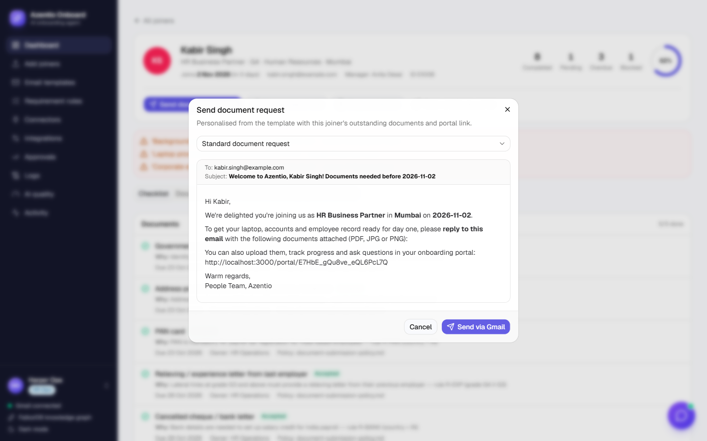

**Requirement rules**: Which documents and tasks apply by role, department, grade and location, and why.

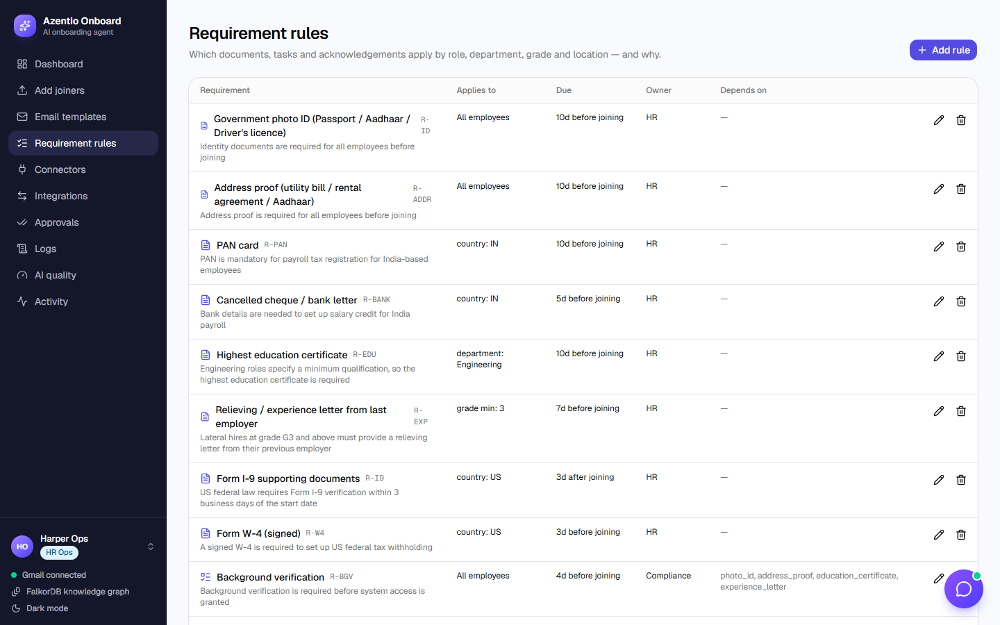

**Email templates**: Document-request emails with per-employee variables and a live preview.

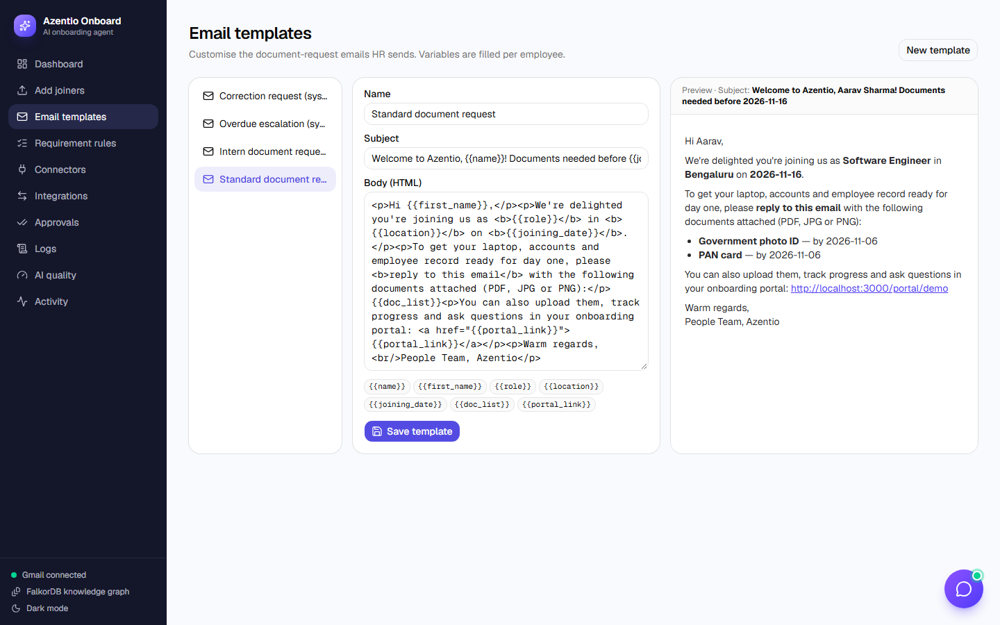

**Connectors**: Sources, targets and the apps joiners get access to.

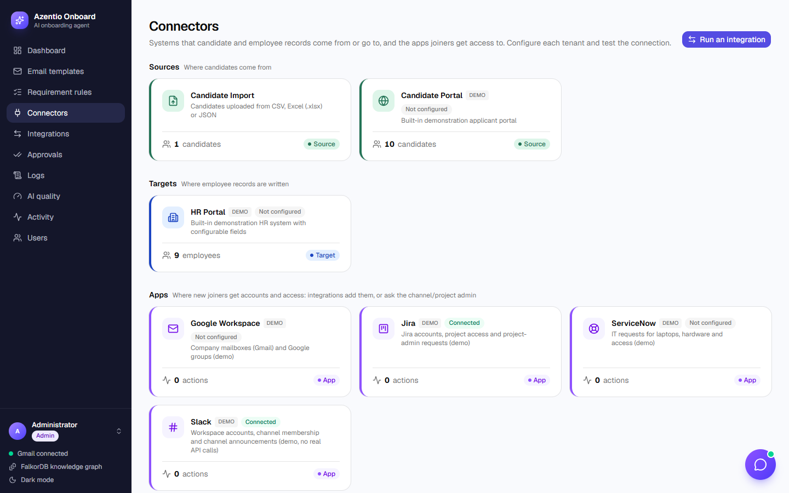

**Integrations**: Flows that move candidates from a source to a target.

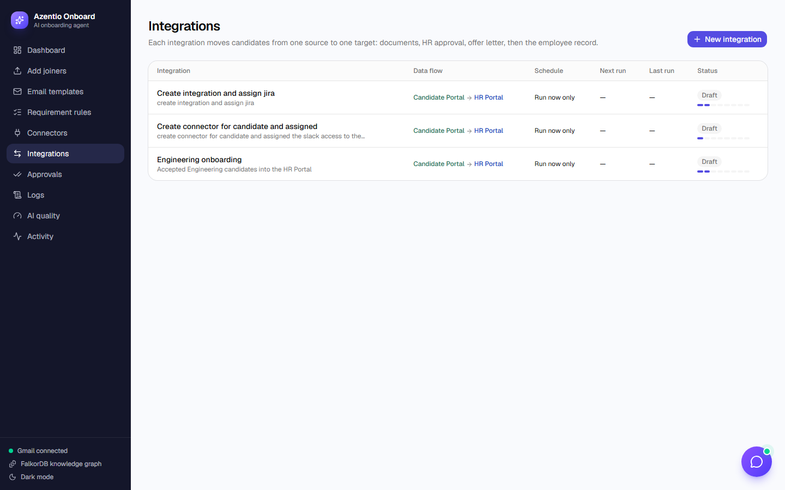

**Approvals**: Everything waiting on a decision. Only approvers can approve or reject.

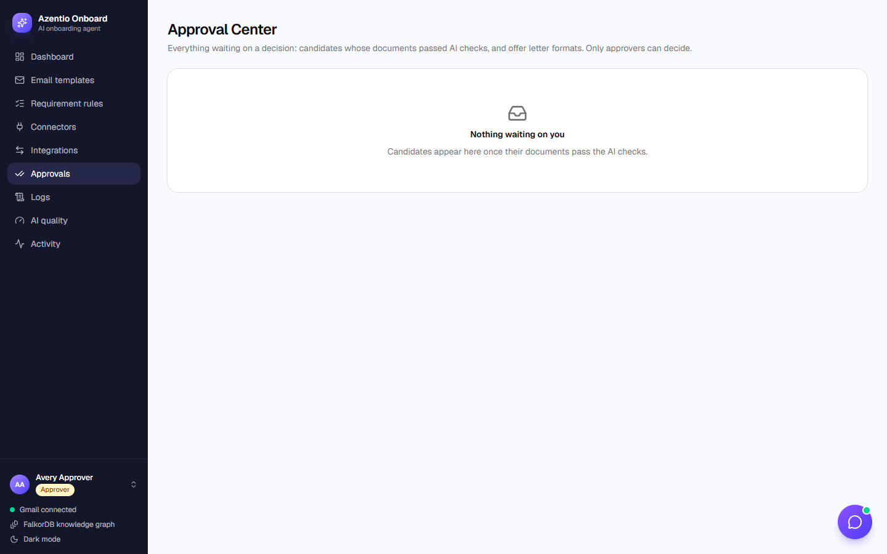

**Audit log**: Every action under the name of the person (or system) that did it, in a tamper-evident chain.

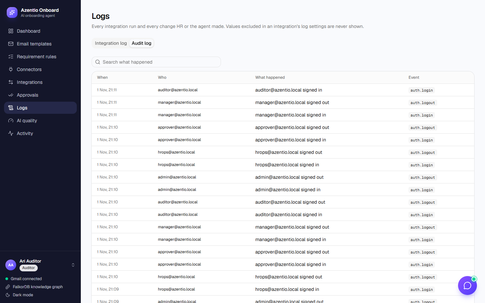

**AI quality**: Assistant evaluation scores and guardrail hits.

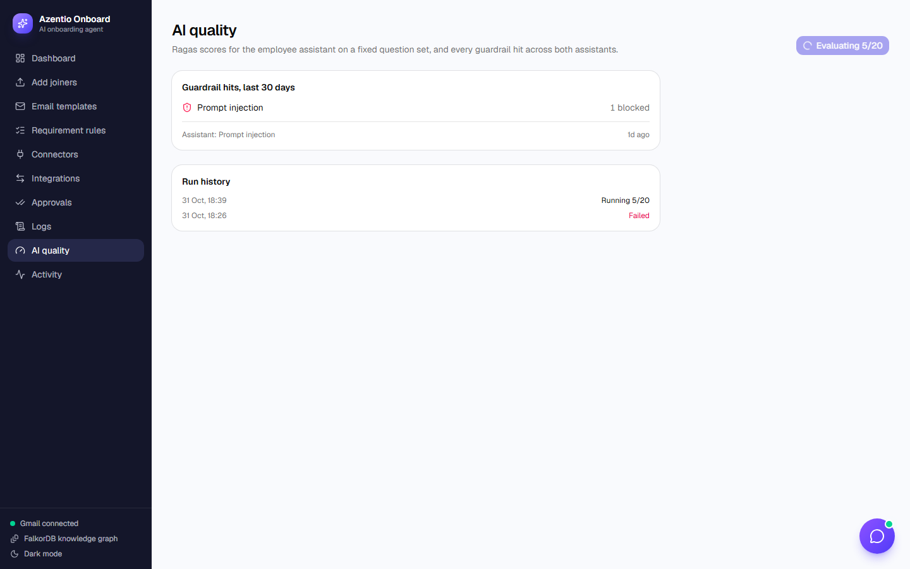

## Run it

```bash
# 1. Databases
docker compose up -d                      # Postgres on :5432 (system of record), FalkorDB on :6379 (UI on :3001)

# 2. Backend: sets itself up on start (migrations, admin user, sample data). No manual steps.
cd backend && uv run uvicorn main:app --port 8000

# 3. Frontend
cd frontend && npm install && npm run dev  # http://localhost:3000
```

Sign in at http://localhost:3000/login. In development the backend creates one account per role and the login page lists them:

| Email | Role | Password |
|---|---|---|
| `admin@azentio.local` | Admin: users, connectors, integrations | `admin-dev-pass` (or `ADMIN_PASSWORD`) |
| `hrops@azentio.local` | HR Ops: runs onboarding | `hrops-dev-pass` |
| `approver@azentio.local` | Approver: signs off documents and policy | `approver-dev-pass` |
| `manager@azentio.local` | Manager: read-only, own reports | `manager-dev-pass` |
| `auditor@azentio.local` | Auditor: read-only, including the audit log | `auditor-dev-pass` |

With `ENV=production`, `DATABASE_URL`, `ADMIN_EMAIL` and `ADMIN_PASSWORD` are required and no dev accounts are created. `GET /ready` reports whether Postgres, the graph and the job worker are up.

Configuration lives in `.env` at the repo root (see `.env.example`):

| Area | Variables |
|---|---|
| LLM (any OpenAI-compatible provider, OpenRouter free models by default) | `OPENROUTER_API_KEY`, optional `LLM_BASE_URL`, `LLM_MODEL`, `LLM_FALLBACK_MODEL`, `LLM_EMBED_MODEL` |
| Gmail | `GMAIL_CLIENT_ID`, `GMAIL_CLIENT_SECRET`, `GMAIL_REFRESH_TOKEN`, `HR_MAILBOX` |
| Optional human verification | `AWAITVERIFY_ENABLED`, `AWAITVERIFY_API_KEY` |
| Runtime and sign-in | `ENV`, `DATABASE_URL`, `ADMIN_EMAIL`, `ADMIN_PASSWORD`, `SESSION_DAYS`, `COOKIE_SECURE`, `CORS_ORIGINS` |

Self-checks (each uses a throwaway database, never live data):
```bash
cd backend && uv run python test_core.py     # rules, validation, ingestion, connectors, integrations
cd backend && uv run python test_phase0.py   # sign-in, permissions for every role, audit chain, job queue, bootstrap
backend/.venv/Scripts/python scripts/smoke.py --base http://localhost:3000   # UI: every role signs in, navigates, runs a workflow
```

## What's where

| Path | Purpose |
|---|---|
| `backend/checklist.py` | Rules engine: match by role, department, grade and location, with reasons, due dates, dependency blocking and auto-provisioning |
| `backend/validate.py` | Deterministic checks: file type, legibility, expiry, name and DOB mismatch, missing fields |
| `backend/extract.py`, `llm.py` | Vision extraction to structured JSON (PDFs are rendered to images), with a provider-agnostic client |
| `backend/pipeline.py` | Shared intake for email attachments and portal uploads |
| `backend/gmail.py` | Templated sends, a reply poller scoped to employee addresses, correction emails |
| `backend/chat.py` | Grounded assistant: policy retrieval plus the employee's live checklist, streamed with citations |
| `backend/ingest.py` | CSV, Excel and JSON ingestion with row-level validation, plus seeding |
| `backend/seed/` | Sample joiners, owners, requirement rules, email templates and policies |
| `frontend/app/(hr)` | HR app: dashboard, employee record (checklist, documents, HR record, graph, activity), import, templates, rules |
| `frontend/app/portal/[token]` | Employee portal: checklist timeline, uploads, policy acknowledgements, assistant |

## Demo script
1. **Dashboard:** filter by department, location or status. Kabir is at risk (BGV overdue); the auto-provisioning trail shows on his record.
2. **Aarav → Send document request:** preview the templated email, then send it via Gmail.
3. **Reply to that email with an ID image, then click "Check inbox now":** extraction runs, then validation. A name mismatch is flagged and a correction email goes out in the same thread.
4. **Change date / role:** move the joining date, and the toast lists every recalculated due date.
5. **Open the employee portal:** upload a document, acknowledge the infosec policy, and ask "Which documents do I need before joining?" for a cited, role-specific answer.
6. **Escalate overdue:** owners of overdue tasks get an email listing what they are blocking.

## Connectors & integrations
Connectors are the systems that records come from (**sources**, shown in pine) or go to (**targets**, shown in ultramarine). The demo connectors store their data in this app's FalkorDB graph.

| Connector | Role | Holds |
|---|---|---|
| Candidate Portal (demo) | Source | Candidates (10 seeded) |
| Candidate Import | Source | Candidates uploaded as CSV, Excel or JSON, with import history |
| HR Portal (demo) | Target | Employees, matched on work email; supports custom fields |

- Code: `backend/connectors/` (`base.py` interface, `registry.py`, one module per connector, `sync.py`), routes in `backend/connector_routes.py`.
- **Integrations** (`/integrations`): pick a source and target, adjust the suggested field mapping, choose update or skip for duplicates, and run. Re-running never creates duplicates, and every rejected record comes with a reason.
- **Linked to onboarding:** "Start onboarding" on a candidate creates the joiner and checklist. When a joiner's HR record completes, they're written to the HR Portal automatically.
- Access: sign-in with five roles (admin, HR Ops, approver, manager, auditor). See the [hardening roadmap](docs/plans/2026-11-01-hardening-design.md) for what's built and what's next.

To add a connector: subclass `Connector`, implement the four read methods (plus `upsert_record` for a target), register it in `_REGISTRY`, and add a catalog row and an instance in `connectors/seed.py`.
