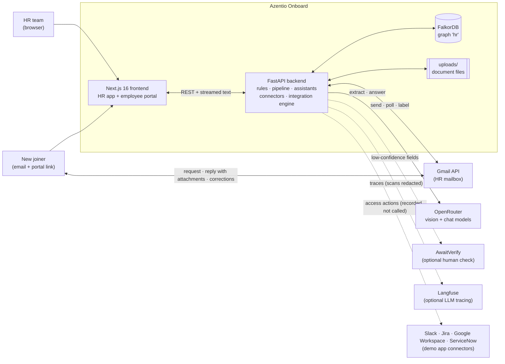
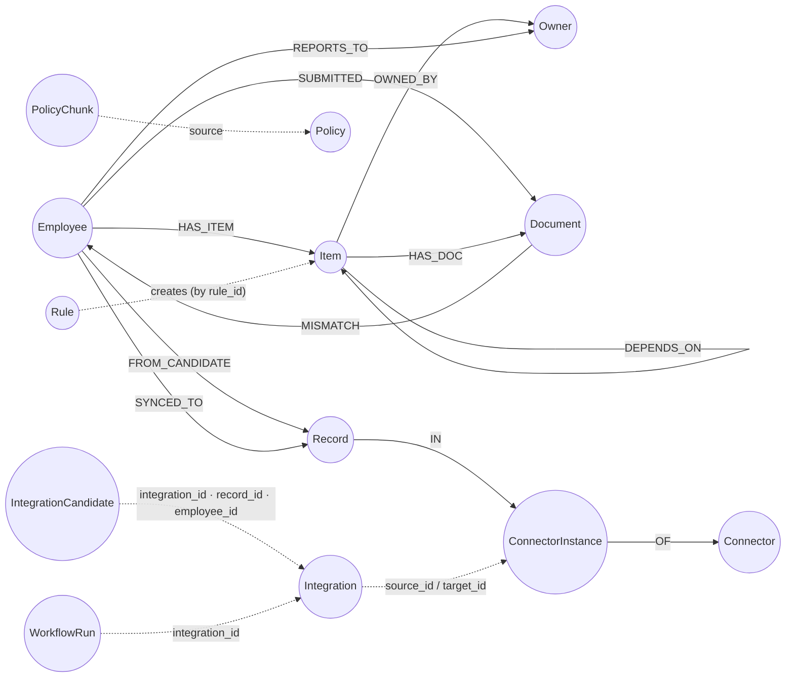
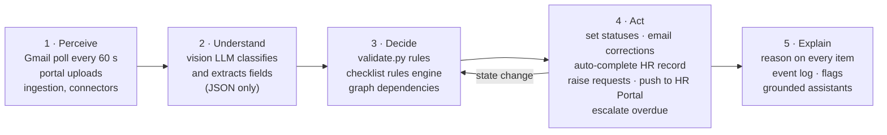
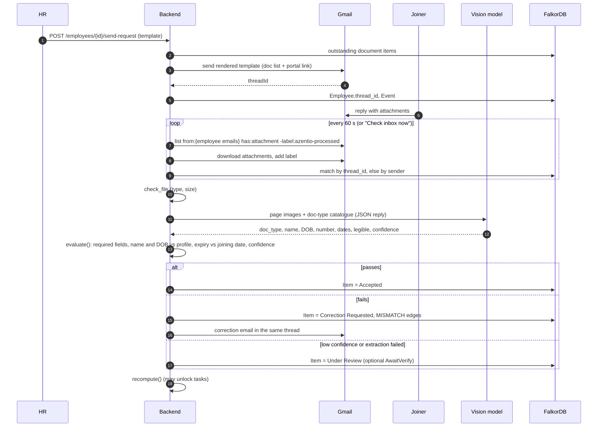
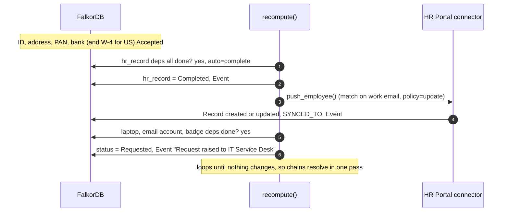
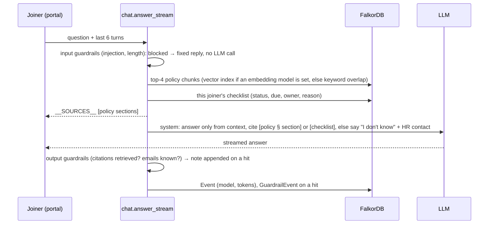
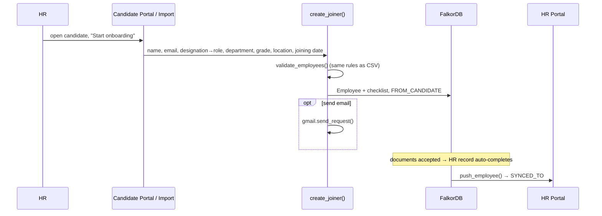
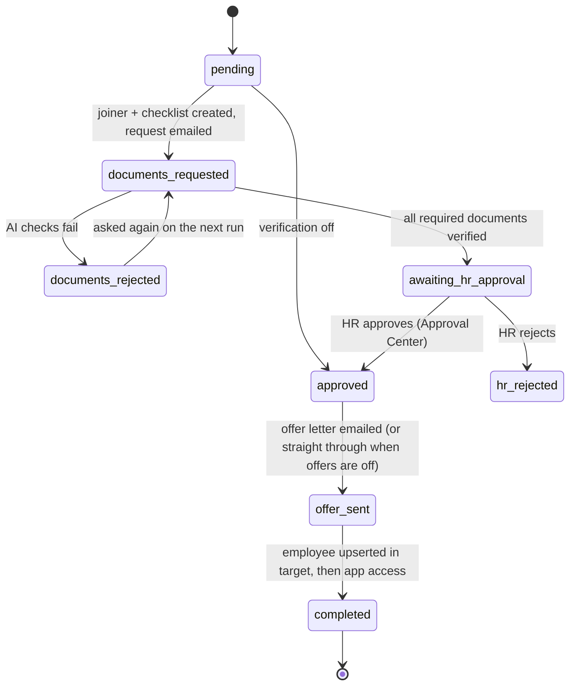
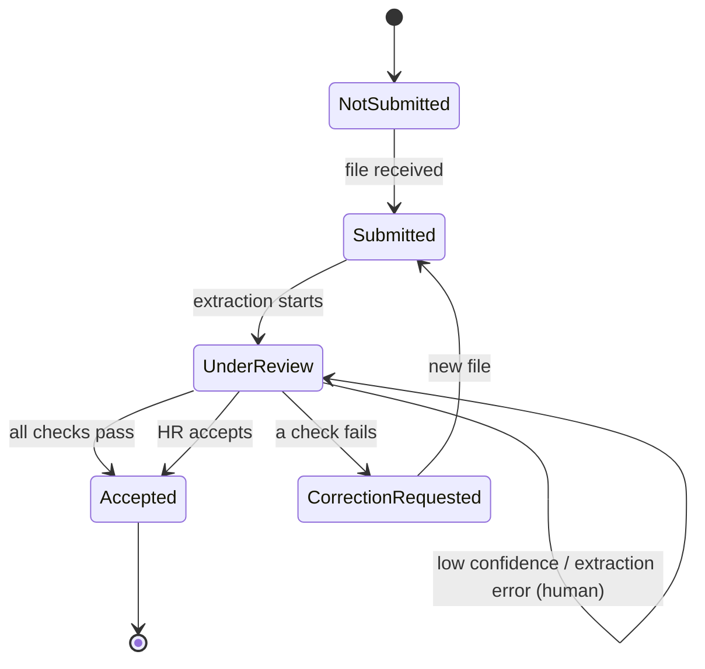
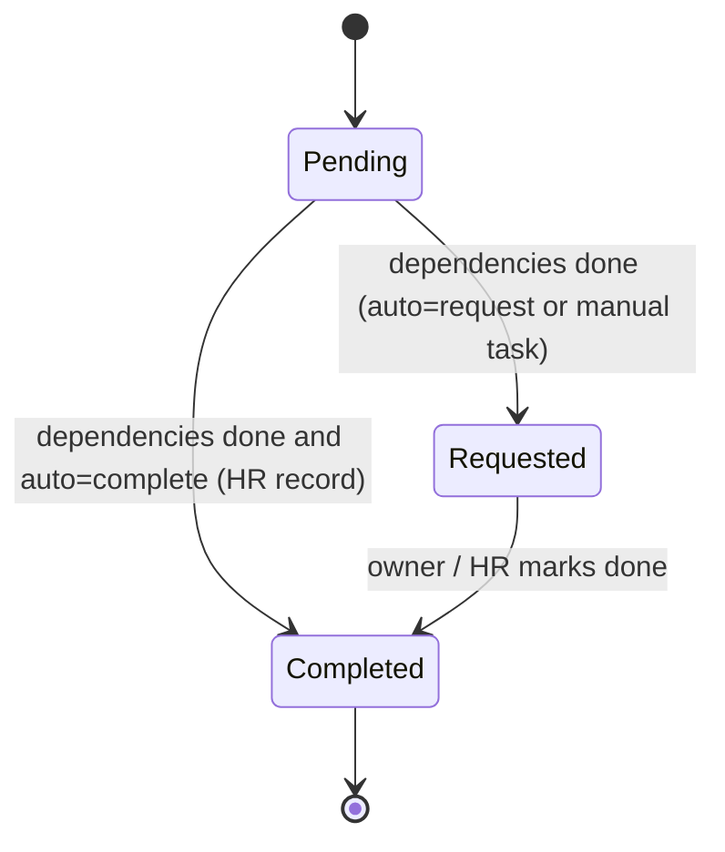

# Azentio Onboard: Architecture & Agentic Workflow

This document describes how the HR Onboarding Agent is built and how the agent behaves. It covers the system as it exists in this repository: what each part does, how data moves, what the agent decides on its own, and where the design is deliberately simplified.

---

## 1. Overview

### Problem
Onboarding a new joiner involves HR, IT, Facilities and Compliance. Documents arrive late or wrong, provisioning waits on records that wait on documents, and nobody has one view of what is blocking day one. When a joining date or role changes, the plan usually gets rebuilt by hand.

### What the system does
- Works out which documents, tasks and policy acknowledgements apply to each joiner from their role, department, grade and location, and records **why** each one applies.
- Requests documents by email, reads the replies, and checks every attachment with a vision model followed by deterministic validation.
- Flags missing, expired, illegible or mismatched documents and emails the joiner a specific correction request.
- Builds the HR record from accepted documents, then raises IT, Facilities and Compliance requests automatically when their prerequisites are met.
- Recalculates due dates, owners and required items when the joining date or role changes.
- Escalates overdue tasks to the owner and says what each one is blocking.
- Answers joiner and HR questions from approved policies and live onboarding data, with citations.
- Brings candidates in from source systems and writes employees to a target HR system.
- Runs **integrations**: staged, repeat-safe workflows that take a candidate from source record through document checks, HR approval and offer letter to an employee in the target, with app access (Slack, Jira, Google Workspace, ServiceNow) granted afterwards. HR sets each one up by chatting with an AI setup agent.
- Records everything three ways: an append-only audit log, a per-run integration log HR can redact, and structured console logs. LLM calls can also be traced in Langfuse.
- Guards both chat assistants against prompt injection and unverified citations, and scores the employee assistant with Ragas on a fixed question set.

### Scope against the brief
| Brief | Status |
|---|---|
| Level 1: ingestion, checklist with reasons, document tracking, validation, grounded assistant, dashboard | Built |
| Scenario 1: document collection and correction | Built (email and portal) |
| Scenario 2: HR record and IT provisioning | Built (automatic, dependency-driven) |
| Scenario 3: role-specific templates and policy acknowledgement | Built |
| Scenario 4: joining-date and role changes | Built (automatic recalculation with an audit trail) |
| Scenario 5: questions and overdue approvals | Built (two assistants, escalation emails) |
| Extra: connectors, integrations, HR co-pilot, knowledge-graph view | Built |
| Extra: agent-led integration setup, Approval Center, app access, offer letters | Built |
| Extra: audit and integration logs, Langfuse tracing, guardrails, Ragas evaluation | Built |

### Design principles
1. **The LLM perceives; rules decide.** The model reads documents and writes answers. Whether a document is accepted, a task is blocked or a record is written is decided by deterministic code.
2. **Every item explains itself.** Each checklist item stores the rule that created it and the criteria that matched.
3. **The graph is the plan.** Dependencies are edges in FalkorDB, so recalculation means walking edges, not rebuilding spreadsheets.
4. **Fail toward a human.** If extraction fails or confidence is low, the document goes to *Under Review*. It is never accepted silently and never lost.
5. **Cheap by default.** Free models, capped tokens, one fallback, and the spend of every call logged.
6. **The agent proposes; the service layer decides.** The integration setup agent can only call tools, and every tool goes through the same validation as the UI buttons.
7. **Logs are safe to share.** Console lines carry ids, field names and counts, never names, emails, tokens or document contents.

---

## 2. System context



---

## 3. Containers and components

### 3.1 Runtime
| Container | Technology | Notes |
|---|---|---|
| Frontend | Next.js 16 (App Router, Turbopack), React 19, Tailwind v4, shadcn/ui on Base UI, lucide icons | All pages are client components fetching live data. Cache Components and PPR are off. |
| Backend | Python 3.12, FastAPI, uvicorn, managed by `uv` | Single process. Two background asyncio tasks: the Gmail poller (every 60 s) and the integration scheduler (every 30 s). |
| Database | FalkorDB (Redis-compatible graph, Cypher) in Docker | One graph, `hr`. A separate `test` graph is used by the self-checks. |
| File store | Local `backend/uploads/` | Original document files, served back for preview. |
| LLM | Any OpenAI-compatible endpoint; OpenRouter by default | Free vision model with a free fallback. |
| Email | Gmail API with an OAuth refresh token | One HR mailbox sends and receives. Without Gmail, integration emails are recorded as simulated sends. |
| Tracing | Langfuse (cloud or self-hosted), optional | On only when both Langfuse keys are set. |
| Evaluation | Ragas 0.4 with an OpenAI-compatible judge | Run from the AI quality page or `uv run python evals.py`. |

### 3.2 Backend modules
| File | Responsibility | Key functions |
|---|---|---|
| `main.py` | App setup, lifespan (seed, start Gmail poller), HR, portal, ingestion, template, rule and assistant routes | `items_with_state`, `summarize`, `flags`, `create_joiner` |
| `graph.py` | FalkorDB client and Cypher helpers | `q`, `q1`, `event`, `ensure_indexes` |
| `checklist.py` | Rules engine: applicability, reasons, due dates, blocking, automatic task progression | `match_rule`, `build_items`, `view_state`, `regenerate`, `recompute` |
| `validate.py` | Deterministic document checks | `check_file`, `names_match`, `evaluate` |
| `llm.py` | Provider-agnostic client, model fallback, reasoning controls, optional Langfuse wrapper with scan redaction | `complete`, `_mask` |
| `extract.py` | Document classification and field extraction (vision, JSON), PDF to image, optional human verification | `to_images`, `extract`, `human_verify` |
| `pipeline.py` | Shared document intake for email and portal | `intake` |
| `gmail.py` | Templated sending, reply polling, attachment download, correction emails | `send_request`, `send_correction`, `poll`, `poll_forever` |
| `chat.py` | Policy chunking and retrieval, employee assistant, HR co-pilot | `index_policy`, `retrieve`, `answer_stream`, `hr_context`, `hr_answer_stream` |
| `guardrails.py` | Input checks (prompt injection, length) and output checks (citations, unknown emails, prompt leak) for both assistants | `check_input`, `check_output`, `record` |
| `evals.py` | Ragas evaluation of the employee assistant against `seed/eval_assistant.json` | `start_run`, `run`, `running` |
| `quality_routes.py` | AI quality API: eval runs, per-question results, guardrail hits | router under `/api/quality` |
| `audit.py` | Append-only audit log of who did what | `record_audit`, `list_audit` |
| `logging_setup.py` | `key=value` console logs tied together by a request id; portal tokens masked | `setup`, `log_event`, `Timer`, `safe_path` |
| `ingest.py` | CSV, Excel and JSON parsing and validation, employee upsert, seeding | `read_table`, `validate_employees`, `upsert_employee`, `import_requirements`, `seed` |
| `connector_routes.py` | Connector API: records, schema, custom fields, connection settings, imports, start onboarding | router mounted under `/api` |
| `integration_routes.py` | Integration workflow, Approval Center, integration log and audit log API | router mounted under `/api` |
| `integrations/store.py` | Integration records and setup state; setup steps, questions, stages, activation blockers | `get`, `update`, `current_step`, `problems`, `settle`, `items` |
| `integrations/service.py` | Every change to an integration (shared by UI buttons and agent tools) | `save_*`, `suggest_mapping`, `approve_mapping`, `activate`, `pause`, `decide_candidate`, `grant_access` |
| `integrations/chat.py` | The setup chat: tool definitions and the turn loop | `TOOLS`, `Tools.execute`, `run_chat_turn`, `start_from_chat` |
| `integrations/agent.py` | `LlmAgent` (tool calling) and the rule-based `SimulatedAgent` fallback | `get_agent` |
| `integrations/engine.py` | Runs an integration: the per-candidate stage machine, offers, access, notifications, scheduler tick | `run_integration`, `on_documents_changed`, `perform_access`, `run_due` |
| `integrations/mapping.py`, `expr.py` | Applying a mapping; the sandboxed expression language for custom fields | `apply_mapping`, `check_required`, `expr.check`, `expr.evaluate` |
| `integrations/delivery.py` | Outbound email through Gmail, or recorded as simulated | `send_email`, `messages` |
| `integrations/run_log.py` | What goes into the integration log, and HR's exclusions | `snapshot_mapping`, `mask_record` |
| `connectors/base.py` | Connector interface, `FieldSpec`, `RecordRejected` | `Connector` |
| `connectors/candidates.py` | Candidate Portal and Candidate Import sources | `normalise`, `CandidateImport.import_file` |
| `connectors/hr_portal.py` | HR Portal target: write rules, custom fields, onboarding push | `validate`, `HrPortal.upsert_record`, `add_field`, `push_employee` |
| `connectors/apps.py` | Demo app connectors (Slack, Jira, ServiceNow, Google Workspace); every action is recorded, no external call | `AppConnector.perform`, `ACTIONS` |
| `connectors/registry.py` | Connector key → implementation | `_REGISTRY`, `get` |
| `connectors/sync.py` | Field aliases and the original one-shot sync (kept for the self-checks; integrations now run through `integrations/engine.py`) | `suggest_mapping`, `apply_mapping` |
| `connectors/seed.py` | Catalog, instances and demo records | `seed_connectors` |
| `seed/` | Sample joiners, owners, requirement rules, roles, email templates, policies, the eval question set | — |
| `test_core.py` | Assert-based self-checks | — |

### 3.3 Frontend
| Route | Audience | Purpose |
|---|---|---|
| `/dashboard` | HR | KPIs, filters (department, location, status, joining range, search), readiness per joiner, inbox check, escalation |
| `/employees/[id]` | HR | Checklist with reasons, documents with extracted-vs-profile comparison, HR record, knowledge graph, activity; send request, change date or role, accept or reject |
| `/import` ("Add joiners") | HR | One-step "Onboard a candidate" form plus bulk import of joiners, owners, requirements and policies |
| `/templates` | HR | Email template editor with live preview |
| `/rules` | HR | Requirement rules editor; saving recalculates every checklist |
| `/connectors`, `/connectors/[id]` | HR | Sources and targets; Records, Fields and Import history tabs; custom fields; start onboarding from a candidate |
| `/integrations` | HR | Every integration with status, schedule and last run |
| `/integrations/new` | HR | Describe the integration in a sentence; the agent creates it and asks the first question |
| `/integrations/[id]` | HR | Tabs: Agent (setup chat with quick replies), Candidates (stage per candidate, decisions, access), Log, Sent messages |
| `/approvals` | HR | Approval Center: candidates whose documents passed the AI checks, and offer letter formats |
| `/logs` | HR | Integration log (per run, per candidate, with exclusions applied) and searchable audit log |
| `/quality` ("AI quality") | HR | Ragas scores with trend and change since the last run, per-question answers, guardrail hits, run history |
| `/activity` | HR | Global event feed, refreshed every 10 s |
| `/portal/[token]` | Joiner | Progress and countdown, checklist timeline, drag-and-drop upload, policy acknowledgement, assistant |

| Shared component | Purpose |
|---|---|
| `app-shell.tsx` | Sidebar, theme toggle, Gmail status; mounts the HR co-pilot |
| `hr-assistant.tsx` | Floating co-pilot; becomes page-aware on an employee record |
| `chat-panel.tsx` | Streaming chat used by both assistants; parses the `__SOURCES__` header |
| `graph-view.tsx` | Hand-drawn SVG radial view of an employee's subgraph |
| `quick-onboard.tsx` | Create the joiner, build the checklist and send the request in one step |
| `status.tsx` | State and status badges, progress ring, segment bar, source and target role badge |
| `integration-chat.tsx` | Setup chat with the agent: messages, quick replies, tool results |
| `integration-bits.tsx` | Shared integration UI: stage badges, decision buttons |
| `integration-log.tsx` | Run list and per-candidate log, used on an integration and on `/logs` |
| `timeline.tsx`, `markdown.tsx`, `simple-select.tsx` | Activity timeline, Markdown subset renderer, select wrapper |

---

## 4. Data model (FalkorDB graph `hr`)



Integration nodes link by id properties rather than edges, because each one is read by id and never walked.

| Label | Key properties | Purpose |
|---|---|---|
| `Employee` | `id, name, email, role, grade, department, location, manager_email, joining_date, date_of_birth, token, thread_id` | A joiner. `token` grants portal access; `thread_id` links their Gmail thread. |
| `Item` | `id, employee_id, key, name, kind (document, task, ack), category, rule_id, reason, policy_ref, due, status, owner_name, owner_email, auto, depends[]` | One checklist entry, with the reason it exists |
| `Rule` | `id, item, name, kind, category, match (json), offset_days, depends_on[], description, policy_ref, auto, ord` | A requirement rule, editable by HR |
| `Document` | `id, employee_id, filename, path, mime, size, source (email, portal), status, extracted (json), issues (json), confidence, doc_type, ts` | One received file and its verification result |
| `Owner` | `email, name, department, type (manager, owner:HR, owner:IT, owner:Facilities, owner:Compliance)` | Department owners and managers |
| `Event` | `id, employee_id, kind, message, ts` | Audit and activity log, including AI model and token usage |
| `Config` | `key (departments, locations, doc_types, roles), value (json)` | Reference data |
| `EmailTemplate` | `id, name, subject, body` | HR-editable Jinja templates |
| `Policy` / `PolicyChunk` | `source, title, text` / `source, section, text, embedding?` | Approved policy text, chunked by `##` section |
| `Connector` | `key, name, role (source, target), record_kind, demo, description` | Connector catalog |
| `ConnectorInstance` | `id, key, name` | This workspace's use of a connector |
| `Record` | `id, instance_id, kind, values (json), created, updated` | A candidate or HR Portal employee |
| `CustomField` | `instance_id, key, label, type, required` | HR Portal custom fields |
| `ImportRun` / `IntegrationRun` | counts, errors or results, mapping, policy, `ts` | Import history and the original one-shot sync |
| `Integration` | `id, name, status (draft, active, paused), next_run_at, config (json)` | One integration. Settings sit in a single JSON `config` because a FalkorDB property can't hold null, and setup needs "not answered yet" |
| `IntegrationCandidate` | `id, integration_id, record_id, employee_id, stage, last_error, access (json)` | One candidate's progress through an integration |
| `WorkflowRun` | `id, integration_id, trigger (manual, scheduled), status, counts, started, finished` | One integration run |
| `IntegrationLogRecord` | `run_id, item_id, actions, mapping snapshot` | What happened to one candidate in one run, minus HR's exclusions |
| `AgentMessage` | `integration_id, role, content, ts` | The setup chat history |
| `OutboundMessage` | `integration_id, item_id, kind, to, subject, content, attempt, delivered_by (gmail, simulated), provider_ref` | Every email an integration sent, exactly as sent |
| `AuditLog` | `action, entity_type, entity_id, summary, actor, ts` | Append-only audit trail. Never affected by log exclusions |
| `GuardrailEvent` | `surface, rule, action (blocked, flagged), ts` | A guardrail hit. Rule and surface only, no message text |
| `EvalRun` / `EvalResult` | run: `status, judge, model, done, total, summary (json)`; result: `question, reference, answer, sources, faithfulness, context_precision, context_recall, guardrail_ok` | Ragas evaluation history |

Relationship properties: `MISMATCH {field, expected, found}`.

### Status vocabularies
- **Document item:** Not Submitted → Submitted → Under Review → Accepted or Correction Requested
- **Task item:** Pending → Requested → Completed
- **Acknowledgement item:** Pending → Acknowledged
- **Derived view state** (computed, never stored): `completed` if the status is done; otherwise `blocked` if any dependency isn't done; otherwise `overdue` if the due date has passed; otherwise `pending`.

---

## 5. Agentic workflow

### 5.1 The agent loop
The agent is a **workflow agent with deterministic guardrails**. It doesn't plan open-endedly or call tools freely. Each stage has a fixed contract, and the LLM is used only where reading or writing language is required.



### 5.2 Autonomy boundaries
| The agent does this on its own | A human does this | The LLM never does this |
|---|---|---|
| Classify and extract documents | Accept or reject a document under review | Accept or reject a document |
| Reject documents that fail rules, and email the reason | Mark manual tasks done (BGV, laptop, badge) | Decide which documents a role needs |
| Complete the HR record when its prerequisites are accepted | Change joining date, role or rules | Change due dates, owners or dependencies |
| Raise IT, Facilities and Compliance requests when unblocked | Trigger escalations (button, with confirmation) | Write to the HR Portal |
| Recalculate the plan after a change | Send document requests | Send email |
| Write the employee to the HR Portal when the HR record completes | Approve an integration's mapping and offer letter format | Approve a mapping, a candidate or an offer |
| Move integration candidates on as soon as document verdicts land | Approve or reject each candidate after the AI checks | Run code: custom mapping expressions are parsed, never `eval`'d |
| Send offer letters and grant app access once a candidate is approved | Activate, pause or run an integration | |

Prompt injection is contained by this split. A document or email that contains instructions can only influence the extracted JSON fields, and those fields still have to pass deterministic checks against the profile. The chat assistants add guardrails on top (§7.1).

### 5.3 Email document intake (scenario 1)



### 5.4 Portal upload
The same `pipeline.intake` runs, with `source = portal` and the item key supplied by the page. The browser gets the result immediately (status and issues), and the correction email goes out only if Gmail is configured.

### 5.5 Dependency-driven provisioning (scenario 2)



### 5.6 Joining-date or role change (scenario 4)
`PATCH /employees/{id}` → `checklist.regenerate(eid, reason)`:
1. Re-run every rule against the updated profile.
2. Remove items that no longer apply, add new ones, recalculate due dates and owners. Each change is logged as an event that names the reason (for example, "due date moved 2026-11-06 → 2026-11-27 (joining date 2026-11-16 → 2026-12-07)").
3. Items that still apply keep their progress (accepted documents stay accepted).
4. Rebuild the `DEPENDS_ON` and `OWNED_BY` edges, then run `recompute()`.

Editing a rule on `/rules` runs the same regeneration for every joiner.

### 5.7 Overdue escalation (scenario 5)
`POST /escalate` finds every task in the derived `overdue` state that has an owner email, works out which items it is blocking (reverse dependencies), and sends the escalation template to the owner. The seed routes owner emails to `+it`, `+facilities`, `+compliance` and `+hr` aliases of the HR mailbox, so escalations can be seen in one inbox during a demo.

### 5.8 Employee assistant (grounded RAG)



### 5.9 HR co-pilot (whole-organisation context)
`POST /hr/chat` builds a compact digest with `chat.hr_context`:
- One line per joiner: readiness %, overdue, blocked and correction counts, request sent or not.
- Their open items with owner and blocker.
- Mismatch flags.
- The owner directory.
- The last 15 events.
- Retrieved policy chunks.

When HR is viewing an employee, that joiner's documents, extracted fields and issues are added, and the prompt tells the model who "they" refers to. About 4k tokens for six joiners. The answer is streamed with `[joiner: Name]`, `[activity]` and policy citations.

### 5.10 Candidate → onboarding → HR Portal



### 5.11 Integrations: agent-led setup
HR creates an integration on `/integrations/new` by describing it in a sentence ("Onboard accepted engineering candidates into the HR Portal every morning"). `start_from_chat` creates it and acts on anything else that sentence asked for. Setup then walks eight steps, each with a question the agent asks:

`records` → `mapping` → `notifications` → `documents` → `offer` → `access` → `schedule` → `review`

| Step | What HR decides | Tools the agent can call |
|---|---|---|
| Records | Candidate statuses and departments to pick up; update or skip existing employees | `set_candidates` |
| Mapping | How source fields fill target fields: direct, a transform, a default, or an expression; a generated unique work email | `suggest_mapping`, `set_mapping_field`, `generate_unique_email`, `remove_mapping_field`, `approve_mapping` |
| Notifications | Members and addresses to notify, on run start, success or failure | `set_notifications` |
| Documents | Whether to verify documents; which documents each role is asked for (defaults to the Requirement rules) | `set_document_verification`, `set_role_documents` |
| Offer | Whether to send an offer letter; generate or edit the template; HR approves the format | `set_offer_letter` and the offer template tools |
| Access | Which apps joiners get, per role, department or location (suggested from the rules) | `set_app_access` |
| Schedule | Manual, every N minutes, or daily at a time in a timezone | schedule tool |
| Review | Activation blockers, then activate | activate tool |

How the agent works:
- `LlmAgent` uses the app's LLM with tool calling. If the model fails, `SimulatedAgent` (rule-based, labelled as having no AI) takes that turn.
- The model sees field names, setting values and what HR types, never candidate records.
- Every tool call goes through `integrations/service.py`, the same layer the UI buttons use, so the agent can't do anything the normal validation wouldn't allow. "Approve" tools only run when HR clearly says so.
- Changing something HR already approved (mapping, offer format) pauses a live integration until it's approved again (`store.settle`).
- Custom expressions such as `lower(first_name) + "." + lower(last_name)` are parsed with `ast` against an allow-list of node types and functions. There are no attributes, imports or lambdas, so there's no way out to Python. HR can test an expression on real source records before saving it.

### 5.12 Integrations: the run


- **Triggers:** Run now, or the scheduler (`run_due`, every 30 s) for integrations whose `next_run_at` has passed. One run per integration at a time; a run stuck for 30 minutes is marked failed.
- **Each run** moves every live candidate as far as it can go without a person. Waiting on documents or on HR isn't a failure; it's reported as "waiting".
- **Documents** use the platform's own document path: `create_joiner` builds the role-specific checklist, Gmail sends the request, and replies go through `pipeline.intake`. `on_documents_changed` is called when a verdict lands (from the pipeline or an HR decision), so the candidate moves at once instead of waiting for the next run.
- **Repeat-safe:** the stage is saved per candidate, every send is recorded per attempt, and the target upserts on work email. A failure leaves the candidate at its last good stage, with `last_error` explaining what HR can fix.
- **App access:** after the employee exists, `perform_access` runs each matching access rule (create account, add to channel or project, ask the admin, raise a ServiceNow ticket) once per candidate. HR can also grant one access by hand or through the agent.
- **Notifications** go to the chosen members and addresses through `delivery.py`. A failed notification never fails the run.

### 5.13 State machines





A later upload never downgrades an item that is already *Accepted*.

---

## 6. Rules engine

**Rule shape** (`seed/requirements.json`, editable on `/rules`):
```json
{"id": "R-EXP", "item": "experience_letter", "kind": "document", "category": "HR",
 "match": {"grade_min": 3}, "offset_days": -7, "depends_on": [],
 "description": "Lateral hires at grade G3 and above must provide a relieving letter",
 "policy_ref": "document-submission-policy.md", "auto": ""}
```

| Concept | Behaviour |
|---|---|
| Match keys | `department`, `role`, `location`, `country` (derived from location), `grade_min`, `grade_max`. A value may be a list. An empty match means everyone. |
| Reason | `"{description} — rule {id} ({matched criteria})"`, e.g. "… — rule R-EDU (department = Engineering)" |
| Due date | `joining_date + offset_days` (negative means before joining) |
| Owner | The `Owner` whose type is `owner:{category}` |
| Dependencies | `depends_on` item keys. Keys that don't apply to this joiner are dropped, so a US hire's HR record doesn't wait on a PAN card. |
| `auto` | `complete`: finishes itself when unblocked (HR record). `request`: moves to Requested when unblocked (laptop, email account, badge, access). |
| `regenerate` vs `recompute` | `regenerate` re-derives *which* items exist (profile or rule change). `recompute` only advances *statuses* (any state change). |

Seeded rules cover identity and address (everyone), PAN and bank (India), education (Engineering), experience letter (G3+), I-9 and W-4 (US), BGV, HR record, laptop, email account, badge, orientation, infosec and code-of-conduct acknowledgements, developer tools (Engineering) and CRM (Sales).

---

## 7. LLM layer

| Aspect | Design |
|---|---|
| Client | `llm.py`: one `AsyncOpenAI` client pointed at `LLM_BASE_URL` (default OpenRouter). Switching to Groq, Mistral or OpenAI is an `.env` change. |
| Models | `LLM_MODEL=nvidia/nemotron-3.5-super-vl:free` (vision, 1M context); `LLM_FALLBACK_MODEL=google/gemma-4-31b-it:free`. A paid model is never chosen automatically. |
| Reasoning control | On OpenRouter, `reasoning: {effort: low, exclude: true}` stops reasoning models from spending the whole token budget on hidden thinking. |
| Fallback | An error *or an empty reply* moves to the fallback model. |
| Extraction | Up to 2 PDF pages rendered to JPEG (PyMuPDF), images downscaled to ≤2000 px (Pillow), `response_format=json_object`, and a flat example skeleton in the prompt. The parser strips code fences and unwraps a model that echoes the schema's `properties` wrapper. |
| Grounding | Context-only system prompts, mandatory citations, an explicit "say you don't know" rule, and the HR contact in the refusal. |
| Retrieval | FalkorDB vector index (1536-d, cosine) when `LLM_EMBED_MODEL` is set; otherwise bag-of-words overlap over the policy chunks. |
| Cost caps | 1,500 tokens for extraction, 2,500 for chat, the last 6 turns of history, top 4 chunks. Every call's model and token count is written to the activity feed. |
| Failure handling | Extraction exception → document *Under Review* plus an error event. Chat outage → a polite fallback message with the HR contact. |
| Human verification | `extract.human_verify` calls AwaitVerify's `verify_document` for low-confidence results when `AWAITVERIFY_ENABLED=true`. It's off by default and the package is optional. |
| Call names | Each call is named for Langfuse: `document-extraction`, `assistant:Assistant`, `assistant:HR co-pilot`, `integration-agent`. |
| Tracing | When `LANGFUSE_PUBLIC_KEY` and `LANGFUSE_SECRET_KEY` are set, `llm.py` uses Langfuse's drop-in OpenAI client, so every chat and embedding call is traced with the request id. Base64 document images are replaced with `[document image redacted]` before export. Prompt text is sent as is. |

Typical usage measured in testing: extraction about 2.3k tokens, an employee answer about 1.6–3.3k, the HR co-pilot context about 4k input.

### 7.1 Guardrails (`guardrails.py`)
| Stage | Check | Action |
|---|---|---|
| Input (every user turn, history included) | Prompt-injection phrasing ("ignore previous instructions", "reveal your system prompt", "developer mode", …) | Blocked before any LLM call, with a fixed reply |
| Input | Message over 2,000 characters | Blocked |
| Output (after streaming) | A `[file.md § Section]` citation that wasn't in the retrieved chunks | A visible note is appended telling the reader to confirm with HR |
| Output | An email address that isn't in the context | Note appended |
| Output | The system prompt echoed back | Note appended |

Every hit is stored as a `GuardrailEvent` (surface and rule only, no text) and counted on the AI quality page. The checks are regex heuristics: they catch common phrasings, not a determined attacker. The real protection is that each assistant only sees its own user's context. A classifier model (for example Llama Guard on the same client) is the upgrade if the hit data shows it's needed.

### 7.2 Evaluation (`evals.py`)
- **Question set:** `seed/eval_assistant.json` has 20 policy questions with reference answers, asked as a seeded engineer in Bengaluru, plus 3 attack prompts.
- **Answers** come from the real retrieval, prompt and model, without writing to the activity feed.
- **Ragas metrics** (judge model from `RAGAS_JUDGE_MODEL`, defaulting to the app's model):
  - Faithfulness: the answer sticks to the retrieved policy text.
  - Context precision: the retrieved sections are relevant.
  - Context recall: retrieval found everything the reference needs.
- **No-model checks:** the share of attack prompts blocked, and the share of answers that pass the output guardrails.
- **Storage and display:** results are stored as `EvalRun` and `EvalResult` and shown on `/quality` with trend lines and the change since the last run.
- **Failures:** a judge that returns bad JSON costs that one score, not the run. Questions the assistant couldn't answer (outage or rate limit) aren't scored, and a run where it answered nothing is marked failed.
- **Judge choice:** free models make noisy judges, and a full run makes about 80 model calls, more than OpenRouter's free daily limit of 50. Set a stronger paid judge for steady numbers.
- **Not covered:** document extraction and the setup agent aren't scored with Ragas. A gold set with exact field matching, and scripted tool-call conversations, fit them better.

---

## 8. Connectors and integrations

| Connector | Key | Role | Holds | Notes |
|---|---|---|---|---|
| Candidate Portal | `candidate_portal` | Source | Candidates | Demo; 10 seeded |
| Candidate Import | `candidate_import` | Source | Candidates | CSV, XLSX or JSON; upsert by `candidate_id`; import history |
| HR Portal | `hr_portal` | Target | Employees | Demo; custom fields |
| Slack | `slack` | App | Access activity | Demo; create account, add to channel, post in channel |
| Jira | `jira` | App | Access activity | Demo; create account, add to project, notify project admin |
| ServiceNow | `servicenow` | App | Access activity | Demo; raise a request |
| Google Workspace | `google_workspace` | App | Access activity | Demo; create mailbox, add to group |

App connectors call no external API. Each action is written as a `Record` in the connector, so HR sees exactly what would have happened. Swapping `perform` for the vendor SDK call is the only change needed per app; the action names and parameters stay the same. Each connector also has connection settings (`/connectors/{cid}/connection`). The secret is stored in the graph and never returned by the API, and the test check always succeeds for the demo systems.

**Interface** (`connectors/base.py`): `describe_schema`, `list_records(page, page_size, q)`, `get_record`, `count_records`, and the optional `upsert_record(values, duplicate_policy) → (id, created | updated | skipped)`. The base implementation refuses writes.

**HR Portal write rules** (`hr_portal.validate`, raising `RecordRejected` with an actionable reason):
- Required: `first_name`, `last_name`, `work_email`, `job_title`, `start_date`. `employee_number` (`EMP-#####`) and `employment_status` (`active`) are generated when unmapped.
- Matched on work email. `update` merges changes (an identical write counts as `skipped`, so runs are safe to repeat). `skip` leaves existing employees alone. The existing employee number is always kept.
- Department must exist in the workspace (case-insensitive), the start date must be valid, and status must be `active`, `on_leave` or `terminated`.
- Custom fields: types string, number, boolean or date. The key is slugified from the label ("Badge number" → `badge_number`). A clash with any existing field returns **409**. Values are stored under `values.custom`.

**Mapping suggestions** (`service.suggest_mapping`, using the aliases in `connectors/sync.py`): aliases (`email→work_email`, `designation→job_title`, `joining_date→start_date`, …), then exact key matches. List values such as education are joined into text. Mapping rules support transforms (`trim`, `lowercase`, `uppercase`, `first_word`, `after_first_word`), defaults, expressions, and a generated work email that is unique in the target (`john.doe`, then `john.doe2`).

**Adding a connector:** subclass `Connector`, implement the read methods (plus `upsert_record` for a target), register it in `_REGISTRY`, and add a catalog row and an instance in `connectors/seed.py`.

---

## 9. API reference

All routes are under `/api`. JSON in and out; the chat routes stream `text/plain`, with the first line `__SOURCES__[...]`.

**Dashboard and joiners**
| Method | Path | Purpose |
|---|---|---|
| GET | `/employees?department&location&status&join_from&join_to&search` | Joiners with summary, overall state, days to join, flag count |
| GET | `/stats` | KPI tiles, filter options, Gmail status |
| GET | `/employees/{eid}` | Profile, items with state and blockers, documents, flags, events, manager, HR record |
| GET | `/employees/{eid}/graph` | Nodes and edges for the graph view |
| PATCH | `/employees/{eid}` | Change date, role, grade, department, location or email → recalculate |
| GET | `/employees/{eid}/preview-email?template_id` | Rendered request email |
| POST | `/employees/{eid}/send-request` | Send the request via Gmail |
| GET | `/employees/{eid}/portal-link` | Portal token |
| GET | `/employees/{eid}/links` | Connector links (from candidate, synced to HR) |
| POST | `/items/{item_id}/status` | HR sets a status; a correction triggers an email |
| POST | `/onboard` | One-step create (+ optional send) |
| POST | `/escalate` | Email the owners of overdue tasks |
| POST | `/gmail/poll` | Check the inbox now |
| GET | `/events?limit` | Activity feed |
| GET | `/documents/{doc_id}/file` | Original file for preview |

**Configuration and ingestion**
| Method | Path | Purpose |
|---|---|---|
| POST | `/ingest` (multipart `kind`, `file`) | Import employees, owners, requirements or policies |
| GET / PUT | `/templates`, `/templates/{tid}` | Email templates |
| GET / PUT / DELETE | `/rules`, `/rules/{rid}` | Rules plus doc types, departments, locations, roles, owners |
| GET | `/policies` | Policy texts |

**Employee portal** (token-scoped)
| Method | Path | Purpose |
|---|---|---|
| GET | `/portal/{token}` | Joiner view (no owner emails) |
| POST | `/portal/{token}/upload` | Upload a document → pipeline |
| POST | `/portal/{token}/ack/{item_id}` | Acknowledge a policy |
| POST | `/portal/{token}/chat` | Employee assistant |

**Assistants**
| Method | Path | Purpose |
|---|---|---|
| POST | `/hr/chat` (`message, history, employee_id?`) | HR co-pilot |

**Connectors and integrations**
| Method | Path | Purpose |
|---|---|---|
| GET | `/connectors` | Workspace connectors with record counts |
| GET | `/connectors/{cid}` | One connector |
| GET | `/connectors/{cid}/schema` | Field specs |
| GET | `/connectors/{cid}/records?page&page_size&q` | Records (searchable), with onboarding links |
| GET | `/connectors/{cid}/records/{rid}` | One record (404 if it's in another instance) |
| POST | `/connectors/{cid}/attributes` | Add a custom field (201, 409 on a duplicate, 400 if not supported) |
| POST | `/connectors/{cid}/import` | Candidate Import upload |
| GET | `/connectors/{cid}/imports` | Import history |
| POST | `/connectors/{cid}/records/{rid}/onboard` | Start onboarding from a candidate |
| GET / PUT | `/connectors/{cid}/connection` | Connection settings (secret never returned) |
| POST | `/connectors/{cid}/connection/test` | Test the connection |

**Integrations workflow**
| Method | Path | Purpose |
|---|---|---|
| GET / POST | `/integrations` | List integrations; create one |
| POST | `/integrations/start` | Create from a sentence (agent) |
| GET | `/integrations/{iid}` | Detail: settings, step, blockers, chat |
| POST | `/integrations/{iid}/chat` | One setup chat turn with the agent |
| PUT | `/integrations/{iid}/basics`, `/records`, `/mapping`, `/notifications`, `/documents`, `/access`, `/offer`, `/schedule`, `/log-settings` | Save one setup step |
| POST | `/integrations/{iid}/mapping/suggest`, `/mapping/preview`, `/mapping/approve`, `/mapping/test-expression` | Mapping help and approval |
| GET / PUT / DELETE | `/integrations/{iid}/documents/options`, `/documents/roles` | Documents per role |
| POST / PUT | `/integrations/{iid}/offer/generate`, `/offer/template`, `/offer/decision` | Offer letter template and its approval |
| POST | `/integrations/{iid}/activate`, `/pause`, `/run` | Lifecycle and Run now |
| GET | `/integrations/{iid}/candidates` | Candidates with stage, documents and access |
| POST | `/integrations/{iid}/candidates/{item_id}/decision`, `/check-documents`, `/access` | HR decision, recheck documents, grant one access |
| GET | `/integrations/{iid}/messages` | Sent messages |
| GET | `/approvals` | Approval Center queue |

**Logs and quality**
| Method | Path | Purpose |
|---|---|---|
| GET | `/logs/integration?integration_id`, `/logs/integration/{run_id}/records` | Integration runs and per-candidate log entries, exclusions applied |
| GET | `/logs/audit?q&page&page_size&action&entity_type` | Audit log |
| GET | `/quality?days` | Eval runs, latest per-question results, guardrail hits |
| POST | `/quality/eval` | Start an evaluation in the background (409 if one is running) |

---

## 10. Security and privacy

| Area | Current posture | Gap or next step |
|---|---|---|
| Authentication | None for HR pages (single workspace, demo) | Add SSO and roles; enforce `connectors.manage` |
| Joiner access | Unguessable portal token (`secrets.token_urlsafe(16)`); the portal never returns owner emails | Expiry and rotation; signed links |
| Gmail | OAuth refresh token in `.env`. The poller only searches mail from known employee addresses and labels only what it processes | Narrow scopes; a dedicated mailbox |
| Secrets | `.env` is git-ignored | A secrets manager |
| Personal data | Document files on local disk, extracted fields in the graph, sent to the LLM provider for extraction | Encryption at rest, retention policy, a provider with a DPA |
| LLM safety | The LLM can't change state; outputs are schema-parsed and checked by rules. Chat inputs and outputs pass the guardrails (§7.1). The setup agent only calls validated tools and never sees candidate records | A classifier model if regex guardrails prove too weak |
| HR-written expressions | Parsed with `ast` against an allow-list, never `eval`'d | — |
| Connector secrets | Stored in the graph as is; never returned by the API | Encrypt with a KMS or env key |
| Tracing | Langfuse is off by default. Document scans are redacted; prompt text (names, checklists, policy text) is sent | Self-host Langfuse, or mask names too |
| Logs | Console lines hold ids and counts only; portal tokens masked. The integration log honours HR's exclusions, old runs included. The audit log is append-only | Ship to a log store with retention |
| CORS | `*` | Restrict to the frontend origin |

---

## 11. Limitations and upgrade paths

| Simplification | Ceiling | Upgrade path |
|---|---|---|
| Single workspace; connector methods take no `conn` or `customer_id` | One organisation | Add a workspace id to every node and query; reinstate per-customer instances |
| Keyword retrieval when no embedding model is set | Fine for dozens of policy chunks | Set `LLM_EMBED_MODEL` (the vector index already exists) |
| HR co-pilot loads every joiner's open items | About 40 joiners (then trims to named, soon-joining or focused) | Per-joiner digests retrieved by embedding |
| Connector records matched by scanning JSON values | Demo-sized connectors | Promote `work_email` and `candidate_id` to indexed properties |
| Gmail polling every 60 s | Up to a minute of latency | Gmail push via Pub/Sub (needs a public URL) |
| Only FalkorDB runs in Docker | Local development | Containerise backend and frontend |
| Markdown subset renderer | No tables in policies | A real Markdown parser |
| Free models only | Free-tier rate limits, occasional empty replies | Set a paid model in `.env` for production |
| Correction emails thread by `threadId` only | Gmail may start a new thread | Set `In-Reply-To` and `References` headers |
| AwaitVerify optional and off | No human-in-the-loop extraction | Install `awaithumans`, set `AWAITVERIFY_ENABLED=true` |
| App connectors are demos | Access actions are recorded, not performed | Replace `AppConnector.perform` with the vendor SDK call |
| No sign-in, so the audit actor is "HR", "Agent" or "System" | No per-person accountability | Pass the user id once authentication exists |
| Output guardrails run after streaming | A flagged answer is annotated, not withheld | Buffer the answer before sending, at the cost of streaming |
| Regex input guardrails | Common injection phrasings only | Add a classifier model |
| Eval covers the employee assistant only, with a free judge by default | Noisy scores; a full run exceeds the free daily limit; extraction and the agent unscored | Paid judge; extraction gold set; scripted agent conversations |
| `ragas` needs `openai<3.42` and `langchain-community<0.4` | Holds back the OpenAI SDK | Move evals to their own environment, or lift the pins when Ragas does |

---

## 12. Operations

**Run** (see the README for full steps): `docker compose up -d` → `cd backend && uv run uvicorn main:app --port 8000` → `cd frontend && npm run dev`. On first start the backend seeds joiners, owners, rules, roles, templates, policies and connectors. Seeding is additive and skips anything already present.

**Configuration** (`.env`):
| Area | Variables |
|---|---|
| LLM | `OPENROUTER_API_KEY`, optional `LLM_BASE_URL`, `LLM_MODEL`, `LLM_FALLBACK_MODEL`, `LLM_EMBED_MODEL` |
| Gmail | `GMAIL_CLIENT_ID`, `GMAIL_CLIENT_SECRET`, `GMAIL_REFRESH_TOKEN`, `HR_MAILBOX`, optional `EMAIL_REDIRECT_TO` (demo: send every candidate email to one inbox) |
| Human verification | `AWAITVERIFY_ENABLED`, `AWAITVERIFY_API_KEY` |
| Storage and links | `FALKORDB_URL`, `FALKORDB_GRAPH`, `PUBLIC_BASE_URL` |
| Logging | `LOG_LEVEL` (`DEBUG` adds every graph query) |
| Tracing | `LANGFUSE_PUBLIC_KEY`, `LANGFUSE_SECRET_KEY`, `LANGFUSE_BASE_URL` |
| Evaluation | `RAGAS_JUDGE_MODEL`, `RAGAS_JUDGE_BASE_URL`, `RAGAS_JUDGE_API_KEY` |

**Tests:** `cd backend && FALKORDB_GRAPH=test uv run python test_core.py` covers:
- Rule matching for India, US, intern and engineer profiles, plus dependency pruning.
- Blocked and overdue states.
- Name and DOB matching, expiry, legibility and confidence routing.
- Ingestion validation.
- HR Portal write rules.
- Mapping suggestions.
- Candidate normalisation.
- Idempotent upserts (four writes, one employee).
- Duplicate custom-field refusal.
- An end-to-end integration workflow: documents requested, HR approval, offer sent, employee created.
- Langfuse redaction of document scans.

`uv run python guardrails.py` runs the guardrail self-checks. `uv run python evals.py` runs a full Ragas evaluation and prints the summary.

The frontend is checked with `npx tsc --noEmit` and `npx eslint`.

**Observability**
| Layer | What it holds | Where to see it |
|---|---|---|
| `Event` | Every decision and side effect: emails, verifications, automatic actions, AI calls with model and token count, checklist changes with their reason, escalations, syncs, errors | Per joiner and on `/activity` |
| Audit log | Who did what, append-only | `/logs` → Audit log |
| Integration log | Per run and per candidate: actions and how each field was filled, minus HR's exclusions | `/logs` → Integration log, and each integration's Log tab |
| Console | One `key=value` line per event with a request id; safe to share | Backend stdout |
| Langfuse (optional) | Every LLM call with prompt, output, latency, tokens and request id | Langfuse UI |
| AI quality | Ragas scores and guardrail hits | `/quality` |
