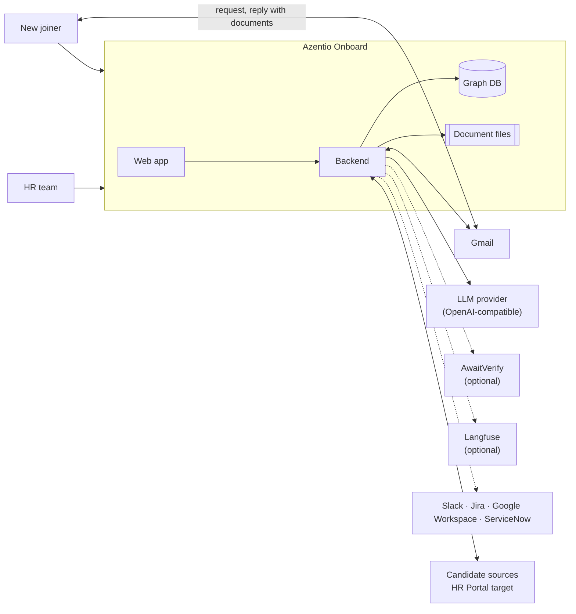
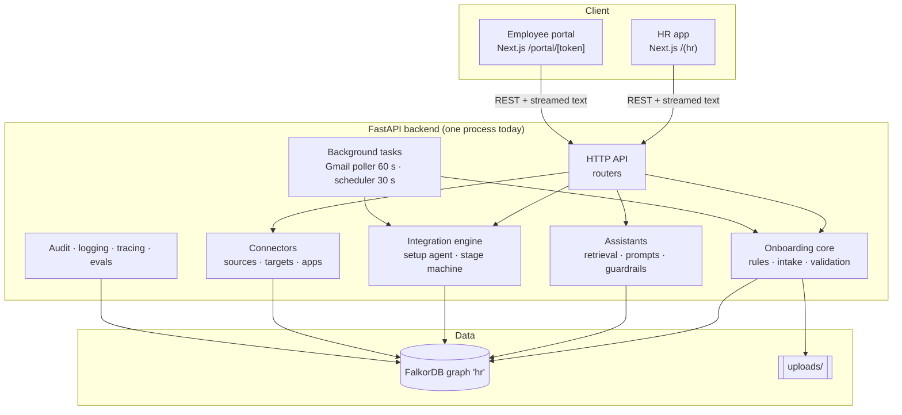

# Azentio Onboard: High-Level Design

Part of the [design docs](README.md). Detail for every part lives in the [LLD](lld.md); the scaling plan is in [production architecture](production-architecture.md).

## 1. Purpose and scope

**Problem.** Onboarding a joiner involves HR, IT, Facilities and Compliance. Documents arrive late or wrong, provisioning waits on records that wait on documents, and nobody has one view of what blocks day one.

**In scope**
- Personalised checklists from role, department, grade and location, each item with the reason it applies.
- Document collection by email and portal, checked by a vision model and then by deterministic rules.
- Automatic HR record, IT, Facilities and Compliance requests once their prerequisites are met.
- Replanning when a joining date or role changes, and escalation of overdue tasks.
- Grounded assistants for joiners and HR, with citations and guardrails.
- Integrations that move candidates from source systems to the HR system, set up by chatting with an agent.
- Audit, integration and console logs, optional LLM tracing, and a quality dashboard with Ragas scores.

**Out of scope today:** sign-in and roles, multi-tenancy, payroll, real app provisioning (the Slack, Jira, ServiceNow and Google Workspace connectors are demos), and government ID verification APIs.

## 2. Actors

| Actor | Uses | Trust |
|---|---|---|
| HR (People Team) | HR web app | Trusted operator. No sign-in today; SSO in production |
| New joiner / candidate | Email and the token-scoped portal | Untrusted input: their files and messages are treated as data |
| Owners (IT, Facilities, Compliance, managers) | Email (requests and escalations) | Receive only what concerns their items |
| Scheduler and pollers | Background tasks in the backend | System actor, recorded as "System" in the audit log |
| Setup agent | Tool calls inside an integration chat | Can only call validated tools; recorded as "Agent" |

## 3. System context

## 4. Containers

| Container | Responsibility | Technology |
|---|---|---|
| HR app | Dashboard, joiner records, rules and templates, connectors, integrations, approvals, logs, AI quality | Next.js 16, React 19, Tailwind v4, shadcn/ui |
| Employee portal | Checklist timeline, uploads, policy acknowledgements, assistant | Same Next.js app, token-scoped routes |
| Backend | All business logic, the LLM calls, email, background work | Python 3.12, FastAPI, uv |
| Graph DB | System of record: joiners, items, dependencies, documents, integrations, logs | FalkorDB (Cypher) |
| File store | Original documents | Local disk |

## 5. Key capabilities and where they live

| Capability | Component | Detail |
|---|---|---|
| Which items apply, why and when | Rules engine (`checklist.py`) | [LLD §6](lld.md#6-rules-engine) |
| Reading documents | Vision extraction (`extract.py`, `llm.py`) | [LLD §7](lld.md#7-llm-layer) |
| Accepting or rejecting documents | Deterministic validation (`validate.py`, `pipeline.py`) | [LLD §5.3](lld.md#53-email-document-intake-scenario-1) |
| Provisioning chain | `checklist.recompute` over graph dependencies | [LLD §5.5](lld.md#55-dependency-driven-provisioning-scenario-2) |
| Answering questions | Assistants + guardrails (`chat.py`, `guardrails.py`) | [LLD §5.8, §7.1](lld.md#71-guardrails-guardrailspy) |
| Candidate to employee | Integration engine (`integrations/`) | [LLD §5.11–5.12](lld.md#511-integrations-agent-led-setup) |
| Who did what | Audit and integration logs | [LLD §12](lld.md#12-operations) |
| Is the AI any good | Ragas evals and guardrail stats (`evals.py`, `/quality`) | [LLD §7.2](lld.md#72-evaluation-evalspy) |

## 6. Architectural principles

1. **The LLM perceives; rules decide.** Models read documents and write answers. Deterministic code decides acceptance, blocking, writes and emails. ([ADR 0001](adr/0001-llm-perceives-rules-decide.md))
2. **The plan is a graph.** Items and their dependencies are nodes and edges, so replanning walks edges. ([ADR 0002](adr/0002-graph-database.md))
3. **One provider-agnostic LLM client.** Any OpenAI-compatible endpoint, with one fallback model. ([ADR 0003](adr/0003-openai-compatible-llm.md))
4. **The agent proposes; the service layer decides.** Agent tools and UI buttons share one validation path.
5. **Fail toward a human.** Low confidence or errors go to *Under Review*, never to silent acceptance.
6. **Repeat-safe by default.** Integration runs, sends and upserts can be retried without duplicates.
7. **Logs are safe to share.** Console logs hold ids and counts, never personal data.

## 7. Quality attributes

| Attribute | Today | Production target |
|---|---|---|
| Availability | Single process, single DB | 99.9% for the HR app and portal ([production §8](production-architecture.md#8-reliability-slos-and-disaster-recovery)) |
| Latency | Page APIs under 200 ms locally; extraction 5–20 s; chat first token 1–3 s | p95 API under 300 ms; extraction async, under 2 min end to end |
| Throughput | Demo scale (dozens of joiners) | 1M joiners a year across tenants ([production §2](production-architecture.md#2-scale-targets-and-load-model)) |
| Privacy | Local files, free LLM provider, no auth | SSO, encryption at rest, a provider with a DPA, India data residency |
| Cost | Free models | Per-tenant LLM budgets through a gateway |
| Explainability | Every item has a reason; every action an event | Same, plus an exportable audit trail |

## 8. External dependencies

| Dependency | Used for | If it's down |
|---|---|---|
| LLM provider (OpenRouter by default) | Extraction, assistants, setup agent, eval judge | Documents go to *Under Review*; chat shows a fallback reply; the agent falls back to rule-based |
| Gmail API | Sending requests, reading replies | Portal upload still works; integration emails are recorded as simulated |
| FalkorDB | Everything | The app is down (single point of failure today) |
| AwaitVerify (optional) | Human check of low-confidence fields | Skipped |
| Langfuse (optional) | LLM tracing | Tracing stops; app unaffected |

## 9. Current state vs production

The repository runs as one backend process, one FalkorDB container and a Next.js dev server, for one organisation and without sign-in. The [production architecture](production-architecture.md) describes the move to:
- stateless API pods,
- queue-backed workers,
- PostgreSQL as the system of record,
- object storage,
- SSO,
- multi-tenancy,
- an LLM gateway.

It's staged in four phases, each with exit criteria.
