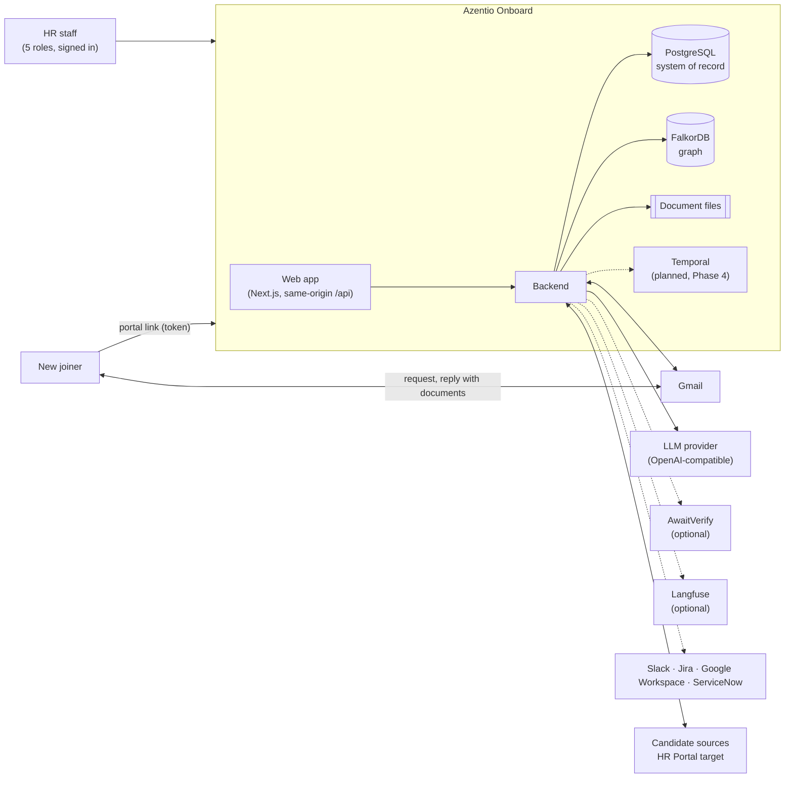
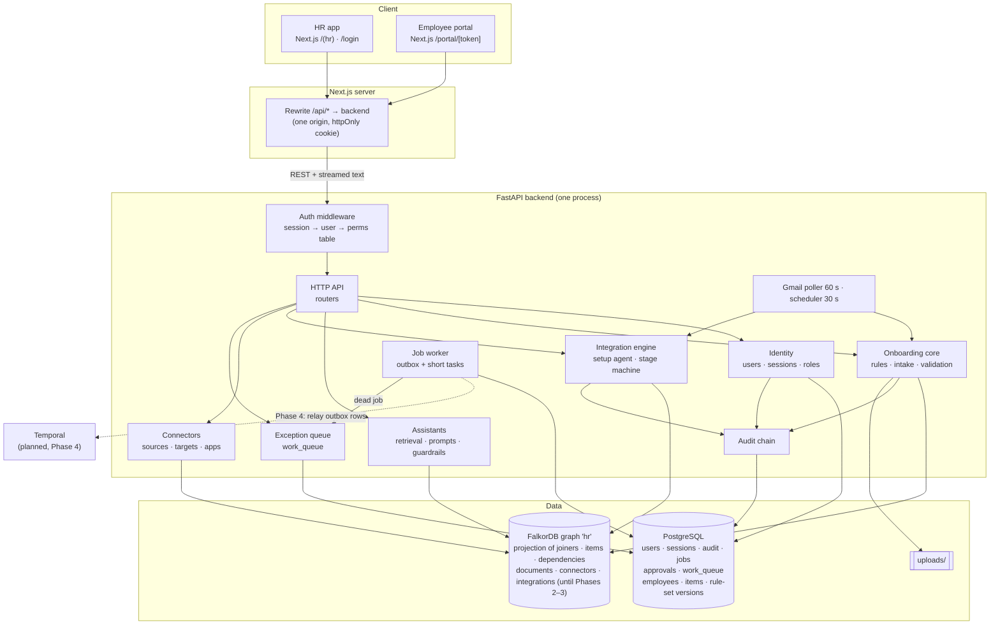

# Azentio Onboard: High-Level Design

Part of the [design docs](README.md). Detail for every part lives in the [LLD](lld.md); the hardening roadmap is in the [hardening design](plans/2026-11-01-hardening-design.md); the scaling plan is in [production architecture](production-architecture.md).

Parts are labelled **Built** (in the code on `main`) or **Planned (Phase N)** (in the [roadmap](plans/2026-11-01-hardening-design.md), not built yet). Anything unlabelled is built.

## 1. Purpose and scope

**Problem.** Onboarding a joiner involves HR, IT, Facilities and Compliance. Documents arrive late or wrong, provisioning waits on records that wait on documents, and nobody has one view of what blocks day one.

**In scope**
- Personalised checklists from role, department, grade and location, each item with the reason it applies.
- Document collection by email and portal, checked by a vision model and then by deterministic rules.
- Automatic HR record, IT, Facilities and Compliance requests once their prerequisites are met.
- Replanning when a joining date or role changes, and escalation of overdue tasks.
- Grounded assistants for joiners and HR, with citations and guardrails.
- Integrations that move candidates from source systems to the HR system, set up by chatting with an agent.
- **Built (Phase 0):** sign-in with five roles, one permission table enforced on every API call, and a tamper-evident audit log that names the person behind every action.
- Audit, integration and console logs, optional LLM tracing, and a quality dashboard with Ragas scores.

**Planned:**
- governed rule versions with draft, preview and approval (Phase 1)
- risk-tiered AI autonomy (Phase 2)
- a job- and workflow-backed ops backbone with Temporal (Phase 4)
- the full employee lifecycle (Phase 5)
- manager views, SLAs and appeals (Phase 6)

**Out of scope today:** SSO, multi-tenancy, payroll, real app provisioning (the Slack, Jira, ServiceNow and Google Workspace connectors are demos), and government ID verification APIs.

## 2. Actors

| Actor | Uses | Trust |
|---|---|---|
| Admin | HR web app | Signed in. Manages users, connectors, integrations, evals. Doesn't run onboarding |
| HR Ops | HR web app | Signed in. Runs onboarding: joiners, templates, rules, document decisions on the checklist, sending portal links |
| Approver | HR web app | Signed in. Approves candidate documents and offer formats; can't author what they approve |
| Manager | HR web app | Signed in, read-only, and only for joiners whose `manager_email` is theirs |
| Auditor | HR web app | Signed in, read-only on everything, including the audit log |
| New joiner / candidate | Email and the token-scoped portal | No account. The portal token is the credential. Their files and messages are treated as untrusted data |
| Owners (IT, Facilities, Compliance) | Email (requests and escalations) | Receive only what concerns their items |
| Scheduler, pollers, job worker | Background tasks in the backend | System actor, recorded as `system` in the audit log |
| Setup agent | Tool calls inside an integration chat | Can only call validated tools. Recorded as `<user> (via agent)` |

## 3. System context

## 4. Containers

| Container | Responsibility | Technology |
|---|---|---|
| HR app | Sign-in, dashboard, joiner records, rules and templates, connectors, integrations, approvals, logs, AI quality, users. Navigation and write buttons follow the signed-in role | Next.js 16, React 19, Tailwind v4, shadcn/ui |
| Employee portal | Checklist timeline, uploads, policy acknowledgements, assistant | Same Next.js app, token-scoped routes, no account |
| Next.js server | Serves the app and rewrites `/api/*` to the backend, so browser and API share one origin and the session cookie stays httpOnly | `next.config.ts` rewrites |
| Backend | All business logic, permission checks, the LLM calls, email, background work | Python 3.12, FastAPI, uv |
| PostgreSQL | **Built (Phases 0–1):** system of record for users, sessions, the audit chain, jobs (outbox + short-task queue), approvals, the exception queue, **employees, checklist items and versioned rule sets**. **Planned:** Document (Phase 2); connectors and integrations (Phase 3) | Postgres 17, plain SQL via `psycopg`, migrations applied on start |
| Graph DB | A projection of joiners, items and dependencies (refreshed in place after every write, Phase 1), plus documents, connectors and integrations until Phases 2–3. Afterwards it's a read model only: dependency graph, relationship view, policy chunks | FalkorDB (Cypher) |
| File store | Original documents | Local disk |
| Temporal | **Planned (Phase 4):** durable workflows (lifecycle cases, escalation ladders, approval waits). Business state stays in Postgres | Temporal server + Python SDK |

## 5. Key capabilities and where they live

| Capability | Component | Detail |
|---|---|---|
| Who may do what | Identity + permission table (`identity/perms.py`), one middleware in `main.py` | [LLD §9](lld.md#9-identity-and-access) |
| Who did what | Hash-chained audit log (`audit.py` → `audit_log/service.py`) | [LLD §10](lld.md#10-audit-chain) |
| Background work that can't get lost | Postgres jobs table: outbox and short-task queue (`shared/jobs.py`) | [LLD §11](lld.md#11-jobs-outbox-and-exception-queue) |
| Anything that needs a human | Exception queue (`work_queue.py`) | [LLD §11](lld.md#11-jobs-outbox-and-exception-queue) |
| Starting up without manual steps | `shared/bootstrap.py`, `/health`, `/ready` | [LLD §12](lld.md#12-bootstrap-health-and-the-migration-bridge) |
| Which items apply, why and when | Rules engine (`checklist.py`) | [LLD §6](lld.md#6-rules-engine) |
| Reading documents | Vision extraction (`extract.py`, `llm.py`) | [LLD §7](lld.md#7-llm-layer) |
| Accepting or rejecting documents | Deterministic validation (`validate.py`, `pipeline.py`) | [LLD §5.3](lld.md#53-email-document-intake-scenario-1) |
| Provisioning chain | `checklist.recompute` over graph dependencies | [LLD §5.5](lld.md#55-dependency-driven-provisioning-scenario-2) |
| Answering questions | Assistants + guardrails (`chat.py`, `guardrails.py`) | [LLD §5.8, §7.1](lld.md#71-guardrails-guardrailspy) |
| Candidate to employee | Integration engine (`integrations/`) | [LLD §5.11–5.12](lld.md#511-integrations-agent-led-setup) |
| Is the AI any good | Ragas evals and guardrail stats (`evals.py`, `/quality`) | [LLD §7.2](lld.md#72-evaluation-evalspy) |

## 6. Architectural principles

1. **The LLM perceives; rules decide.** Models read documents and write answers. Deterministic code decides acceptance, blocking, writes and emails. ([ADR 0001](adr/0001-llm-perceives-rules-decide.md))
2. **Postgres is the system of record; the graph is a read model.** Record types move from FalkorDB to Postgres one at a time, each read from exactly one store. ([ADR 0005](adr/0005-postgres-system-of-record.md), [ADR 0006](adr/0006-graph-as-read-model.md))
3. **Permissions live in one table.** Every `/api` request goes through one middleware and one ordered rule table; anything unlisted is denied. ([ADR 0008](adr/0008-five-role-rbac.md))
4. **Every action is attributable and tamper-evident.** The audit log is append-only at the database and hash-chained; the actor comes from the signed-in user.
5. **Background work has one owner and can't be lost.** A follow-up is enqueued in the same transaction as the change that caused it. Short tasks run on the Postgres jobs table; from Phase 4, long-lived workflows run on Temporal, fed by the same table as an outbox. ([ADR 0007](adr/0007-postgres-job-queue.md), [ADR 0011](adr/0011-temporal-orchestration.md))
6. **Humans at policy gates, not watching dashboards.** Routine work is automatic. Anything needing a person opens an item in the exception queue, assigned to a role.
7. **One provider-agnostic LLM client.** Any OpenAI-compatible endpoint, with one fallback model. ([ADR 0003](adr/0003-openai-compatible-llm.md))
8. **The agent proposes; the service layer decides.** Agent tools and UI buttons share one validation path.
9. **Fail toward a human; fail fast on bad config.** Low confidence or errors go to *Under Review*. Missing required config stops startup with a clear message.
10. **Logs are safe to share.** Console logs hold ids and counts, never personal data.

## 7. Quality attributes

| Attribute | Today | Production target |
|---|---|---|
| Availability | Single process, Postgres + FalkorDB. `/ready` returns 503 when Postgres, the graph or the job worker is down | 99.9% for the HR app and portal ([production §8](production-architecture.md#8-reliability-slos-and-disaster-recovery)) |
| Latency | Page APIs under 200 ms locally (plus one session lookup per call); extraction 5–20 s; chat first token 1–3 s | p95 API under 300 ms; extraction async, under 2 min end to end |
| Throughput | Demo scale (dozens of joiners) | 1M joiners a year across tenants ([production §2](production-architecture.md#2-scale-targets-and-load-model)) |
| Security | Five roles, server-side sessions (revocable instantly), scrypt passwords, login throttle, same-origin httpOnly cookie, manager scoping, CORS limited to the frontend origin | SSO, MFA, encryption at rest, a provider with a DPA, India data residency |
| Auditability | Every human action in a hash-chained, append-only log with the user's email and role | Same, plus an exportable audit trail |
| Cost | Free models | Per-tenant LLM budgets through a gateway |
| Explainability | Every item has a reason; every action an event | Same, plus rule versions with diffs (Phase 1) |

## 8. External dependencies

| Dependency | Used for | If it's down |
|---|---|---|
| PostgreSQL | Users, sessions, audit, jobs, approvals, exceptions | Startup fails fast with a clear message; once running, `/ready` returns 503 and signed-in API calls return 503 |
| FalkorDB | Joiners, items, documents, rules, connectors, integrations (until Phase 3), then read model | The HR pages fail; `/ready` returns 503. Bootstrap skips graph seeding and reports `graph=False` |
| LLM provider (OpenRouter by default) | Extraction, assistants, setup agent, eval judge | Documents go to *Under Review*; chat shows a fallback reply; the agent falls back to rule-based |
| Gmail API | Sending requests, reading replies | Portal upload still works; integration emails are recorded as simulated |
| Temporal (Planned, Phase 4) | Durable workflows | The outbox keeps the start/signal rows; they're relayed when Temporal is back |
| AwaitVerify (optional) | Human check of low-confidence fields | Skipped |
| Langfuse (optional) | LLM tracing | Tracing stops; app unaffected |

## 9. Current state and roadmap

The repository runs as one backend process, Postgres and FalkorDB in Docker, and a Next.js server, for one organisation. Phase 0 is complete; the rest is planned in the [hardening design](plans/2026-11-01-hardening-design.md):

| Phase | Theme | Status |
|---|---|---|
| 0 | Trust + foundation: sign-in, 5 roles, audit chain, jobs/outbox, exception queue, bootstrap, `/ready` | **Built** |
| 1 | Policy governance; Employee, Item, Rule move to Postgres | **Built** |
| 2 | AI control (risk tiers, review queue); Document moves to Postgres | Planned |
| 3 | Retire graph record storage; graph becomes a rebuild-only read model | Planned |
| 4 | Ops backbone: all external calls job- or workflow-backed, Temporal, DLQ screen, alerts, backups, CI | Planned |
| 5 | Lifecycle: transfer, offboarding, compliance rechecks, contractor/rehire, leave | Planned |
| 6 | HR ops platform: manager view, SLAs, escalation ladder, appeals, analytics | Planned |

The [production architecture](production-architecture.md) covers the scale-out beyond this: stateless API pods, object storage, SSO, multi-tenancy and an LLM gateway.
