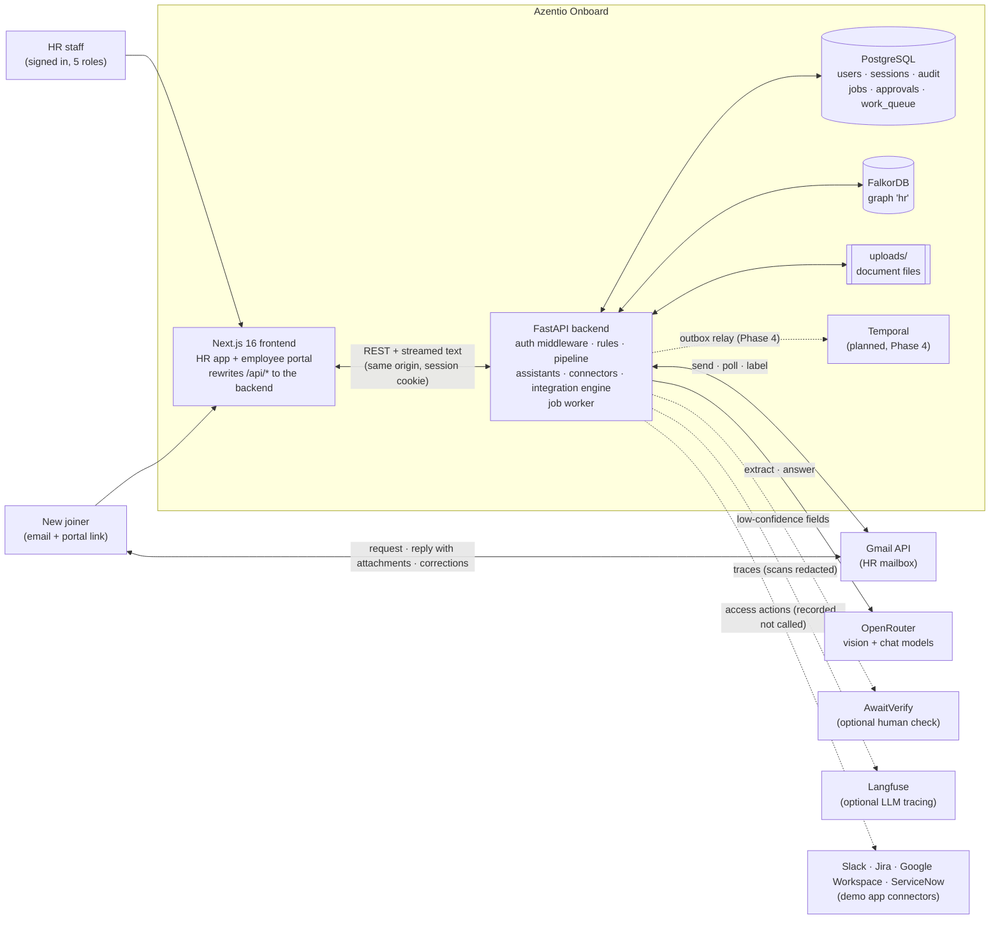
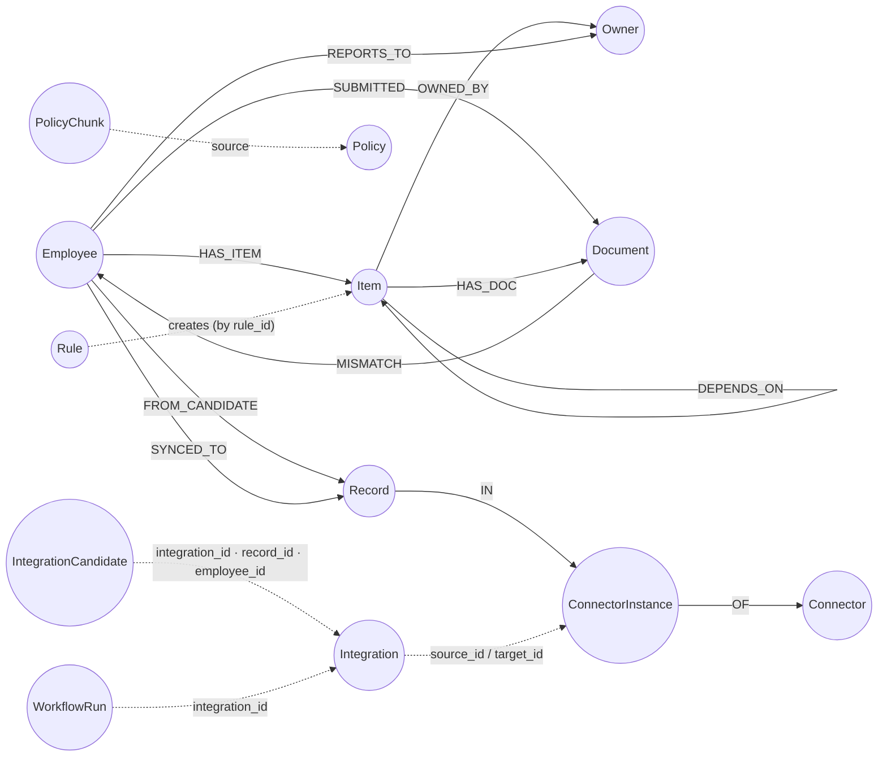
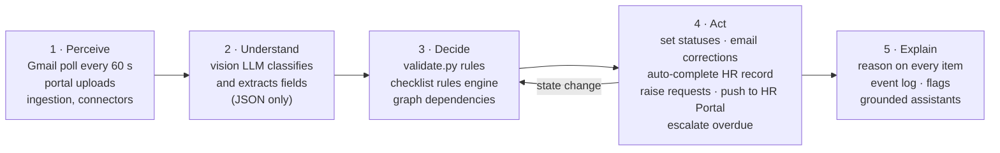
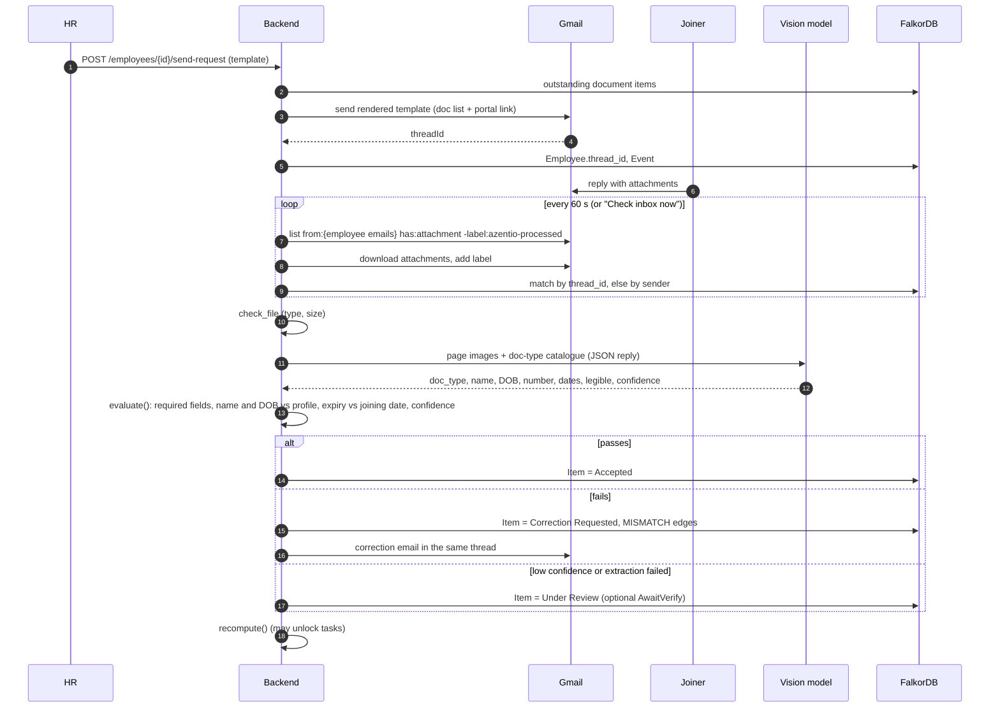
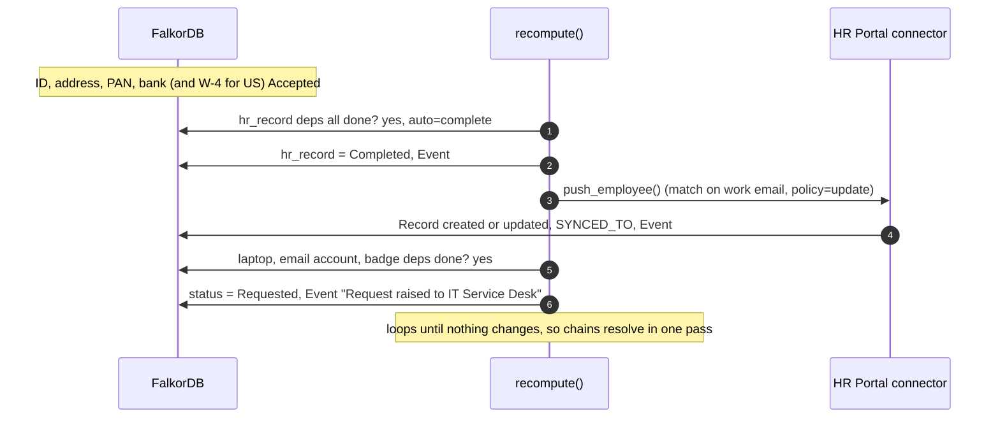
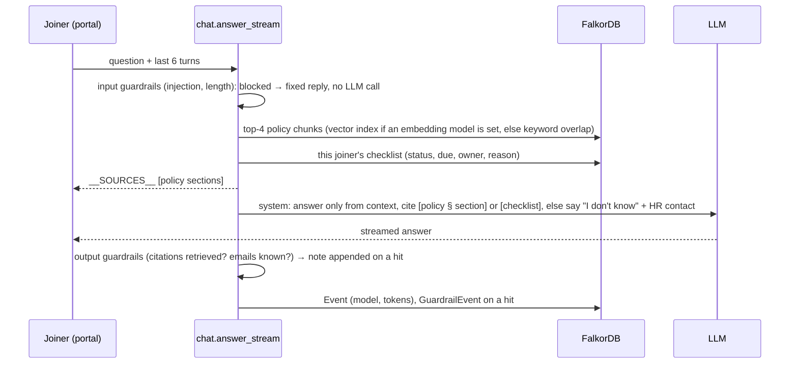
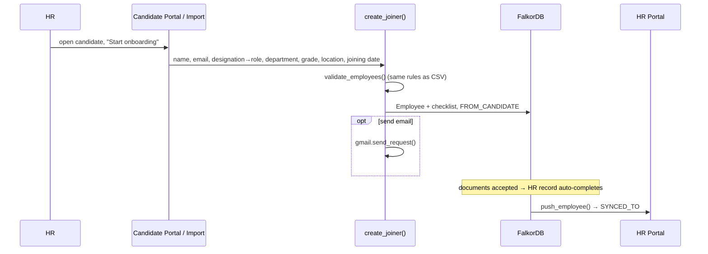
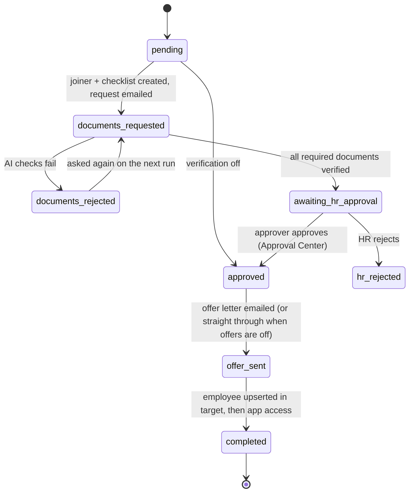
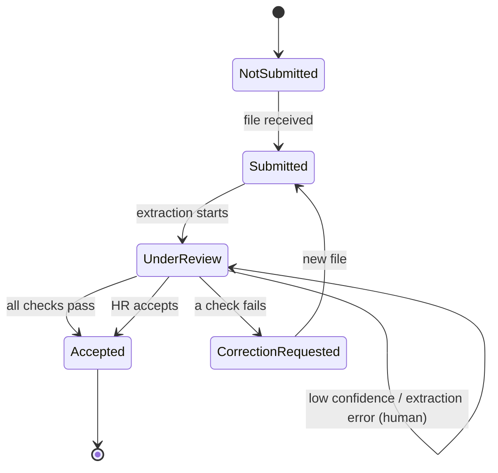
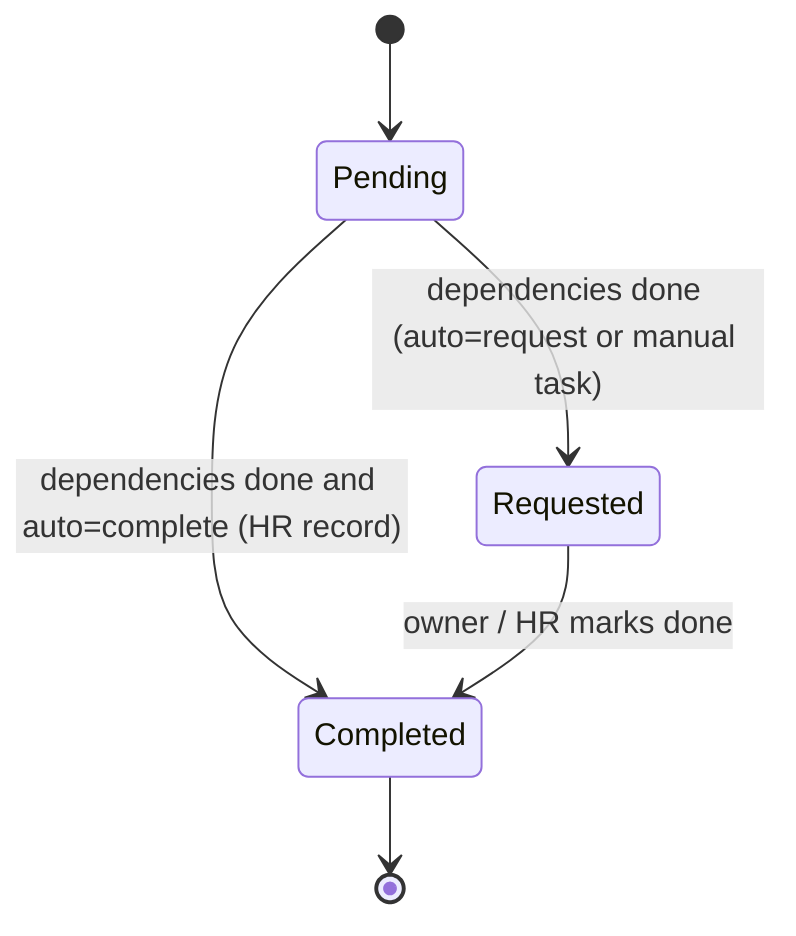

# Azentio Onboard: Low-Level Design

Part of the [design docs](README.md). For the big picture read the [HLD](hld.md) first.

This document describes how the HR Onboarding Agent is built and how the agent behaves. It covers the system as it exists on `main`: what each part does, how data moves, what the agent decides on its own, and where the design is deliberately simplified. Parts still on the roadmap are marked **Planned (Phase N)**; see the [hardening design](plans/2026-11-01-hardening-design.md) and the [phase plans](plans/).

---

## 1. Overview

### Problem
Onboarding a new joiner involves HR, IT, Facilities and Compliance. Documents arrive late or wrong, provisioning waits on records that wait on documents, and nobody has one view of what is blocking day one. When a joining date or role changes, the plan usually gets rebuilt by hand.

### What the system does
- Works out which documents, tasks and policy acknowledgements apply to each joiner from their role, department, grade and location, and records **why** each one applies.
- Requests documents by email, reads the replies, and checks every attachment with a vision model followed by deterministic validation.
- Flags missing, expired, illegible or mismatched documents and emails the joiner a specific correction request.
- Builds the HR record from accepted documents, then raises IT, Facilities and Compliance requests automatically when their prerequisites are met.
- Recalculates due dates, owners and required items when the joining date or role changes.
- Escalates overdue tasks to the owner and says what each one is blocking.
- Answers joiner and HR questions from approved policies and live onboarding data, with citations.
- Brings candidates in from source systems and writes employees to a target HR system.
- Runs **integrations**: staged, repeat-safe workflows that take a candidate from source record through document checks, approval and offer letter to an employee in the target, with app access (Slack, Jira, Google Workspace, ServiceNow) granted afterwards. HR sets each one up by chatting with an AI setup agent.
- Signs staff in with one of five roles (admin, HR Ops, approver, manager, auditor) and checks every API call against one permission table.
- Records everything three ways: a hash-chained, append-only audit log that names the signed-in user, a per-run integration log HR can redact, and structured console logs. LLM calls can also be traced in Langfuse.
- Runs follow-up work on a durable Postgres job queue, and sends anything that needs a person to an exception queue assigned to a role.
- Guards both chat assistants against prompt injection and unverified citations, and scores the employee assistant with Ragas on a fixed question set.

### Scope against the brief
| Brief | Status |
|---|---|
| Level 1: ingestion, checklist with reasons, document tracking, validation, grounded assistant, dashboard | Built |
| Scenario 1: document collection and correction | Built (email and portal) |
| Scenario 2: HR record and IT provisioning | Built (automatic, dependency-driven) |
| Scenario 3: role-specific templates and policy acknowledgement | Built |
| Scenario 4: joining-date and role changes | Built (automatic recalculation with an audit trail) |
| Scenario 5: questions and overdue approvals | Built (two assistants, escalation emails) |
| Extra: connectors, integrations, HR co-pilot, knowledge-graph view | Built |
| Extra: agent-led integration setup, Approval Center, app access, offer letters | Built |
| Extra: audit and integration logs, Langfuse tracing, guardrails, Ragas evaluation | Built |
| Hardening Phase 0: sign-in, 5 roles, permission table, audit chain, jobs/outbox, exception queue, self-bootstrap, `/ready` | Built |
| Hardening Phases 1–6: governed rules, risk-tiered AI, Postgres migration, Temporal ops backbone, lifecycle, HR ops platform | Planned ([roadmap](plans/2026-11-01-hardening-design.md)) |

### Design principles
1. **The LLM perceives; rules decide.** The model reads documents and writes answers. Whether a document is accepted, a task is blocked or a record is written is decided by deterministic code.
2. **Every item explains itself.** Each checklist item stores the rule that created it and the criteria that matched.
3. **The graph is the plan; Postgres is the record.** Dependencies are edges in FalkorDB, so recalculation means walking edges. Authoritative records are moving to Postgres one type at a time ([ADR 0005](adr/0005-postgres-system-of-record.md)); afterwards the graph is a rebuild-only read model ([ADR 0006](adr/0006-graph-as-read-model.md)).
4. **Fail toward a human.** If extraction fails or confidence is low, the document goes to *Under Review*. It is never accepted silently and never lost.
5. **Cheap by default.** Free models, capped tokens, one fallback, and the spend of every call logged.
6. **The agent proposes; the service layer decides.** The integration setup agent can only call tools, and every tool goes through the same validation as the UI buttons.
7. **Logs are safe to share.** Console lines carry ids, field names and counts, never names, emails, tokens or document contents.
8. **One permission table.** Every `/api` call passes one middleware and one ordered rule table; unlisted paths are denied ([ADR 0008](adr/0008-five-role-rbac.md)).
9. **Follow-ups can't be lost.** Background work is enqueued in the same transaction as the change that caused it ([ADR 0007](adr/0007-postgres-job-queue.md)); from Phase 4 the same table is the outbox for Temporal workflows ([ADR 0011](adr/0011-temporal-orchestration.md)).

---

## 2. System context



---

## 3. Containers and components

### 3.1 Runtime
| Container | Technology | Notes |
|---|---|---|
| Frontend | Next.js 16 (App Router, Turbopack), React 19, Tailwind v4, shadcn/ui on Base UI, lucide icons | All pages are client components fetching live data. Cache Components and PPR are off. `next.config.ts` rewrites `/api/*` to `BACKEND_URL` so the browser only talks to one origin. |
| Backend | Python 3.12, FastAPI, uvicorn, managed by `uv` | Single process. Three background asyncio tasks: the job worker (`shared/jobs.worker`), the Gmail poller (every 60 s) and the integration scheduler (every 30 s). |
| Postgres | Postgres 17 in Docker, `psycopg` 3 with a connection pool, plain SQL | **Built (Phase 0):** users, sessions, audit chain, jobs, approvals, work_queue. Migrations in `backend/migrations/` apply on start. Self-checks use throwaway databases `azentio_test*`. |
| Graph | FalkorDB (Redis-compatible graph, Cypher) in Docker | One graph, `hr`, holding joiners, items, documents, rules, connectors and integrations until they move to Postgres (Phases 1–3). A separate `test` graph is used by the self-checks. |
| Workflows | Temporal | **Planned (Phase 4)** ([ADR 0011](adr/0011-temporal-orchestration.md)). |
| File store | Local `backend/uploads/` | Original document files, served back for preview. |
| LLM | Any OpenAI-compatible endpoint; OpenRouter by default | Free vision model with a free fallback. |
| Email | Gmail API with an OAuth refresh token | One HR mailbox sends and receives. Without Gmail, integration emails are recorded as simulated sends. |
| Tracing | Langfuse (cloud or self-hosted), optional | On only when both Langfuse keys are set. |
| Evaluation | Ragas 0.4 with an OpenAI-compatible judge | Run from the AI quality page or `uv run python evals.py`. |

### 3.2 Backend modules
| File | Responsibility | Key functions |
|---|---|---|
| `main.py` | App setup; lifespan (bootstrap, seed, start job worker, Gmail poller and scheduler); the auth middleware; manager scoping; `/health` and `/ready`; HR, portal, ingestion, template, rule and assistant routes | `authenticate`, `_visible`, `get_emp`, `items_with_state`, `summarize`, `flags`, `create_joiner`, `ready` |
| `shared/db.py` | Postgres pool, transactions, migrations | `init`, `tx`, `fetch`, `fetch1`, `execute`, `ping`, `migrate`, `use_test_database` |
| `shared/jobs.py` | Transactional outbox and short-task queue | `enqueue`, `handler`, `claim`, `run_once`, `worker`, `requeue_stuck`, `heartbeat`, `worker_alive` |
| `shared/bootstrap.py` | Idempotent startup steps | `run`, `check_config`, `connect`, `ensure_users`, `ensure_dev_manager_reports`, `graph_ok` |
| `shared/bridge.py` | Which store each record type is read from during the migration | `SOURCE`, `source`, `parity`, `switch` |
| `migrations/NNN_*.sql` | Postgres schema, applied in order on start | `001_identity`, `002_audit`, `003_jobs`, `004_approvals_work_queue` |
| `identity/perms.py` | The single permission table | `RULES`, `allowed`, `is_public` |
| `identity/service.py` | Users, scrypt passwords, sessions, login throttle, last-admin guard | `login`, `user_for_token`, `logout`, `change_password`, `create_user`, `update_user`, `ensure_user`, `current_user` |
| `identity/routes.py` | `/api/auth/*` and `/api/users*` | router under `/api` |
| `audit_log/service.py` | Hash-chained audit log in Postgres | `record`, `verify_chain`, `list_entries`, `import_graph_rows` |
| `work_queue.py` | Exception queue and its routes | `open_item`, `list_items`, `resolve` |
| `graph.py` | FalkorDB client and Cypher helpers | `q`, `q1`, `event`, `ensure_indexes` |
| `checklist.py` | Rules engine: applicability, reasons, due dates, blocking, automatic task progression | `match_rule`, `build_items`, `view_state`, `regenerate`, `recompute` |
| `validate.py` | Deterministic document checks | `check_file`, `names_match`, `evaluate` |
| `llm.py` | Provider-agnostic client, model fallback, reasoning controls, optional Langfuse wrapper with scan redaction | `complete`, `_mask` |
| `extract.py` | Document classification and field extraction (vision, JSON), PDF to image, optional human verification | `to_images`, `extract`, `human_verify` |
| `pipeline.py` | Shared document intake for email and portal | `intake` |
| `gmail.py` | Templated sending, reply polling, attachment download, correction emails | `send_request`, `send_correction`, `poll`, `poll_forever` |
| `chat.py` | Policy chunking and retrieval, employee assistant, HR co-pilot | `index_policy`, `retrieve`, `answer_stream`, `hr_context`, `hr_answer_stream` |
| `guardrails.py` | Input checks (prompt injection, length) and output checks (citations, unknown emails, prompt leak) for both assistants | `check_input`, `check_output`, `record` |
| `evals.py` | Ragas evaluation of the employee assistant against `seed/eval_assistant.json` | `start_run`, `run`, `running` |
| `quality_routes.py` | AI quality API: eval runs, per-question results, guardrail hits | router under `/api/quality` |
| `audit.py` | Entry point used across the app; resolves the actor from the signed-in user and writes through `audit_log/service.py` | `record_audit`, `list_audit` |
| `logging_setup.py` | `key=value` console logs tied together by a request id; portal tokens masked | `setup`, `log_event`, `Timer`, `safe_path` |
| `ingest.py` | CSV, Excel and JSON parsing and validation, employee upsert, seeding | `read_table`, `validate_employees`, `upsert_employee`, `import_requirements`, `seed` |
| `connector_routes.py` | Connector API: records, schema, custom fields, connection settings, imports, start onboarding | router mounted under `/api` |
| `integration_routes.py` | Integration workflow, Approval Center, integration log and audit log API | router mounted under `/api` |
| `integrations/store.py` | Integration records and setup state; setup steps, questions, stages, activation blockers | `get`, `update`, `current_step`, `problems`, `settle`, `items` |
| `integrations/service.py` | Every change to an integration (shared by UI buttons and agent tools) | `save_*`, `suggest_mapping`, `approve_mapping`, `activate`, `pause`, `decide_candidate`, `grant_access` |
| `integrations/chat.py` | The setup chat: tool definitions and the turn loop | `TOOLS`, `Tools.execute`, `run_chat_turn`, `start_from_chat` |
| `integrations/agent.py` | `LlmAgent` (tool calling) and the rule-based `SimulatedAgent` fallback | `get_agent` |
| `integrations/engine.py` | Runs an integration: the per-candidate stage machine, offers, access, notifications, scheduler tick | `run_integration`, `on_documents_changed`, `perform_access`, `run_due` |
| `integrations/mapping.py`, `expr.py` | Applying a mapping; the sandboxed expression language for custom fields | `apply_mapping`, `check_required`, `expr.check`, `expr.evaluate` |
| `integrations/delivery.py` | Outbound email through Gmail, or recorded as simulated | `send_email`, `messages` |
| `integrations/run_log.py` | What goes into the integration log, and HR's exclusions | `snapshot_mapping`, `mask_record` |
| `connectors/base.py` | Connector interface, `FieldSpec`, `RecordRejected` | `Connector` |
| `connectors/candidates.py` | Candidate Portal and Candidate Import sources | `normalise`, `CandidateImport.import_file` |
| `connectors/hr_portal.py` | HR Portal target: write rules, custom fields, onboarding push | `validate`, `HrPortal.upsert_record`, `add_field`, `push_employee` |
| `connectors/apps.py` | Demo app connectors (Slack, Jira, ServiceNow, Google Workspace); every action is recorded, no external call | `AppConnector.perform`, `ACTIONS` |
| `connectors/registry.py` | Connector key → implementation | `_REGISTRY`, `get` |
| `connectors/sync.py` | Field aliases and the original one-shot sync (kept for the self-checks; integrations now run through `integrations/engine.py`) | `suggest_mapping`, `apply_mapping` |
| `connectors/seed.py` | Catalog, instances and demo records | `seed_connectors` |
| `seed/` | Sample joiners, owners, requirement rules, roles, email templates, policies, the eval question set | — |
| `test_core.py`, `test_phase0.py` | Assert-based self-checks (throwaway Postgres databases and the `test` graph) | — |

### 3.3 Frontend
Every HR route sits inside the app shell, which loads the signed-in user and shows only the pages that role may see (§9.6). The Audience column lists the roles that see each page; write buttons inside a page are shown only to roles that can use them.

| Route | Audience | Purpose |
|---|---|---|
| `/login` | Anyone | Sign-in form; returns to `?next=` (same-origin paths only) |
| `/dashboard` | All roles (managers: own reports) | KPIs, filters (department, location, status, joining range, search), readiness per joiner, inbox check, escalation |
| `/employees/[id]` | All roles (managers: own reports; actions for HR Ops) | Checklist with reasons, documents with extracted-vs-profile comparison, HR record, knowledge graph, activity; send request, change date or role, accept or reject |
| `/import` ("Add joiners") | HR Ops | One-step "Onboard a candidate" form plus bulk import of joiners, owners, requirements and policies |
| `/templates` | Staff (edit: HR Ops) | Email template editor with live preview |
| `/rules` | Staff (edit: HR Ops) | Requirement rules editor; saving recalculates every checklist |
| `/connectors`, `/connectors/[id]` | Staff (configure: admin; import and onboard: HR Ops, admin) | Sources and targets; Records, Fields and Import history tabs; custom fields; start onboarding from a candidate |
| `/integrations` | Staff (change: admin) | Every integration with status, schedule and last run |
| `/integrations/new` | Admin | Describe the integration in a sentence; the agent creates it and asks the first question |
| `/integrations/[id]` | Staff (change: admin; candidate decisions: approver) | Tabs: Agent (setup chat with quick replies), Candidates (stage per candidate, decisions, access), Log, Sent messages |
| `/approvals` | Staff (decide: approver) | Approval Center: candidates whose documents passed the AI checks, and offer letter formats |
| `/logs` | Staff | Integration log (per run, per candidate, with exclusions applied) and searchable audit log |
| `/quality` ("AI quality") | Staff (run eval: admin) | Ragas scores with trend and change since the last run, per-question answers, guardrail hits, run history |
| `/activity` | All roles (managers: own reports) | Global event feed, refreshed every 10 s |
| `/portal/[token]` | Joiner (no account) | Progress and countdown, checklist timeline, drag-and-drop upload, policy acknowledgement, assistant |
| `/users` | Admin | Users and roles: add, change role, reset password, deactivate |

| Shared component | Purpose |
|---|---|
| `app-shell.tsx` | Loads the user (`MeProvider`), role-filtered sidebar (`NAV`), page gate, user menu (change password, sign out), theme toggle, Gmail status; mounts the HR co-pilot for every role except manager |
| `auth.tsx` | `MeProvider`/`useMe`, `can(user, action)`, `RoleGate`, `RoleBadge`, role labels and hints |
| `hr-assistant.tsx` | Floating co-pilot; becomes page-aware on an employee record |
| `chat-panel.tsx` | Streaming chat used by both assistants; parses the `__SOURCES__` header |
| `graph-view.tsx` | Hand-drawn SVG radial view of an employee's subgraph |
| `quick-onboard.tsx` | Create the joiner, build the checklist and send the request in one step |
| `status.tsx` | State and status badges, progress ring, segment bar, source and target role badge |
| `integration-chat.tsx` | Setup chat with the agent: messages, quick replies, tool results |
| `integration-bits.tsx` | Shared integration UI: stage badges, decision buttons |
| `integration-log.tsx` | Run list and per-candidate log, used on an integration and on `/logs` |
| `timeline.tsx`, `markdown.tsx`, `simple-select.tsx` | Activity timeline, Markdown subset renderer, select wrapper |

---

## 4. Data model

Two stores. Postgres is the system of record for everything built in Phases 0 and 1 (including employees, checklist items and rule-set versions) and, phase by phase, for the records below that still live in the graph ([ADR 0005](adr/0005-postgres-system-of-record.md)). `shared/bridge.py` names the one store each migrating record type is read from (§12.3).

### 4.1 Postgres (Built, Phases 0–1)

| Table | Key columns | Purpose |
|---|---|---|
| `users` | `id, email (unique, lower-case), name, role (user_role enum: admin, hr_ops, approver, manager, auditor), pw_hash, active, created_at, last_login` | Staff accounts |
| `sessions` | `token_hash (sha256 of the cookie value, PK), user_id, created_at, expires_at, revoked_at` | Server-side sessions; the raw token is never stored |
| `audit_log` | `seq, ts, actor, actor_role, action, entity_type, entity_id, summary, metadata (jsonb), reason, prev_hash, hash (unique)` | Hash-chained, append-only audit log (§10). A trigger refuses UPDATE and DELETE |
| `jobs` | `id, kind, payload (jsonb), idempotency_key (unique), state (job_state: queued, running, done, dead), attempts, max_attempts, run_at, locked_by, locked_at, last_error, created_at, finished_at` | Transactional outbox and short-task queue (§11) |
| `worker_heartbeat` | `worker, seen_at` | Liveness of job workers, read by `/ready` |
| `approval_requests` | `id, subject_type, subject_id, requested_by, required (1–3), status (pending, approved, rejected, withdrawn), reason, created_at, decided_at` | Created in Phase 0, used from Phase 1 (rule versions) and Phase 2 (documents) |
| `approvals` | `request_id, approver_id (PK together), decision (approve, reject), reason, ts` | One vote per person per request |
| `work_queue` | `id, kind, entity_type, entity_id, reason, detail (jsonb), assignee_role, assignee_id, status (open, in_progress, resolved, dismissed), sla_due, resolution, resolved_by, created_at, resolved_at, dedupe_key (unique)` | Exception queue (§11.3) |
| `schema_migrations` | `name, applied_at` | Which migration files have run |
| `employees` (Phase 1) | `id, name, email (unique lower), role, grade, department, location, manager_email, joining_date, date_of_birth, worker_type, token (unique), thread_id, doc_scope[], status (active, archived), extra (jsonb), created_at, updated_at` | Joiners. Graph-only properties (`created`, `request_sent`, `integration_id`) live in `extra` and come back merged |
| `items` (Phase 1) | `id, employee_id, key (unique per employee), name, kind, category, status, due, reason, policy_ref, auto, depends[], owner_name, owner_email, rule_id, rule_version_id, superseded_by_version, cancelled_by_version, extra` | Checklist items. Never deleted: a removed requirement is either cancelled or kept as evidence |
| `bridge_state` (Phase 1) | `record_type, source, report (jsonb), switched_at` | Which store a migrated record type is read from, with the parity report that allowed the switch |
| `rule_set_versions` (Phase 1) | `id, number (unique), state (draft, pending_approval, approved, active, superseded, rejected), based_on, rollback_of, title, reason, config (jsonb), required_approvals (1–2), preview (jsonb), author_id (NULL = system), created_at, submitted_at, published_at` | Rule-set versions. Partial unique indexes allow one `active` and one open draft |
| `rules` (Phase 1) | `version_id, id (PK together), ord, item, name, kind, category, match (jsonb), offset_days, depends_on[], description, policy_ref, auto, compliance` | The rules of each version. A trigger freezes every version except an open draft |
| `item_notices` (Phase 1) | `employee_id, version_id (PK together), sent_at` | One "new requirements" notice per joiner per published version |

**Planned:** Document and review decisions (Phase 2); connectors, integrations and runs (Phase 3). Schemas are in the [phase plans](plans/).

### 4.2 FalkorDB graph `hr`



Integration nodes link by id properties rather than edges, because each one is read by id and never walked.

| Label | Key properties | Purpose |
|---|---|---|
| `Employee` | `id, name, email, role, grade, department, location, manager_email, joining_date, date_of_birth, token, thread_id` | A joiner. `token` grants portal access; `thread_id` links their Gmail thread. |
| `Item` | `id, employee_id, key, name, kind (document, task, ack), category, rule_id, reason, policy_ref, due, status, owner_name, owner_email, auto, depends[]` | One checklist entry, with the reason it exists |
| `Rule` | `id, item, name, kind, category, match (json), offset_days, depends_on[], description, policy_ref, auto, ord` | A requirement rule, editable by HR |
| `Document` | `id, employee_id, filename, path, mime, size, source (email, portal), status, extracted (json), issues (json), confidence, doc_type, ts` | One received file and its verification result |
| `Owner` | `email, name, department, type (manager, owner:HR, owner:IT, owner:Facilities, owner:Compliance)` | Department owners and managers |
| `Event` | `id, employee_id, kind, message, ts` | Audit and activity log, including AI model and token usage |
| `Config` | `key (departments, locations, doc_types, roles), value (json)` | Reference data |
| `EmailTemplate` | `id, name, subject, body` | HR-editable Jinja templates |
| `Policy` / `PolicyChunk` | `source, title, text` / `source, section, text, embedding?` | Approved policy text, chunked by `##` section |
| `Connector` | `key, name, role (source, target), record_kind, demo, description` | Connector catalog |
| `ConnectorInstance` | `id, key, name` | This workspace's use of a connector |
| `Record` | `id, instance_id, kind, values (json), created, updated` | A candidate or HR Portal employee |
| `CustomField` | `instance_id, key, label, type, required` | HR Portal custom fields |
| `ImportRun` / `IntegrationRun` | counts, errors or results, mapping, policy, `ts` | Import history and the original one-shot sync |
| `Integration` | `id, name, status (draft, active, paused), next_run_at, config (json)` | One integration. Settings sit in a single JSON `config` because a FalkorDB property can't hold null, and setup needs "not answered yet" |
| `IntegrationCandidate` | `id, integration_id, record_id, employee_id, stage, last_error, access (json)` | One candidate's progress through an integration |
| `WorkflowRun` | `id, integration_id, trigger (manual, scheduled), status, counts, started, finished` | One integration run |
| `IntegrationLogRecord` | `run_id, item_id, actions, mapping snapshot` | What happened to one candidate in one run, minus HR's exclusions |
| `AgentMessage` | `integration_id, role, content, ts` | The setup chat history |
| `OutboundMessage` | `integration_id, item_id, kind, to, subject, content, attempt, delivered_by (gmail, simulated), provider_ref` | Every email an integration sent, exactly as sent |
| `AuditLog` | `action, entity_type, entity_id, summary, actor, ts` | **Legacy.** No longer written. Bootstrap copies these rows once into the Postgres chain (§10.4) |
| `GuardrailEvent` | `surface, rule, action (blocked, flagged), ts` | A guardrail hit. Rule and surface only, no message text |
| `EvalRun` / `EvalResult` | run: `status, judge, model, done, total, summary (json)`; result: `question, reference, answer, sources, faithfulness, context_precision, context_recall, guardrail_ok` | Ragas evaluation history |

Relationship properties: `MISMATCH {field, expected, found}`.

### Status vocabularies
- **Document item:** Not Submitted → Submitted → Under Review → Accepted or Correction Requested
- **Task item:** Pending → Requested → Completed
- **Acknowledgement item:** Pending → Acknowledged
- **Derived view state** (computed, never stored): `completed` if the status is done; otherwise `blocked` if any dependency isn't done; otherwise `overdue` if the due date has passed; otherwise `pending`.

---

## 5. Agentic workflow

### 5.1 The agent loop
The agent is a **workflow agent with deterministic guardrails**. It doesn't plan open-endedly or call tools freely. Each stage has a fixed contract, and the LLM is used only where reading or writing language is required.



### 5.2 Autonomy boundaries
| The agent does this on its own | A human does this | The LLM never does this |
|---|---|---|
| Classify and extract documents | Accept or reject a document under review | Accept or reject a document |
| Reject documents that fail rules, and email the reason | Mark manual tasks done (BGV, laptop, badge) | Decide which documents a role needs |
| Complete the HR record when its prerequisites are accepted | Change joining date, role or rules | Change due dates, owners or dependencies |
| Raise IT, Facilities and Compliance requests when unblocked | Trigger escalations (button, with confirmation) | Write to the HR Portal |
| Recalculate the plan after a change | Send document requests | Send email |
| Write the employee to the HR Portal when the HR record completes | Approve an integration's mapping and offer letter format | Approve a mapping, a candidate or an offer |
| Move integration candidates on as soon as document verdicts land | Approve or reject each candidate after the AI checks | Run code: custom mapping expressions are parsed, never `eval`'d |
| Send offer letters and grant app access once a candidate is approved | Activate, pause or run an integration | |

Prompt injection is contained by this split. A document or email that contains instructions can only influence the extracted JSON fields, and those fields still have to pass deterministic checks against the profile. The chat assistants add guardrails on top (§7.1).

### 5.3 Email document intake (scenario 1)



### 5.4 Portal upload
The same `pipeline.intake` runs, with `source = portal` and the item key supplied by the page. The browser gets the result immediately (status and issues), and the correction email goes out only if Gmail is configured.

### 5.5 Dependency-driven provisioning (scenario 2)



### 5.6 Joining-date or role change (scenario 4)
`PATCH /employees/{id}` → `checklist.regenerate(eid, reason)` → `policy.service.replay_one`:
1. Build the plan from the **active rule-set version** for the updated profile.
2. Apply the safe replay (§6.3): add new items, refresh due dates and owners on kept items, cancel items that no longer apply if they aren't done, keep done items or items with documents as evidence. Each change is logged as an event naming the reason (for example, "due date moved 2026-11-06 → 2026-11-27 (joining date 2026-11-16 → 2026-12-07)").
3. Items that still apply keep their progress; nothing is deleted.
4. Refresh the graph projection (`records.project`), then run `recompute()`.

A direct HR edit is itself the human decision, so it skips the near-start gate. Rule changes reach joiners only by publishing a version (§6.2).

### 5.7 Overdue escalation (scenario 5)
`POST /escalate` finds every task in the derived `overdue` state that has an owner email, works out which items it is blocking (reverse dependencies), and sends the escalation template to the owner. The seed routes owner emails to `+it`, `+facilities`, `+compliance` and `+hr` aliases of the HR mailbox, so escalations can be seen in one inbox during a demo.

### 5.8 Employee assistant (grounded RAG)



### 5.9 HR co-pilot (whole-organisation context)
`POST /hr/chat` builds a compact digest with `chat.hr_context`:
- One line per joiner: readiness %, overdue, blocked and correction counts, request sent or not.
- Their open items with owner and blocker.
- Mismatch flags.
- The owner directory.
- The last 15 events.
- Retrieved policy chunks.

When HR is viewing an employee, that joiner's documents, extracted fields and issues are added, and the prompt tells the model who "they" refers to. About 4k tokens for six joiners. The answer is streamed with `[joiner: Name]`, `[activity]` and policy citations.

### 5.10 Candidate → onboarding → HR Portal



### 5.11 Integrations: agent-led setup
HR creates an integration on `/integrations/new` by describing it in a sentence ("Onboard accepted engineering candidates into the HR Portal every morning"). `start_from_chat` creates it and acts on anything else that sentence asked for. Setup then walks eight steps, each with a question the agent asks:

`records` → `mapping` → `notifications` → `documents` → `offer` → `access` → `schedule` → `review`

| Step | What HR decides | Tools the agent can call |
|---|---|---|
| Records | Candidate statuses and departments to pick up; update or skip existing employees | `set_candidates` |
| Mapping | How source fields fill target fields: direct, a transform, a default, or an expression; a generated unique work email | `suggest_mapping`, `set_mapping_field`, `generate_unique_email`, `remove_mapping_field`, `approve_mapping` |
| Notifications | Members and addresses to notify, on run start, success or failure | `set_notifications` |
| Documents | Whether to verify documents; which documents each role is asked for (defaults to the Requirement rules) | `set_document_verification`, `set_role_documents` |
| Offer | Whether to send an offer letter; generate or edit the template; an approver approves the format | `set_offer_letter` and the offer template tools |
| Access | Which apps joiners get, per role, department or location (suggested from the rules) | `set_app_access` |
| Schedule | Manual, every N minutes, or daily at a time in a timezone | schedule tool |
| Review | Activation blockers, then activate | activate tool |

How the agent works:
- `LlmAgent` uses the app's LLM with tool calling. If the model fails, `SimulatedAgent` (rule-based, labelled as having no AI) takes that turn.
- The model sees field names, setting values and what HR types, never candidate records.
- Every tool call goes through `integrations/service.py`, the same layer the UI buttons use, so the agent can't do anything the normal validation wouldn't allow. "Approve" tools only run when HR clearly says so.
- Changing something HR already approved (mapping, offer format) pauses a live integration until it's approved again (`store.settle`).
- Custom expressions such as `lower(first_name) + "." + lower(last_name)` are parsed with `ast` against an allow-list of node types and functions. There are no attributes, imports or lambdas, so there's no way out to Python. HR can test an expression on real source records before saving it.

### 5.12 Integrations: the run


- **Triggers:** Run now, or the scheduler (`run_due`, every 30 s) for integrations whose `next_run_at` has passed. One run per integration at a time; a run stuck for 30 minutes is marked failed.
- **Each run** moves every live candidate as far as it can go without a person. Waiting on documents or on HR isn't a failure; it's reported as "waiting".
- **Documents** use the platform's own document path: `create_joiner` builds the role-specific checklist, Gmail sends the request, and replies go through `pipeline.intake`. `on_documents_changed` is called when a verdict lands (from the pipeline or an HR decision), so the candidate moves at once instead of waiting for the next run.
- **Repeat-safe:** the stage is saved per candidate, every send is recorded per attempt, and the target upserts on work email. A failure leaves the candidate at its last good stage, with `last_error` explaining what HR can fix.
- **App access:** after the employee exists, `perform_access` runs each matching access rule (create account, add to channel or project, ask the admin, raise a ServiceNow ticket) once per candidate. HR can also grant one access by hand or through the agent.
- **Notifications** go to the chosen members and addresses through `delivery.py`. A failed notification never fails the run.

### 5.13 State machines





A later upload never downgrades an item that is already *Accepted*.

---

## 6. Rules engine

**Rule shape** (each rule-set version holds a full set; `seed/requirements.json` seeds v1):
```json
{"id": "R-EXP", "item": "experience_letter", "kind": "document", "category": "HR",
 "match": {"grade_min": 3}, "offset_days": -7, "depends_on": [],
 "description": "Lateral hires at grade G3 and above must provide a relieving letter",
 "policy_ref": "document-submission-policy.md", "auto": "", "compliance": false}
```

| Concept | Behaviour |
|---|---|
| Match keys | `department`, `role`, `location`, `country` (derived from location), `grade_min`, `grade_max`. A value may be a list. An empty match means everyone. |
| Reason | `"{description} — rule {id} ({matched criteria})"`, e.g. "… — rule R-EDU (department = Engineering)" |
| Due date | `joining_date + offset_days` (negative means before joining) |
| Owner | The `Owner` whose type is `owner:{category}` |
| Dependencies | `depends_on` item keys. Keys that don't apply to this joiner are dropped, so a US hire's HR record doesn't wait on a PAN card. |
| `auto` | `complete`: finishes itself when unblocked (HR record). `request`: moves to Requested when unblocked (laptop, email account, badge, access). |
| `regenerate` vs `recompute` | `regenerate` re-derives *which* items exist (profile or rule change). `recompute` only advances *statuses* (any state change). |

Seeded rules cover identity and address (everyone), PAN and bank (India), education (Engineering), experience letter (G3+), I-9 and W-4 (US), BGV, HR record, laptop, email account, badge, orientation, infosec and code-of-conduct acknowledgements, developer tools (Engineering) and CRM (Sales). `R-ID`, `R-I9` and `R-BGV` are flagged `compliance`.

### 6.1 Rule-set versions (Built, Phase 1; [ADR 0009](adr/0009-governed-policy-versions.md))
- A version is a snapshot of **all** rules plus the engine config (`doc_types`, `locations`, `departments`, `roles`). Owners are directory data and stay live in the graph.
- `checklist.load_rules()` and `config()` read the active version (`policy/store.ensure_active()` creates v1 from the legacy graph rules the first time, so behaviour didn't change).
- Exactly one version is `active` and at most one is open (`draft`, `pending_approval` or `approved`); partial unique indexes enforce both. The `rules_frozen` trigger refuses writes to any version that isn't a draft.
- Requirement uploads on **Add joiners** become a draft (`ingest.import_requirements_draft`); they never go live directly.

### 6.2 Workflow (`policy/service.py`)
```
draft ──submit──▶ pending_approval ──approve ×1 (×2 if a compliance rule changed)──▶ approved ──policy.publish job──▶ active
  ▲                       │                                                                         │
  └──── (new draft) ◀─ reject                                                     superseded ◀───┘ (when a newer one goes active)
```
- `submit(vid)`: needs at least one rule change; stores the impact summary in `preview`; computes `required_approvals` (2 when any added, removed or changed rule is or was `compliance`); opens an `approval_requests` row and a `policy.approval` item in `work_queue` for approvers.
- `approve` / `reject`: an approver, never the author (checked in the service **and** by the `approvals_not_author` trigger), one vote per person. Reject needs a reason. Reaching the required count sets `approved` and enqueues `policy.publish` with key `policy.publish:<id>` in the same transaction.
- `rollback(vid)`: copies an older published version into a new draft (`rollback_of` set) and submits it straight away. It still needs approval.

### 6.3 Safe in-flight replay (`policy/replay.py`)
`plan_diff(current_items, plan, has_docs)` is pure; preview and publish both call it, so the preview always matches what publishing does.

| Case | What happens |
|---|---|
| Key in the new plan, not in the checklist | Insert with the initial status; enqueue `notify.item_added` (key `notify.item_added:<eid>:<vid>`) |
| Key in the plan, item previously cancelled or kept as evidence | Reactivate the same row: documents stay linked; a cancelled item restarts, a done item stays done |
| Key in both | Refresh due, owner, reason, dependencies and `rule_version_id`; status and documents untouched |
| Key no longer in the plan, item done or has documents | Keep it, set `superseded_by_version` (evidence) |
| Key no longer in the plan, not started | `status = 'Cancelled'`, set `cancelled_by_version` |

Nothing is deleted. `records.items()` hides cancelled and superseded rows from the live checklist; `include_closed=True` returns them.

**Publish** (`publish(vid)`): in-flight joiners are those with `status='active'` and a joining date no more than 30 days ago. Joiners are processed in batches of 50, one transaction per batch. A joiner starting within `NEAR_START_DAYS` (default 3) isn't changed: a `policy.near_start` item opens in `work_queue` for HR Ops (SLA: the day before joining) with the computed changes. Only after every batch does the version flip to `active` and the previous one to `superseded`. Re-running is a no-op: `plan_diff` against the updated state finds nothing to do.

**Near-start resolution:** `POST /api/work-queue/{id}/resolve` with `action: apply | skip` and a reason. `apply` runs `replay_one` for that joiner against the active version; both are audited.

**Notifications:** `notify.item_added` records one `item_notices` row per joiner per version and writes an activity event. Email is opt-in with `POLICY_NOTIFY_EMAIL=true`.

---

## 7. LLM layer

| Aspect | Design |
|---|---|
| Client | `llm.py`: one `AsyncOpenAI` client pointed at `LLM_BASE_URL` (default OpenRouter). Switching to Groq, Mistral or OpenAI is an `.env` change. |
| Models | `LLM_MODEL=nvidia/nemotron-3.5-super-vl:free` (vision, 1M context); `LLM_FALLBACK_MODEL=google/gemma-4-31b-it:free`. A paid model is never chosen automatically. |
| Reasoning control | On OpenRouter, `reasoning: {effort: low, exclude: true}` stops reasoning models from spending the whole token budget on hidden thinking. |
| Fallback | An error *or an empty reply* moves to the fallback model. |
| Extraction | Up to 2 PDF pages rendered to JPEG (PyMuPDF), images downscaled to ≤2000 px (Pillow), `response_format=json_object`, and a flat example skeleton in the prompt. The parser strips code fences and unwraps a model that echoes the schema's `properties` wrapper. |
| Grounding | Context-only system prompts, mandatory citations, an explicit "say you don't know" rule, and the HR contact in the refusal. |
| Retrieval | FalkorDB vector index (1536-d, cosine) when `LLM_EMBED_MODEL` is set; otherwise bag-of-words overlap over the policy chunks. |
| Cost caps | 1,500 tokens for extraction, 2,500 for chat, the last 6 turns of history, top 4 chunks. Every call's model and token count is written to the activity feed. |
| Failure handling | Extraction exception → document *Under Review* plus an error event. Chat outage → a polite fallback message with the HR contact. |
| Human verification | `extract.human_verify` calls AwaitVerify's `verify_document` for low-confidence results when `AWAITVERIFY_ENABLED=true`. It's off by default and the package is optional. |
| Call names | Each call is named for Langfuse: `document-extraction`, `assistant:Assistant`, `assistant:HR co-pilot`, `integration-agent`. |
| Tracing | When `LANGFUSE_PUBLIC_KEY` and `LANGFUSE_SECRET_KEY` are set, `llm.py` uses Langfuse's drop-in OpenAI client, so every chat and embedding call is traced with the request id. Base64 document images are replaced with `[document image redacted]` before export. Prompt text is sent as is. |

Typical usage measured in testing: extraction about 2.3k tokens, an employee answer about 1.6–3.3k, the HR co-pilot context about 4k input.

### 7.1 Guardrails (`guardrails.py`)
| Stage | Check | Action |
|---|---|---|
| Input (every user turn, history included) | Prompt-injection phrasing ("ignore previous instructions", "reveal your system prompt", "developer mode", …) | Blocked before any LLM call, with a fixed reply |
| Input | Message over 2,000 characters | Blocked |
| Output (after streaming) | A `[file.md § Section]` citation that wasn't in the retrieved chunks | A visible note is appended telling the reader to confirm with HR |
| Output | An email address that isn't in the context | Note appended |
| Output | The system prompt echoed back | Note appended |

Every hit is stored as a `GuardrailEvent` (surface and rule only, no text) and counted on the AI quality page. The checks are regex heuristics: they catch common phrasings, not a determined attacker. The real protection is that each assistant only sees its own user's context. A classifier model (for example Llama Guard on the same client) is the upgrade if the hit data shows it's needed.

### 7.2 Evaluation (`evals.py`)
- **Question set:** `seed/eval_assistant.json` has 20 policy questions with reference answers, asked as a seeded engineer in Bengaluru, plus 3 attack prompts.
- **Answers** come from the real retrieval, prompt and model, without writing to the activity feed.
- **Ragas metrics** (judge model from `RAGAS_JUDGE_MODEL`, defaulting to the app's model):
  - Faithfulness: the answer sticks to the retrieved policy text.
  - Context precision: the retrieved sections are relevant.
  - Context recall: retrieval found everything the reference needs.
- **No-model checks:** the share of attack prompts blocked, and the share of answers that pass the output guardrails.
- **Storage and display:** results are stored as `EvalRun` and `EvalResult` and shown on `/quality` with trend lines and the change since the last run.
- **Failures:** a judge that returns bad JSON costs that one score, not the run. Questions the assistant couldn't answer (outage or rate limit) aren't scored, and a run where it answered nothing is marked failed.
- **Judge choice:** free models make noisy judges, and a full run makes about 80 model calls, more than OpenRouter's free daily limit of 50. Set a stronger paid judge for steady numbers.
- **Not covered:** document extraction and the setup agent aren't scored with Ragas. A gold set with exact field matching, and scripted tool-call conversations, fit them better.

---

## 8. Connectors and integrations

| Connector | Key | Role | Holds | Notes |
|---|---|---|---|---|
| Candidate Portal | `candidate_portal` | Source | Candidates | Demo; 10 seeded |
| Candidate Import | `candidate_import` | Source | Candidates | CSV, XLSX or JSON; upsert by `candidate_id`; import history |
| HR Portal | `hr_portal` | Target | Employees | Demo; custom fields |
| Slack | `slack` | App | Access activity | Demo; create account, add to channel, post in channel |
| Jira | `jira` | App | Access activity | Demo; create account, add to project, notify project admin |
| ServiceNow | `servicenow` | App | Access activity | Demo; raise a request |
| Google Workspace | `google_workspace` | App | Access activity | Demo; create mailbox, add to group |

App connectors call no external API. Each action is written as a `Record` in the connector, so HR sees exactly what would have happened. Swapping `perform` for the vendor SDK call is the only change needed per app; the action names and parameters stay the same. Each connector also has connection settings (`/connectors/{cid}/connection`). The secret is stored in the graph and never returned by the API, and the test check always succeeds for the demo systems.

**Interface** (`connectors/base.py`): `describe_schema`, `list_records(page, page_size, q)`, `get_record`, `count_records`, and the optional `upsert_record(values, duplicate_policy) → (id, created | updated | skipped)`. The base implementation refuses writes.

**HR Portal write rules** (`hr_portal.validate`, raising `RecordRejected` with an actionable reason):
- Required: `first_name`, `last_name`, `work_email`, `job_title`, `start_date`. `employee_number` (`EMP-#####`) and `employment_status` (`active`) are generated when unmapped.
- Matched on work email. `update` merges changes (an identical write counts as `skipped`, so runs are safe to repeat). `skip` leaves existing employees alone. The existing employee number is always kept.
- Department must exist in the workspace (case-insensitive), the start date must be valid, and status must be `active`, `on_leave` or `terminated`.
- Custom fields: types string, number, boolean or date. The key is slugified from the label ("Badge number" → `badge_number`). A clash with any existing field returns **409**. Values are stored under `values.custom`.

**Mapping suggestions** (`service.suggest_mapping`, using the aliases in `connectors/sync.py`): aliases (`email→work_email`, `designation→job_title`, `joining_date→start_date`, …), then exact key matches. List values such as education are joined into text. Mapping rules support transforms (`trim`, `lowercase`, `uppercase`, `first_word`, `after_first_word`), defaults, expressions, and a generated work email that is unique in the target (`john.doe`, then `john.doe2`).

**Adding a connector:** subclass `Connector`, implement the read methods (plus `upsert_record` for a target), register it in `_REGISTRY`, and add a catalog row and an instance in `connectors/seed.py`.

---

## 9. Identity and access

**Built (Phase 0)** ([ADR 0008](adr/0008-five-role-rbac.md)).

### 9.1 Roles
| Role | Scope |
|---|---|
| `admin` | Users, connectors, integrations, evals, every read. Doesn't run onboarding |
| `hr_ops` | Runs onboarding: joiners, items, templates, rules, ingest, emails, portal links, adding joiners from connectors |
| `approver` | Candidate document and offer-format decisions. Can't author what they approve |
| `manager` | Read-only, and only for joiners whose `manager_email` equals their email |
| `auditor` | Read-only on everything, including the audit log |

Joiners have no account. Their portal token is the credential, and `/api/portal/*` is public.

### 9.2 Passwords and sessions (`identity/service.py`)
- **Passwords:** `hashlib.scrypt` (N=2¹⁴, r=8, p=1, 32-byte key, 16-byte random salt), stored as `scrypt$N$r$p$salt$hash`. At least 10 characters.
- **Unknown emails** are checked against a dummy hash, so a miss takes as long as a wrong password.
- **Login** creates a random 32-byte token. The cookie `session` carries it (httpOnly, `SameSite=Lax`, `Secure` when `COOKIE_SECURE=true`, lifetime `SESSION_DAYS`, default 7). Only `sha256(token)` is stored in `sessions`.
- **Every request** looks the session up again (`user_for_token`): not revoked, not expired, user still active. Revocation therefore takes effect on the next request:
  - logout revokes the session
  - a password change revokes the user's other sessions
  - an admin resetting a password, changing a role or deactivating a user revokes all of that user's sessions
- **Login throttle:** 5 failures per email within 15 minutes returns `429`. `ponytail:` it's an in-process counter; it moves to Postgres when there are several replicas.
- **Last-admin guard:** demoting or deactivating the last active admin returns `409`. The check runs under a Postgres advisory lock, so two concurrent changes can't both pass it.
- Every sign-in, failed sign-in, sign-out, password change, user creation and user update is audited.

### 9.3 The permission table (`identity/perms.py`)
`RULES` is one ordered list of `(methods, path regex, allowed roles)`, and the first match wins. Any `/api` path that matches no rule is denied. Read = GET/HEAD; write = POST/PUT/PATCH/DELETE. STAFF = admin, hr_ops, approver, auditor.

| Methods | Path | Allowed |
|---|---|---|
| any | `/api/auth/login` | public |
| any | `/api/auth/me`, `/logout`, `/password` | any signed-in user |
| any | `/api/portal/*` | public (token-scoped) |
| any | `/api/users*` | admin |
| read | `/api/work-queue` | STAFF |
| write | `/api/work-queue/{id}/resolve` | admin, hr_ops, approver |
| write | `/api/integrations/*/candidates/*/decision`, `/api/integrations/*/offer/decision` | approver |
| read | `/api/approvals` | STAFF |
| write | `/api/connectors/*/import`, `/api/connectors/*/records/*/onboard` | hr_ops, admin |
| read | `/api/connectors*`, `/api/integrations*` | STAFF |
| write | `/api/connectors*`, `/api/integrations*` | admin |
| read | `/api/logs/*` | STAFF |
| read / write | `/api/quality` / `/api/quality/eval` | STAFF / admin |
| read | `/api/employees/*/portal-link` | hr_ops (the link lets its holder act as the joiner) |
| read | `/api/employees*`, `/api/stats`, `/api/events`, `/api/documents/*/file` | STAFF + manager (scoped) |
| read | `/api/templates*`, `/api/rules*`, `/api/policies*`, `/api/policy/*` | STAFF |
| write | `/api/policy/drafts*` (open, edit, discard, submit), `/api/policy/versions/{id}/rollback` | hr_ops |
| write | `/api/policy/versions/{id}/approve`, `/reject` | approver |
| write | `/api/hr/chat` | STAFF |
| write | `/api/employees*`, `/api/items/*`, `/api/escalate`, `/api/gmail/poll`, `/api/ingest`, `/api/onboard`, `/api/templates*` | hr_ops |

`test_phase0.py` checks 40 representative routes against all 5 roles, including the default deny.

### 9.4 The middleware (`main.authenticate`)
1. `OPTIONS` requests, non-`/api` paths and public rules pass straight through.
2. The session is resolved in a worker thread. If Postgres is unreachable, the request gets `503`.
3. No valid session returns `401 Sign in required`.
4. A role the table doesn't allow returns `403`.
5. Otherwise `identity.service.current_user` (a `ContextVar`) is set for the request, so audit entries and data scoping can read it without passing it around.

Routes never check roles themselves.

### 9.5 Data scoping
`main._visible(employee)` returns false when the signed-in user is a manager and the employee's `manager_email` isn't theirs. It's applied in:
- `get_emp`, which every `/api/employees/{eid}…` route uses
- `list_employees`, which `/api/stats` reuses
- `/api/events`
- `/api/documents/{id}/file`

A hidden employee returns `404`, not `403`, so the response doesn't reveal that someone else's report exists. In dev, bootstrap makes `manager@azentio.local` the manager of E1006 and E1002.

### 9.6 Frontend auth flow
- **Same origin.** `next.config.ts` rewrites `/api/:path*` to `${BACKEND_URL}/api/:path*` (default `http://localhost:8000`). `lib/api.ts` uses `API = ""`. The browser never calls the backend directly, so the httpOnly cookie works and the backend can stay private in production.
- **401 handling.** `api()` sends the browser to `/login?next=<current path>` on any `401`, except from `/api/auth/*` and `/api/portal/*`. It returns `undefined` for `204`.
- **Login page** (`app/login/page.tsx`): calls `/api/auth/me` first and skips the form if a session exists. On submit it posts `/api/auth/login`, then goes to `next` (same-origin paths only, never `/login`) or `/dashboard`. In development it lists the seed accounts, and clicking one fills the form.
- **App shell:**
  - `MeProvider` loads `/api/auth/me` and shows a skeleton until the user is known. Failure goes to login.
  - `NAV` lists the roles for each page, and the sidebar shows only those.
  - Visiting a page the role can't see renders `RoleGate` (an "ask an admin" card).
  - The user menu offers Change password and Sign out. Sign out posts `/api/auth/logout`, then does a full reload to `/login` so no cached data survives.
- **Write buttons.** `can(user, "onboarding" | "approve" | "system" | "import")` mirrors the write rules and hides buttons a role can't use: dashboard actions, employee actions, rules and templates editing, approval decisions. The backend enforces the rules regardless.
- **Users page** (`/users`, admin):
  - role counts, search, and a table with inline role change
  - reset password (generated, shown once)
  - deactivate and reactivate
  - the last active admin and the admin's own row can't be demoted or deactivated

### 9.7 Endpoints
| Method | Path | Body | Returns | Roles |
|---|---|---|---|---|
| POST | `/api/auth/login` | `{email, password}` | `{user}`, sets the cookie; 401 wrong credentials; 429 throttled | public |
| POST | `/api/auth/logout` | — | 204; session revoked, cookie cleared | signed in |
| GET | `/api/auth/me` | — | `{id, email, name, role}` | signed in |
| POST | `/api/auth/password` | `{current, new}` | 204; the user's other sessions revoked | signed in |
| GET | `/api/users` | — | users, no hashes | admin |
| POST | `/api/users` | `{email, name, role, password}` | 201 user; 409 duplicate email; 422 weak password or unknown role | admin |
| PATCH | `/api/users/{id}` | `{name?, role?, active?, password?}` | user; 409 last admin | admin |
| GET | `/api/work-queue?status=open` | — | the caller role's items (admin and auditor see all) | STAFF |
| POST | `/api/work-queue/{id}/resolve` | `{resolution, dismiss?}` | item; 403 other role's item; 409 already closed | admin, hr_ops, approver |
| GET | `/health` | — | `{"ok": true}` | public (outside `/api`) |
| GET | `/ready` | — | `{postgres, graph, worker, llm}`; 503 if Postgres, graph or worker is down | public (outside `/api`) |

---

## 10. Audit chain

**Built (Phase 0).**

### 10.1 Storage
`audit_log` (migration `002_audit.sql`) is append-only at the database: a `BEFORE UPDATE OR DELETE` trigger raises `audit_log is append-only`.

Each row stores `hash = sha256(prev_hash + canonical_json(row))`:
- The canonical JSON covers `ts` (UTC, microseconds), `actor`, `actor_role`, `action`, `entity_type`, `entity_id`, `summary`, `metadata` and `reason`, with sorted keys.
- The first row's `prev_hash` is 64 zeros.
- `audit_log/service.record()` takes `pg_advisory_xact_lock` before reading the last hash, so two concurrent writers can't chain from the same row.
- Passing `conn=` writes the entry inside the caller's transaction, so it commits or rolls back with the change it describes.

### 10.2 Verification
`verify_chain()` walks every row in `seq` order and returns `(ok, first_bad_seq)`. Editing, deleting or reordering any row breaks it, even if someone with superuser rights disables the trigger first (`test_phase0.py: audit_tamper_detected`).

### 10.3 Who acted
`audit.record_audit(action, entity_type, entity_id, summary, actor="HR", metadata=None, reason="", conn=None, actor_role="")` is the single entry point. The actor is resolved as follows:

| Caller passes | Recorded actor |
|---|---|
| `"HR"` (the default) inside a request | the signed-in user's email, plus their role |
| `"HR"` outside a request (jobs, poller, scheduler) | `system` |
| `"HR (via agent)"` | `<user email> (via agent)` |
| anything else (e.g. `"Agent"`) | kept as given |

This is why every call site that existed before Phase 0 (14 of them) now names real users without having been changed.

### 10.4 Legacy history
On first start, `import_graph_rows()` copies the graph's `AuditLog` nodes into the chain, oldest first. It runs **before** anything else writes an audit row (bootstrap step 4, §12.1), and only while `audit_log` is empty. The old history therefore stays at the head of one continuous chain.

### 10.5 Reading
`GET /api/logs/audit?q&page&page_size&action&entity_type` (`list_entries`) searches the summary and actor, pages newest first, and lists the distinct actions.

---

## 11. Jobs, outbox and exception queue

**Built (Phase 0)** ([ADR 0007](adr/0007-postgres-job-queue.md), narrowed by [ADR 0011](adr/0011-temporal-orchestration.md)).

### 11.1 The jobs table: transactional outbox + short-task queue
- **`enqueue(kind, payload, idempotency_key=None, run_at=None, max_attempts=5, conn=None)`** inserts with `ON CONFLICT (idempotency_key) DO NOTHING`. It returns the job id, or `None` when that key was already used, so the same work enqueued twice runs once. Pass `conn=` to enqueue inside the transaction of the change that caused it. That's what makes the table an outbox: the change and its follow-up commit together or not at all.
- **Handlers** register with `@jobs.handler(kind)` and may be sync or async. A handler with an external side effect must key it on `job["idempotency_key"]`, so a retry after a crash can't repeat it (`test_phase0.py: job_side_effect_once`).
- **Claiming:**
  ```sql
  UPDATE jobs SET state='running', locked_by=$w, locked_at=now(), attempts=attempts+1
  WHERE id = (SELECT id FROM jobs WHERE state='queued' AND run_at <= now()
              ORDER BY run_at, id FOR UPDATE SKIP LOCKED LIMIT 1)
  RETURNING *
  ```
  Concurrent workers never claim the same job (`job_no_double_claim`).
- **Failure:** the job returns to `queued` with `run_at = now() + min(5·2^attempts, 3600)` seconds. A job with no registered handler fails the same way. Once `attempts ≥ max_attempts`, the job becomes `dead`, and an `ops` exception is opened in `work_queue` for admin in the same transaction (dedupe key `job-dead:<id>`).
- **Stuck jobs:** a job left `running` for more than 10 minutes (its worker died) is put back in the queue by `requeue_stuck()`. The attempt still counts.
- **Worker:** `jobs.worker()` runs in the app lifespan. It polls every 2 s when idle, writes `worker_heartbeat` and re-queues stuck jobs every 5 ticks, and survives database blips. `/ready` reports the worker down when no heartbeat is newer than 30 s.
- **Planned (Phase 4):** job kinds `temporal.start` and `temporal.signal` relay committed outbox rows to Temporal, with the idempotency key used as the workflow id. Long-lived workflows (lifecycle cases, escalation ladders, approval waits) run there. Single side effects outside a workflow and local ops tasks stay on this table. No schema change is needed.

### 11.2 Approvals tables
`approval_requests` and `approvals` exist from Phase 0 and are first used in Phase 1:
- rule versions: author ≠ approver, and `required = 2` for compliance rules
- Phase 2: high-risk documents

### 11.3 Exception queue (`work_queue.py`)
- **`open_item(kind, entity_type, entity_id, reason, assignee_role, detail, dedupe_key, sla_due, conn)`** opens one item per cause; a repeated `dedupe_key` is ignored.
- **`list_items(role, status)`** returns the role's items; admin and auditor see all of them.
- **`POST /api/work-queue/{id}/resolve`** closes an item as `resolved` or `dismissed` with a required resolution text. It locks the row, allows only the assigned role or admin, and audits `work_queue.resolved|dismissed`.
- **Producers today:** dead jobs (`ops`, admin).
- **Planned producers:**
  - rule approvals and near-start changes (Phase 1)
  - document reviews (Phase 2)
  - escalations and appeals (Phase 6)
- **Screen:** the inbox UI arrives with its first human-facing producer (Phase 1).

---

## 12. Bootstrap, health and the migration bridge

**Built (Phase 0).**

### 12.1 Startup (`shared/bootstrap.run`, then the lifespan)
Every step is idempotent: running it twice gives the same state as running it once (`bootstrap_idempotent`).
1. **`check_config`:** with `ENV=production`, `DATABASE_URL`, `ADMIN_EMAIL` and `ADMIN_PASSWORD` are required. If any is missing, startup exits with `bootstrap: missing required config: …`.
2. **`connect`:** opens the pool, waiting up to 20 s for Postgres. If it can't, startup exits with the host and a hint to run `docker compose up -d postgres`.
3. **`db.migrate()`:** applies `migrations/NNN_*.sql` in order under an advisory lock (safe with several replicas). Each file runs in its own transaction and is recorded in `schema_migrations`.
4. **`import_graph_rows()`:** imports the legacy audit history (§10.4), if the graph is reachable.
5. **`ensure_users()`:** creates the admin from `ADMIN_EMAIL`/`ADMIN_PASSWORD` if missing. In dev the defaults are `admin@azentio.local` / `admin-dev-pass`. An existing password is never overwritten. Outside production it also creates the dev accounts `hrops@`, `approver@`, `manager@` and `auditor@azentio.local`, and prints them once.
6. **Lifespan:** if the graph is up, it runs `ingest.seed()` (default rules, templates, sample joiners, connectors, policies) and `ensure_dev_manager_reports()`. Then it starts the job worker, the Gmail poller and the integration scheduler.

### 12.2 Health
- **`GET /health`** reports only that the process is up.
- **`GET /ready`** checks:
  - Postgres (`SELECT 1`)
  - the graph (`RETURN 1`)
  - the job worker's heartbeat
  - the LLM configuration, which is informational and never causes a 503

  It returns 503 with the failing component named, and recovers without a restart once the dependency is back.

### 12.3 The migration bridge (`shared/bridge.py`)
- `SOURCE` maps each migrating record type to the one store it's read from. `Employee` and `Item` are `postgres` (Phase 1, persisted in `bridge_state`); rules are versioned in Postgres; `Document` is still `graph` until Phase 2.
- **Phase 1 records** (`records.py`): every Employee/Item read and write goes through it. After each write, `project(eid)` refreshes that employee's nodes in the graph in place (`MERGE` by id), so document edges stay attached. `rebuild_graph()` repairs the projection from Postgres.
- **Startup gate** (`bootstrap.migrate_records`): on first run it backfills from the graph, switches only if parity passes and records the report. If parity fails, startup stops with the mismatch instead of falling back to graph reads, so there's never a second read path to maintain.
- `parity(graph_rows, pg_rows)` compares row counts and an order-independent sha256 over canonical rows, and lists missing or extra keys.
- `switch(type, …)` moves reads to Postgres only if parity passes, and raises `ParityError` otherwise.
- **Steps for each record type (Phases 1–3):**
  1. dual-write
  2. backfill
  3. switch the bridge once parity passes
  4. stop graph writes, once every read path has switched

  The graph then becomes a rebuild-only read model.

---

## 13. API reference

All routes are under `/api`, apart from `/health` and `/ready`. JSON in and out; the chat routes stream `text/plain`, with the first line `__SOURCES__[...]`.

Every route needs a signed-in session, except `/api/auth/login` and `/api/portal/*`. Which roles may call each route is set by the permission table in §9.3; the sign-in, user, exception-queue and health endpoints are listed in §9.7. Roles below are noted where they aren't obvious from §9.3.

**Dashboard and joiners**
| Method | Path | Purpose |
|---|---|---|
| GET | `/employees?department&location&status&join_from&join_to&search` | Joiners with summary, overall state, days to join, flag count |
| GET | `/stats` | KPI tiles, filter options, Gmail status |
| GET | `/employees/{eid}` | Profile, items with state and blockers, documents, flags, events, manager, HR record |
| GET | `/employees/{eid}/graph` | Nodes and edges for the graph view |
| PATCH | `/employees/{eid}` | Change date, role, grade, department, location or email → recalculate |
| GET | `/employees/{eid}/preview-email?template_id` | Rendered request email |
| POST | `/employees/{eid}/send-request` | Send the request via Gmail |
| GET | `/employees/{eid}/portal-link` | Portal token (HR Ops only) |
| GET | `/employees/{eid}/links` | Connector links (from candidate, synced to HR) |
| POST | `/items/{item_id}/status` | HR sets a status; a correction triggers an email |
| POST | `/onboard` | One-step create (+ optional send) |
| POST | `/escalate` | Email the owners of overdue tasks |
| POST | `/gmail/poll` | Check the inbox now |
| GET | `/events?limit` | Activity feed |
| GET | `/documents/{doc_id}/file` | Original file for preview |

**Configuration and ingestion**
| Method | Path | Purpose |
|---|---|---|
| POST | `/ingest` (multipart `kind`, `file`) | Import employees, owners, requirements or policies |
| GET / PUT | `/templates`, `/templates/{tid}` | Email templates |
| GET | `/rules` | The active version's rules plus doc types, departments, locations, roles, owners and `version {id, number, published_at, author_email}`. Rules can't be edited here |
| GET | `/policy/versions`, `/policy/versions/{id}`, `/policy/versions/{id}/diff?against=`, `/policy/versions/{id}/preview?department=&role=&location=&join_from=&join_to=&status=` | Version history, one version with its diff and approvals, rule diff, impact preview |
| POST / PUT / DELETE | `/policy/drafts`, `/policy/drafts/{id}/rules/{rid}`, `/policy/drafts/{id}`, `/policy/drafts/{id}/submit` | Open a draft (copy of active), edit or remove a rule, discard, submit `{title, reason}` |
| POST | `/policy/versions/{id}/approve`, `/reject`, `/rollback` | Decide `{reason}` (required to reject); roll back to a published version |
| GET | `/policies` | Policy texts |

**Employee portal** (token-scoped)
| Method | Path | Purpose |
|---|---|---|
| GET | `/portal/{token}` | Joiner view (no owner emails) |
| POST | `/portal/{token}/upload` | Upload a document → pipeline |
| POST | `/portal/{token}/ack/{item_id}` | Acknowledge a policy |
| POST | `/portal/{token}/chat` | Employee assistant |

**Assistants**
| Method | Path | Purpose |
|---|---|---|
| POST | `/hr/chat` (`message, history, employee_id?`) | HR co-pilot |

**Connectors and integrations**
| Method | Path | Purpose |
|---|---|---|
| GET | `/connectors` | Workspace connectors with record counts |
| GET | `/connectors/{cid}` | One connector |
| GET | `/connectors/{cid}/schema` | Field specs |
| GET | `/connectors/{cid}/records?page&page_size&q` | Records (searchable), with onboarding links |
| GET | `/connectors/{cid}/records/{rid}` | One record (404 if it's in another instance) |
| POST | `/connectors/{cid}/attributes` | Add a custom field (201, 409 on a duplicate, 400 if not supported) |
| POST | `/connectors/{cid}/import` | Candidate Import upload |
| GET | `/connectors/{cid}/imports` | Import history |
| POST | `/connectors/{cid}/records/{rid}/onboard` | Start onboarding from a candidate |
| GET / PUT | `/connectors/{cid}/connection` | Connection settings (secret never returned) |
| POST | `/connectors/{cid}/connection/test` | Test the connection |

**Integrations workflow**
| Method | Path | Purpose |
|---|---|---|
| GET / POST | `/integrations` | List integrations; create one |
| POST | `/integrations/start` | Create from a sentence (agent) |
| GET | `/integrations/{iid}` | Detail: settings, step, blockers, chat |
| POST | `/integrations/{iid}/chat` | One setup chat turn with the agent |
| PUT | `/integrations/{iid}/basics`, `/records`, `/mapping`, `/notifications`, `/documents`, `/access`, `/offer`, `/schedule`, `/log-settings` | Save one setup step |
| POST | `/integrations/{iid}/mapping/suggest`, `/mapping/preview`, `/mapping/approve`, `/mapping/test-expression` | Mapping help and approval |
| GET / PUT / DELETE | `/integrations/{iid}/documents/options`, `/documents/roles` | Documents per role |
| POST / PUT | `/integrations/{iid}/offer/generate`, `/offer/template` | Offer letter template (admin) |
| POST | `/integrations/{iid}/offer/decision` | Approve the offer format (approver only) |
| POST | `/integrations/{iid}/activate`, `/pause`, `/run` | Lifecycle and Run now |
| GET | `/integrations/{iid}/candidates` | Candidates with stage, documents and access |
| POST | `/integrations/{iid}/candidates/{item_id}/decision` | Approve or reject a candidate's documents (approver only) |
| POST | `/integrations/{iid}/candidates/{item_id}/check-documents`, `/access` | Recheck documents, grant one access (admin) |
| GET | `/integrations/{iid}/messages` | Sent messages |
| GET | `/approvals` | Approval Center queue |

**Logs and quality**
| Method | Path | Purpose |
|---|---|---|
| GET | `/logs/integration?integration_id`, `/logs/integration/{run_id}/records` | Integration runs and per-candidate log entries, exclusions applied |
| GET | `/logs/audit?q&page&page_size&action&entity_type` | Audit log from the Postgres chain (§10.5) |
| GET | `/quality?days` | Eval runs, latest per-question results, guardrail hits |
| POST | `/quality/eval` | Start an evaluation in the background (409 if one is running) |

---

## 14. Security and privacy

| Area | Current posture | Gap or next step |
|---|---|---|
| Authentication | Email and password; scrypt hashes; server-side sessions behind an httpOnly, SameSite=Lax cookie on one origin; revocation takes effect on the next request; login throttle (§9.2) | SSO (OIDC), MFA, email-based password reset |
| Authorisation | Five roles, one permission table enforced by one middleware, default deny; managers scoped to their own reports; approvers separate from operators (§9.3–9.5) | Custom roles or SSO group mapping if a customer needs them |
| Joiner access | Unguessable portal token (`secrets.token_urlsafe(16)`); the portal never returns owner emails; only HR Ops can fetch a joiner's link | Expiry and rotation; signed links |
| Gmail | OAuth refresh token in `.env`. The poller only searches mail from known employee addresses and labels only what it processes | Narrow scopes; a dedicated mailbox |
| Secrets | `.env` is git-ignored | A secrets manager |
| Personal data | Document files on local disk, extracted fields in the graph, sent to the LLM provider for extraction | Encryption at rest, retention policy, a provider with a DPA |
| LLM safety | The LLM can't change state; outputs are schema-parsed and checked by rules. Chat inputs and outputs pass the guardrails (§7.1). The setup agent only calls validated tools and never sees candidate records | A classifier model if regex guardrails prove too weak |
| HR-written expressions | Parsed with `ast` against an allow-list, never `eval`'d | — |
| Connector secrets | Stored in the graph as is; never returned by the API | Encrypt with a KMS or env key |
| Tracing | Langfuse is off by default. Document scans are redacted; prompt text (names, checklists, policy text) is sent | Self-host Langfuse, or mask names too |
| Logs | Console lines hold ids and counts only; portal tokens masked. The integration log honours HR's exclusions, old runs included | Ship to a log store with retention |
| Audit | Append-only at the database (trigger), hash-chained and verifiable, actor and role on every entry (§10) | Periodic `verify_chain` job and an exportable, signed audit trail |
| CORS | The browser uses the same-origin rewrite, so CORS only affects direct callers: `CORS_ORIGINS` (default `http://localhost:3000`) with credentials | — |
| Configuration | Required production config is checked at startup; startup stops with a clear message if anything is missing | A secrets manager |

---

## 15. Limitations and upgrade paths

| Simplification | Ceiling | Upgrade path |
|---|---|---|
| One organisation; connector methods take no `conn` or `customer_id` | One tenant | Add a workspace id to every table, node and query; reinstate per-customer instances |
| Most HR records still in the graph | No cross-record transactions for joiners, items and documents yet | Phases 1–3 move them to Postgres through the bridge (§12.3) |
| Login throttle is an in-process counter | Resets on restart; not shared across replicas | Store failures in Postgres (noted in code with `ponytail:`) |
| Gmail poller and scheduler are bare loops in the lifespan | No retries or dead-lettering for them yet | Phase 4: Temporal schedules; all external calls job- or workflow-backed |
| No exception-queue screen yet | Dead jobs are visible through `GET /api/work-queue` only | The inbox UI ships with Phase 1's first human-facing producers |
| Keyword retrieval when no embedding model is set | Fine for dozens of policy chunks | Set `LLM_EMBED_MODEL` (the vector index already exists) |
| HR co-pilot loads every joiner's open items | About 40 joiners (then trims to named, soon-joining or focused) | Per-joiner digests retrieved by embedding |
| Connector records matched by scanning JSON values | Demo-sized connectors | Promote `work_email` and `candidate_id` to indexed properties |
| Gmail polling every 60 s | Up to a minute of latency | Gmail push via Pub/Sub (needs a public URL) |
| Only FalkorDB runs in Docker | Local development | Containerise backend and frontend |
| Markdown subset renderer | No tables in policies | A real Markdown parser |
| Free models only | Free-tier rate limits, occasional empty replies | Set a paid model in `.env` for production |
| Correction emails thread by `threadId` only | Gmail may start a new thread | Set `In-Reply-To` and `References` headers |
| AwaitVerify optional and off | No human-in-the-loop extraction | Install `awaithumans`, set `AWAITVERIFY_ENABLED=true` |
| App connectors are demos | Access actions are recorded, not performed | Replace `AppConnector.perform` with the vendor SDK call |
| Output guardrails run after streaming | A flagged answer is annotated, not withheld | Buffer the answer before sending, at the cost of streaming |
| Regex input guardrails | Common injection phrasings only | Add a classifier model |
| Eval covers the employee assistant only, with a free judge by default | Noisy scores; a full run exceeds the free daily limit; extraction and the agent unscored | Paid judge; extraction gold set; scripted agent conversations |
| `ragas` needs `openai<3.42` and `langchain-community<0.4` | Holds back the OpenAI SDK | Move evals to their own environment, or lift the pins when Ragas does |

---

## 16. Operations

**Run** (see the README for full steps): `docker compose up -d` (Postgres and FalkorDB) → `cd backend && uv run uvicorn main:app --port 8000` → `cd frontend && npm run dev`, then sign in at `/login`.

On start, the backend bootstraps itself (§12.1): migrations, the admin and dev accounts, and the legacy audit import. It then seeds joiners, owners, rules, roles, templates, policies and connectors into the graph. Seeding is additive and skips anything already present.

**Configuration** (`.env`):
| Area | Variables |
|---|---|
| LLM | `OPENROUTER_API_KEY`, optional `LLM_BASE_URL`, `LLM_MODEL`, `LLM_FALLBACK_MODEL`, `LLM_EMBED_MODEL` |
| Gmail | `GMAIL_CLIENT_ID`, `GMAIL_CLIENT_SECRET`, `GMAIL_REFRESH_TOKEN`, `HR_MAILBOX`, optional `EMAIL_REDIRECT_TO` (demo: send every candidate email to one inbox) |
| Human verification | `AWAITVERIFY_ENABLED`, `AWAITVERIFY_API_KEY` |
| Runtime and sign-in | `ENV` (`production` makes the next three required and turns off dev accounts), `DATABASE_URL`, `ADMIN_EMAIL`, `ADMIN_PASSWORD`, `SESSION_DAYS`, `COOKIE_SECURE`, `CORS_ORIGINS`, `DB_POOL_MAX` |
| Frontend | `BACKEND_URL` (where the `/api` rewrite points; default `http://localhost:8000`) |
| Storage and links | `FALKORDB_URL`, `FALKORDB_GRAPH`, `PUBLIC_BASE_URL` |
| Logging | `LOG_LEVEL` (`DEBUG` adds every graph query) |
| Tracing | `LANGFUSE_PUBLIC_KEY`, `LANGFUSE_SECRET_KEY`, `LANGFUSE_BASE_URL` |
| Evaluation | `RAGAS_JUDGE_MODEL`, `RAGAS_JUDGE_BASE_URL`, `RAGAS_JUDGE_API_KEY` |

**Tests:** `cd backend && uv run python test_core.py` (it uses the `test` graph and a throwaway Postgres database `azentio_test_core` by itself) covers:
- Rule matching for India, US, intern and engineer profiles, plus dependency pruning.
- Blocked and overdue states.
- Name and DOB matching, expiry, legibility and confidence routing.
- Ingestion validation.
- HR Portal write rules.
- Mapping suggestions.
- Candidate normalisation.
- Idempotent upserts (four writes, one employee).
- Duplicate custom-field refusal.
- An end-to-end integration workflow: documents requested, HR approval, offer sent, employee created.
- Langfuse redaction of document scans.

`cd backend && uv run python test_phase0.py` (throwaway database `azentio_test`) covers:
- the permission matrix (40 routes × 5 roles, plus default deny)
- password hashing, session revocation on logout and on deactivation, the login throttle, the last-admin guard
- the audit chain: valid chain, UPDATE refused, tamper detected, actor resolved from context
- jobs: idempotent enqueue, backoff then `dead` plus one `ops` exception, a side effect happening once, no double claim, stuck-job requeue
- `work_queue` dedupe and role scoping, the bridge parity gate
- bootstrap: idempotent, and failing fast on missing config
- manager scoping

`uv run python guardrails.py` runs the guardrail self-checks. `uv run python evals.py` runs a full Ragas evaluation and prints the summary.

The frontend is checked with `npx tsc --noEmit` and `npx eslint app components`.

`backend/.venv/Scripts/python scripts/smoke.py --base http://localhost:3000` drives headless Chrome against the running stack. For every role it:
- signs in through the real form
- checks the navigation and that forbidden pages are gated
- runs one workflow (HR Ops previews a request email, admin lists users, the manager sees only their reports, the auditor reads sign-ins in the audit log)
- signs out
- refreshes `docs/screenshots/`

**Observability**
| Layer | What it holds | Where to see it |
|---|---|---|
| `Event` | Every decision and side effect: emails, verifications, automatic actions, AI calls with model and token count, checklist changes with their reason, escalations, syncs, errors | Per joiner and on `/activity` |
| Audit log | Who did what (user email and role), append-only and hash-chained | `/logs` → Audit log; `audit_log.service.verify_chain()` |
| Jobs and exceptions | Job state, attempts, last error; dead jobs as `ops` exceptions | `jobs` and `work_queue` tables; `GET /api/work-queue` |
| Health | Process up / dependencies ready | `GET /health`, `GET /ready` |
| Integration log | Per run and per candidate: actions and how each field was filled, minus HR's exclusions | `/logs` → Integration log, and each integration's Log tab |
| Console | One `key=value` line per event with a request id; safe to share | Backend stdout |
| Langfuse (optional) | Every LLM call with prompt, output, latency, tokens and request id | Langfuse UI |
| AI quality | Ragas scores and guardrail hits | `/quality` |
