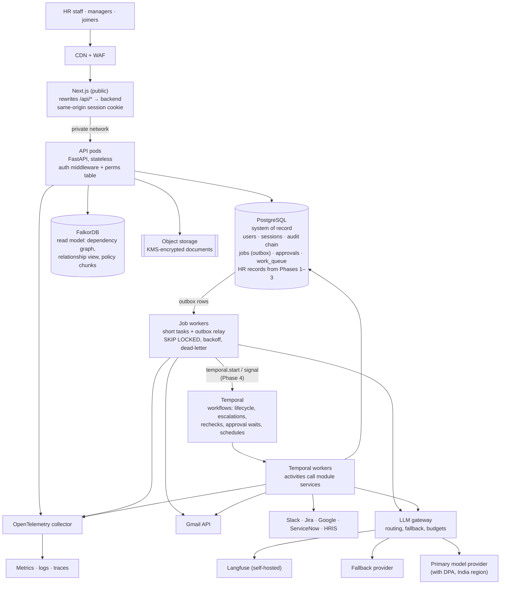

# Azentio Onboard: Production Architecture

Part of the [design docs](README.md). This is how we would ship Azentio Onboard and scale it. Each part is marked:
- **Built (Phase 0)**: in the repo today,
- **Planned (Phase N)**: agreed in the [hardening roadmap](plans/2026-11-01-hardening-design.md) and its phase docs,
- **Proposed**: recommended, but still needs a decision.

Load and cost figures are estimates from the stated assumptions, not measurements.

Two sets of phase labels appear here, and they mean different things:
- **Phase 0–6** are the hardening phases (trust → policy → AI control → graph retirement → ops + Temporal → lifecycle → HR ops platform).
- **P1–P3** are scale stages (pilot → early SaaS → scale), used for load and cost planning.

## 1. Starting point

Today (after Phase 0) the app runs as:
- **A Next.js app.** It's the only public origin; it rewrites `/api/*` to the backend, so the browser never calls the backend directly.
- **One FastAPI process.** It runs the API, plus three in-process asyncio tasks: the Postgres job worker, the Gmail poller and the integration scheduler.
- **PostgreSQL 17**, the system of record ([ADR 0005](adr/0005-postgres-system-of-record.md)). Today it holds users, sessions, the hash-chained audit log, jobs, approvals and the exception queue.
- **FalkorDB.** It still holds employees, checklist items, documents and connector data until Phases 1–3 move them ([ADR 0006](adr/0006-graph-as-read-model.md)).
- **Uploaded files** on local disk.
- **Free LLM models.**

**Built in Phase 0:**
- Sign-in with five roles and one permission table.
- Server-side sessions.
- Startup that sets itself up: migrations, an admin from env, dev seed users.
- Fail-fast config checks.
- `/health` and `/ready`.

**What's still in the way of production:**

| Blocker | Why it matters | Resolved in |
|---|---|---|
| Background work runs inside the API process | Two API replicas would poll Gmail twice and run every integration twice | Phase 4 (Temporal schedules; job worker as its own deployment) |
| HR records still live in FalkorDB | No transactions across records, weak constraints, no point-in-time recovery for the core data | Phases 1–3 |
| Documents on local disk | Lost with the container; can't be shared between replicas | Proposed (object storage) |
| Password sign-in only | No SSO or MFA; one organisation | Proposed (OIDC SSO, tenancy) |
| Free LLM tier | 50 requests a day on OpenRouter's free tier, no DPA, and data may be used by the provider | Proposed |

## 2. Scale targets and load model

| Stage | Tenants | Joiners / year | Typical customer |
|---|---|---|---|
| P1 Pilot | 1 | 2,000 | Azentio itself |
| P2 Early SaaS | 50 | 100,000 | Mid-size companies |
| P3 Scale | 500 | 1,000,000 | Including large enterprises |

**Per joiner (assumptions):**
- Documents: about 8 submitted, about 1.3 attempts each, so about 10 extractions of about 2.3k tokens each.
- Assistant: about 15 questions, at about 2.5k tokens each.
- Email: about 12 messages.
- Portal: about 30 visits.
- Files: about 15 MB.
- Data: about 25 checklist items and about 100 events.

**At P3 (1M joiners a year):**

| Load | Average | Peak (10× hourly average: start-of-month cohorts) |
|---|---|---|
| Document extractions | 27k / day ≈ 0.3 / s | ≈ 3 / s, each 5–20 s → ~60 concurrent LLM calls |
| Assistant questions | 41k / day ≈ 0.5 / s | ≈ 5 / s, ~10 s streams → ~50 concurrent streams |
| LLM tokens | ≈ 165M / day (≈ 60B / year) | Provider rate limits matter more than our compute |
| Portal + HR page views | ≈ 1 / s | ≈ 10–20 / s |
| New document storage | ≈ 40 GB / day, ≈ 15 TB / year | Retention policy decides the real total |
| New events | ≈ 100M rows / year | Needs partitioning and archival |

**What this means:** API compute is small. The limits are:
- LLM throughput and cost,
- email delivery,
- document storage,
- the size of the event and audit tables.

The design below spends its effort there.

## 3. Principles for production

1. **Postgres is the system of record. The graph is a read model.** Authoritative HR state, approvals, audit and jobs live in Postgres. FalkorDB is rebuilt from Postgres on purpose, never synced in the background ([ADR 0005](adr/0005-postgres-system-of-record.md), [0006](adr/0006-graph-as-read-model.md)).
2. **Stateless web tier, durable work out of the request.** Anything slow or retryable (extraction, email, integration runs, evals) runs as a job or a Temporal workflow, never inside the request.
3. **Background work has exactly one owner** ([ADR 0011](adr/0011-temporal-orchestration.md)):
   - Waiting on a person, timers and multi-day flows → Temporal workflows.
   - A single side effect outside a workflow, and local operational tasks → Postgres jobs.
   - Handing a committed change to Temporal → the Postgres outbox.

   Scaling replicas never duplicates work.
4. **Idempotent everything.** Every job and every side effect carries an idempotency key. The repeat-safe integration engine is the pattern for the rest.
5. **Humans only at policy gates.** Routine work is automatic. Exceptions go to `work_queue`, assigned to a role.
6. **The LLM is a dependency, not the system.** It perceives; deterministic rules decide ([ADR 0001](adr/0001-llm-perceives-rules-decide.md), [0010](adr/0010-risk-tiered-ai-autonomy.md)). Every LLM failure has a path to a human.
7. **Tenant id on every row and every log line** once multi-tenant, enforced in the database.

## 4. Target topology

| Component | Status | Choice | Why |
|---|---|---|---|
| Web | Built (Phase 0) | Next.js. The only public origin; `next.config.ts` rewrites `/api/*` to `BACKEND_URL` | The browser talks to one origin, so the httpOnly cookie just works and the backend can stay private |
| API | Built → Planned (Phase 4) | FastAPI. Today one process; from Phase 4, 3+ stateless pods across zones | Becomes stateless once the poller and scheduler move to Temporal |
| Auth | Built (Phase 0) | Five roles, one permission table, server-side sessions ([ADR 0008](adr/0008-five-role-rbac.md)). OIDC SSO is Proposed | See §7 |
| System of record | Built (Phase 0) → Planned (Phases 1–3) | PostgreSQL 17 with plain-SQL migrations applied at startup. Employee/Item/Rule move in Phase 1, Document in Phase 2, connectors and integrations in Phase 3. Managed HA with PITR in production | [ADR 0005](adr/0005-postgres-system-of-record.md) |
| Graph | Built → Planned (Phase 3) | FalkorDB as a rebuild-only read model | [ADR 0006](adr/0006-graph-as-read-model.md) |
| Job queue / outbox | Built (Phase 0) | The Postgres `jobs` table: the transactional outbox and short-task queue. Idempotency keys, `FOR UPDATE SKIP LOCKED`, exponential backoff, `dead` after `max_attempts` | No broker to run; a change and its follow-up commit together ([ADR 0007](adr/0007-postgres-job-queue.md)) |
| Workflow orchestration | Planned (Phase 4) | Temporal. Locally `temporalio/auto-setup` with its own `temporal` database in the same Postgres; in production self-hosted or Temporal Cloud, chosen by env. Worker task queue `azentio` | Durable waits on people, timers and schedules ([ADR 0011](adr/0011-temporal-orchestration.md)) |
| Scheduler / Gmail poller | Built (in-process) → Planned (Phase 4) | Temporal schedules replace `main._scheduler` and `gmail.poll_forever` | No duplicate runs when the API scales |
| Gmail intake | Built (polling) → Proposed | Gmail push notifications through Pub/Sub to a webhook | Seconds instead of a minute |
| Vector search | Built (FalkorDB index) | Policy chunks stay in the graph read model ([ADR 0006](adr/0006-graph-as-read-model.md)); pgvector is Proposed if tenancy requires it | Tenant-filtered retrieval at P2 |
| Files | Built (local disk) → Proposed | S3 or GCS, SSE-KMS, presigned URLs, lifecycle rules | Shared by all pods; retention by policy |
| LLM | Built (direct client) → Proposed | Gateway in front of a paid provider with a DPA, plus a fallback | Budgets, rate limits and failover in one place |

## 5. Data architecture

### 5.1 System of record
**Decided** ([ADR 0005](adr/0005-postgres-system-of-record.md)): PostgreSQL is the system of record. Data moves by domain, in the phase whose feature needs it:

| Phase | Moves to Postgres |
|---|---|
| 0 (built) | New tables only: identity, audit, jobs, approvals, work_queue |
| 1 | Employee, Item, Rule (policy preview needs them transactionally) |
| 2 | Document and review decisions |
| 3 | Connectors, integrations, runs; graph-backed record storage removed |

**How each record type moves:**
1. Dual-write.
2. Backfill.
3. Switch reads in `shared/bridge.py`, only after `parity()` (row count plus checksum) passes.
4. Stop graph writes, only after every read path has switched.

**Rules:**
- Migrations are plain numbered `.sql` files, applied at startup in their own transactions and tracked in `schema_migrations`. They're append-only, and there's no Alembic.
- The graph is rebuilt on purpose: `rebuild_graph()` rebuilds everything, `rebuild_graph(eid)` rebuilds one employee.

### 5.2 Tables

| Table | Status | Notes |
|---|---|---|
| `users`, `sessions` | Built (Phase 0) | Role enum, scrypt hash; sessions store only the sha256 of the cookie token |
| `audit_log` | Built (Phase 0) | Append-only (a trigger refuses UPDATE/DELETE); `hash = sha256(prev_hash + row)`. Partition by month at scale |
| `jobs`, `worker_heartbeat` | Built (Phase 0) | Outbox and short-task queue; unique `idempotency_key` |
| `approval_requests`, `approvals` | Built (Phase 0), used from Phase 1 | One vote per approver; `required` = 2 for compliance rules |
| `work_queue` | Built (Phase 0) | The single exceptions inbox: assignee role, SLA, `dedupe_key` |
| `employees`, `checklist_items`, `rule_versions` | Planned (Phase 1) | Immutable rule versions with author, approvers, diff |
| `documents`, review decisions, threshold versions | Planned (Phase 2) | Decision provenance: model, prompt version, confidence, threshold version |
| `connectors`, `integrations`, runs | Planned (Phase 3) | Connector secrets encrypted |
| `lifecycle_cases` | Planned (Phase 5) | One model for transfer, offboarding, rechecks, rehire, leave |
| `tenants` + `tenant_id` columns with RLS | Proposed (P2) | Tenant isolation as a database guarantee |

### 5.3 Retention and residency
- **Residency:** documents and personal data live in the tenant's region (India by default: `ap-south-1` or `asia-south1`). This follows India's DPDP Act 2023 for Indian joiners, and we'd add GDPR regions for EU tenants.
- **Retention:**

  | Data | Kept for |
  |---|---|
  | Rejected or superseded document files | 90 days |
  | Accepted documents | Per tenant policy, typically employment + 7 years |
  | Extracted ID numbers | Encrypted; masked in UI after acceptance |
  | Audit log | Never edited; archived to WORM storage after 13 months |

- **Right to erasure:** a per-joiner purge job removes files, extracted fields, chat history and traces. The audit log keeps an anonymised entry, and the hash chain is preserved because the entry is appended, not edited.

## 6. Scaling plan per component

| Component | Scales by | Trigger | Ceiling and next step |
|---|---|---|---|
| API pods | Horizontal (HPA) | CPU > 60% or p95 > 300 ms | DB connections. Use PgBouncer before 50 pods |
| Chat streaming | Horizontal; long-lived connections | Concurrent streams per pod > 100 | Keep pods stateless; stream through the Next.js rewrite or a gateway |
| Job workers | Horizontal on queue age (`jobs` where `state='queued'`) | Oldest ready job > 30 s | `SKIP LOCKED` makes extra workers safe; Postgres connections are the limit |
| Temporal workers (Phase 4) | Horizontal on task-queue backlog | Schedule-to-start latency | LLM provider rate limits; per-tenant concurrency caps in activities |
| Email sending | Activity or job concurrency | Gmail 429s | Gmail per-user send limits (about 2,000 a day per Workspace user). Move bulk sends to a dedicated sending domain |
| Integration runs | Per-integration Temporal schedules | Due runs > workers | Shard by tenant, cap concurrency |
| PostgreSQL | Vertical first, then read replicas | CPU > 60%, replica lag | Partition events and audit by month; shard by tenant only at very large scale |
| Object storage | Unlimited | — | Lifecycle to infrequent access after 30 days |
| LLM gateway | Horizontal | Requests per second | Semantic cache for repeated policy questions; per-tenant token budgets |

**Hot paths:**

| Path | Approach |
|---|---|
| Dashboard summaries | Cache per tenant for 30 s, invalidated on item changes |
| Portal view | One query per joiner, read from a replica |
| HR co-pilot context | The full-org digest stops scaling at about 40 joiners (built limit). At P2, retrieve per-joiner digests by embedding instead of loading everyone |

## 7. Security and compliance

| Area | Design | Status |
|---|---|---|
| Staff authentication | Email and password; scrypt hashes (stdlib). Server-side sessions: a random token in an `httpOnly`, `SameSite=Lax` cookie (`Secure` when `COOKIE_SECURE=true`), only its sha256 stored. Default lifetime `SESSION_DAYS=7`. Logout, password change and deactivation revoke immediately | Built (Phase 0) |
| Login throttle | 5 failed attempts per email per 15 minutes → `429`. The counter is kept in memory per process, so with several replicas each counts separately; it moves to Postgres when the backend scales out | Built (Phase 0) |
| SSO / MFA | OIDC SSO (Entra ID, Okta, Google) with MFA enforced by the identity provider; IdP groups mapped to the five roles | Proposed |
| Authorisation | Five roles (`admin`, `hr_ops`, `approver`, `manager`, `auditor`). One ordered permission table in `backend/identity/perms.py`, enforced by one middleware; anything not listed under `/api` is denied. Managers are scoped to their own reports (`404` for others). Approval decisions are approver-only. Tests check every role against every route group | Built (Phase 0) |
| Joiner access | No account. Per-joiner portal link with an unguessable token; only HR Ops can fetch it (`/api/employees/{id}/portal-link`) | Built (Phase 0). Hashing, expiry and rotation Proposed |
| Same origin | Browser → Next.js → backend on a private network. CORS limited to `CORS_ORIGINS` | Built (Phase 0) |
| Audit | Hash-chained, append-only `audit_log` in Postgres. Every action records the signed-in user (or `system` for background work); `verify_chain()` detects tampering. Export to WORM storage | Built (Phase 0); WORM export Proposed |
| Config | Fails fast: `ENV=production` requires `DATABASE_URL`, `ADMIN_EMAIL` and `ADMIN_PASSWORD`, and turns off dev seed users. Startup exits with a message naming what's missing, never hangs | Built (Phase 0) |
| Health | `/health`: is the process up. `/ready`: Postgres, graph and job-worker heartbeat (under 30 s); `503` with the reason if any is down. LLM status is informational. Temporal is added in Phase 4 as degraded, not down, since the outbox buffers | Built (Phase 0); Temporal check Planned (Phase 4) |
| Tenant isolation | PostgreSQL RLS on `tenant_id`; per-tenant storage prefixes with KMS keys | Proposed |
| Secrets | Secrets manager in production; connector credentials encrypted (plaintext in the graph today) | Planned (Phase 3) |
| Uploads | Size and type limits (built), malware scan before extraction | Partly built |
| LLM data | Provider with a DPA and zero retention; document images redacted from traces (built) | Partly built |
| AI decisions | High-risk documents never auto-accepted; versioned thresholds; decision provenance ([ADR 0010](adr/0010-risk-tiered-ai-autonomy.md)) | Planned (Phase 2) |
| Prompt injection | Rules decide, not the model; input and output guardrails | Built |
| Compliance path | SOC 2 Type II and ISO 27001 controls; DPDP and GDPR processor terms; annual penetration test | Proposed |

## 8. Reliability, SLOs and disaster recovery

| SLO | Target |
|---|---|
| HR app and portal availability | 99.9% monthly |
| API latency (non-LLM) | p95 < 300 ms |
| Document verdict after upload | p95 < 2 min |
| Inbound email processed | p95 < 2 min after arrival |
| Integration run started after its scheduled time | p95 < 5 min |

| Failure | Behaviour | Status |
|---|---|---|
| Postgres down | `/ready` returns 503 and authenticated calls return 503, so the app never claims to be working. It recovers on its own when Postgres returns | Built (Phase 0) |
| LLM provider down | Gateway fails over. If every provider is down, documents go to human review rather than failing silently, chat shows the fallback reply, and the setup agent uses rule-based mode | Partly built; review-mode routing Planned (Phase 2) |
| Gmail down or quota hit | Sends retry with backoff; the portal upload still works | Planned (Phase 4: job- and activity-backed sends) |
| Worker crash mid-job | A job left `running` for more than 10 minutes is requeued; idempotency keys stop double sends or double upserts | Built (Phase 0) |
| Poison job | After `max_attempts` (default 5) it's marked `dead` and opens an `ops` exception for Admin in `work_queue`. A screen to retry or discard comes in Phase 4 | Built (Phase 0); screen Planned (Phase 4) |
| Temporal down | The outbox buffers workflow starts and signals; they're relayed when Temporal returns | Planned (Phase 4) |
| Database primary loss | Multi-AZ failover in under 2 minutes | Proposed |
| Region loss | Restore in a second region from backups | Proposed |

**Disaster recovery targets:**

| Measure | Target | How |
|---|---|---|
| RPO (data loss) | 5 minutes | PITR; nightly `pg_dump` with a restore runbook (Phase 4) |
| RTO (time to recover) | 4 hours | Restore drill every quarter |
| Document files | Survive region loss | Cross-region replication for accepted documents |

## 9. Observability

| Signal | Tool | Built today |
|---|---|---|
| Structured logs with request id | `logging_setup.py`; add `tenant_id` | Key=value console logs |
| Readiness | `/ready` (Postgres, graph, worker heartbeat) | Built (Phase 0) |
| Jobs | Counts by kind and state, oldest queued job, dead-letter growth, alerts by email or webhook | Planned (Phase 4) |
| Workflows | Temporal UI; alert on workflow failures | Planned (Phase 4) |
| Traces | OpenTelemetry across the API, workers and the gateway | — |
| LLM traces, cost, latency | Langfuse (self-hosted for data control) | Optional Langfuse with document-image redaction |
| Quality | Ragas evals; guardrail hit rates; spot-check accuracy of auto-accepted documents (Phase 2) | Evals and dashboard built |
| Business | Joiners at risk, time to ready, exception rate, SLA breaches | Dashboard built; analytics Planned (Phase 6) |

**Alerts on symptoms, not causes:**
- SLO burn rate,
- queue age and dead-letter growth,
- a stalled poller or worker heartbeat,
- an LLM error rate above 5%,
- spend over a tenant's budget.

## 10. Cost model

LLM spend dominates. At P3:
- About 60B tokens a year, about 40% of them vision extraction input.
- Cost is that volume times the chosen provider's price per token, so it swings by more than 10× with the model chosen.
- We'd track it per tenant through the gateway.

**Levers, in order of impact:**
1. **Smaller models for easy steps.** Classify the document type with a cheap model; use the large vision model only on the fields that need it.
2. **Skip what's already known.** Don't re-extract an unchanged file (hash the file).
3. **Cache policy answers.** A semantic cache handles repeated questions.
4. **Smaller images.** Downscale pages (built: 2,000 px, 2 pages max).
5. **Per-tenant budgets** with soft and hard limits in the gateway.

Infrastructure at P2 is modest. A rough monthly shape:
- 3 API pods, 2–4 job workers and 2–4 Temporal workers,
- a Multi-AZ PostgreSQL db.r6g.large-class instance (also hosting the Temporal database, or Temporal Cloud instead),
- a small FalkorDB,
- about 1–2 TB of object storage,
- the observability stack.

## 11. Rollout

**Hardening phases** ([roadmap](plans/2026-11-01-hardening-design.md)). Each merges to `main` only when its exit criteria pass.

| Phase | Scope | Status |
|---|---|---|
| 0 Trust + foundation | Postgres, migrations, five roles and sessions, hash-chained audit, jobs as outbox, self-bootstrap, `/health` and `/ready`, login and Users screens | **Done** |
| 1 Policy governance | Rule versions: draft → impact preview → approval (2 approvers for compliance rules) → publish and rollback; Employee/Item/Rule to Postgres | Planned |
| 2 AI control | Risk tiers per document type, versioned thresholds, review queue, 10% spot-check; Document to Postgres | Planned |
| 3 Retire graph records | Connectors, integrations and runs to Postgres; graph becomes a rebuild-only read model; secrets encrypted | Planned |
| 4 Ops backbone + Temporal | All external calls idempotent and job- or activity-backed; Temporal for durable workflows and schedules; dead-letter screen, alerts, backups, CI | Planned |
| 5 Lifecycle | Transfer, offboarding, compliance rechecks, contractor/rehire, leave and return, each as a Temporal workflow | Planned |
| 6 HR ops platform | Manager view with comments, SLAs, escalation ladder, exceptions and appeals, analytics | Planned |

**Scale stages** (run alongside, mostly after Phase 4):

| Stage | Scope | Exit criteria |
|---|---|---|
| P1 Pilot (1 tenant) | Hardening Phases 0–4; paid LLM with a DPA; object storage; SSO; dashboards and alerts | Pen test with no high findings; restore drill passes; SLOs met for 30 days |
| P2 Multi-tenant SaaS | Tenancy with RLS; per-tenant mailboxes, budgets and data keys; real app connectors; billing | 10 tenants live; no cross-tenant access in a dedicated security test |
| P3 Scale | Autoscaling on queue and backlog; partitioned logs; regional deployments; semantic cache | Load test at 3× P3 peak; cost per joiner within target |

## 12. Decisions still open
- **Mail:** keep Gmail, or move to a dedicated sending domain with inbound parsing. This matters for deliverability at P2.
- **Hosting:** Kubernetes or ECS Fargate. Fargate is simpler until there are more than about 10 services.
- **Temporal hosting:** self-hosted or Temporal Cloud. Decide in Phase 4; both are supported by env.
- **Policy-chunk retrieval at P2:** keep it in the graph read model, or move to pgvector for tenant filtering.

**Decided since the first draft:**
- Postgres as the system of record ([ADR 0005](adr/0005-postgres-system-of-record.md)).
- The graph as a read model ([0006](adr/0006-graph-as-read-model.md)).
- The jobs table as the outbox, with Temporal for workflows ([0007](adr/0007-postgres-job-queue.md), [0011](adr/0011-temporal-orchestration.md)).
- The five roles ([0008](adr/0008-five-role-rbac.md)).
