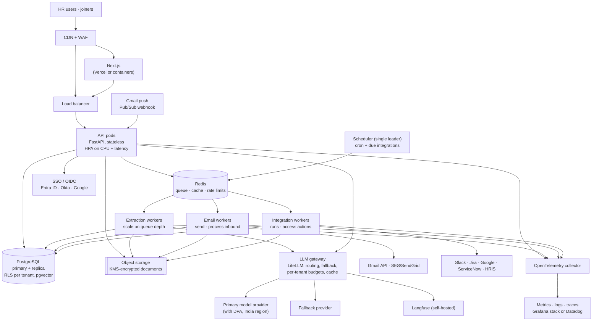

# Azentio Onboard: Production Architecture

Part of the [design docs](README.md). This is how we would ship Azentio Onboard and scale it. Each part is marked **built** (in the repo today), **planned** (agreed, not built) or **proposed** (recommended, needs a decision). Load and cost figures are estimates from the stated assumptions, not measurements.

## 1. Starting point

Today the app runs as:
- one FastAPI process, with the Gmail poller and integration scheduler as in-process asyncio tasks,
- one FalkorDB container,
- files on local disk,
- a Next.js dev server.

There's no sign-in, one organisation, and free LLM models. That's right for a demo. For production it has five blockers:

| Blocker | Why it matters |
|---|---|
| Background work runs inside the API process | Two API replicas would poll Gmail twice and run every integration twice |
| Single FalkorDB instance, no tenancy | One failure takes everything down; no tenant isolation, PITR or row-level security |
| Documents on local disk | Lost with the container; can't be shared between replicas |
| No authentication | Anyone who can reach the HR app can act as HR |
| Free LLM tier | 50 requests a day on OpenRouter's free tier, no DPA, and data may be used by the provider |

## 2. Scale targets and load model

| Phase | Tenants | Joiners / year | Typical customer |
|---|---|---|---|
| P1 Pilot | 1 | 2,000 | Azentio itself |
| P2 Early SaaS | 50 | 100,000 | Mid-size companies |
| P3 Scale | 500 | 1,000,000 | Including large enterprises |

**Per joiner (assumptions):**
- Documents: about 8 submitted, about 1.3 attempts each, so about 10 extractions of about 2.3k tokens each.
- Assistant: about 15 questions, at about 2.5k tokens each.
- Email: about 12 messages.
- Portal: about 30 visits.
- Files: about 15 MB.
- Data: about 25 checklist items and about 100 events.

**At P3 (1M joiners a year):**

| Load | Average | Peak (10× hourly average: start-of-month cohorts) |
|---|---|---|
| Document extractions | 27k / day ≈ 0.3 / s | ≈ 3 / s, each 5–20 s → ~60 concurrent LLM calls |
| Assistant questions | 41k / day ≈ 0.5 / s | ≈ 5 / s, ~10 s streams → ~50 concurrent streams |
| LLM tokens | ≈ 165M / day (≈ 60B / year) | Provider rate limits matter more than our compute |
| Portal + HR page views | ≈ 1 / s | ≈ 10–20 / s |
| New document storage | ≈ 40 GB / day, ≈ 15 TB / year | Retention policy decides the real total |
| New events | ≈ 100M rows / year | Needs partitioning and archival |

**What this means:** API compute is small. The limits are:
- LLM throughput and cost,
- email delivery,
- document storage,
- the size of the event and audit tables.

The design below spends its effort there.

## 3. Principles for production

1. **Stateless web tier, stateful work in queues.** Anything slow or retryable (extraction, email, integration runs, evals) is a job, not a request.
2. **Exactly one owner per background duty.** Scheduling and polling use leader election or a single scheduler, so scaling replicas never duplicates work.
3. **Idempotent everything.** Jobs carry idempotency keys. The repeat-safe integration engine (built) is the pattern for the rest.
4. **Tenant id on every row and every log line.** Enforced in the database, not only in code.
5. **The LLM is a dependency, not the system.** Route it through a gateway with budgets, fallbacks and timeouts. Every LLM failure has a non-LLM path to a human (built).

## 4. Target topology

| Component | Status | Choice | Why |
|---|---|---|---|
| Web | Built (dev) → planned | Next.js build on Vercel, or a container behind the CDN | Static assets at the edge; pages are client components calling the API |
| API | Built → planned | FastAPI on Kubernetes (EKS/GKE) or ECS Fargate, 3+ pods across zones | Already async; becomes stateless once background work moves out |
| Queue | Proposed | Redis + ARQ or Celery for jobs; Temporal if integration runs grow long and multi-step | The integration engine is already a resumable stage machine; a job queue is enough until runs need durable timers |
| Workers | Proposed | Separate deployments per queue, scaled by KEDA on queue depth | Extraction peaks don't starve email or integrations |
| Scheduler | Built (in-process) → proposed | One leader-elected scheduler pod (or K8s CronJob) that only enqueues | Removes duplicate runs when the API scales |
| Gmail intake | Built (polling) → planned | Gmail push notifications through Pub/Sub to a webhook, per tenant mailbox | Seconds instead of a minute; no polling cost per tenant |
| System of record | Built (FalkorDB) → proposed | PostgreSQL (RDS/Cloud SQL/Aurora), Multi-AZ, PITR | See §5 and [ADR 0002](adr/0002-graph-database.md) |
| Vector search | Built (FalkorDB index) → proposed | pgvector in the same PostgreSQL | One store, tenant-filtered retrieval |
| Files | Built (local disk) → planned | S3 or GCS, SSE-KMS, presigned URLs, lifecycle rules | Shared by all pods; retention by policy |
| LLM | Built (direct client) → proposed | LiteLLM gateway in front of a paid provider with a DPA (Azure OpenAI or Bedrock in an India region) plus a fallback | Budgets, rate limits and failover in one place; `llm.py` already speaks the OpenAI API |
| Auth | Proposed | OIDC SSO for HR with roles; portal magic links with expiry | See §7 |

## 5. Data architecture

### 5.1 System of record
We recommend moving the system of record from FalkorDB to PostgreSQL before P2 ([ADR 0002](adr/0002-graph-database.md)):
- **Multi-tenancy:** row-level security on `tenant_id` makes isolation a database guarantee.
- **Operations:** managed HA, point-in-time recovery, read replicas and mature backups.
- **Change management:** schema migrations with Alembic, and constraints that enforce invariants (unique work email per tenant, valid stages).
- **The graph still fits:** the dependency graph is small per joiner (about 25 items), so a recursive CTE or a join table handles blocking and recompute. The FalkorDB graph view can stay as a derived read model if HR values it.

The migration path runs through the repository layer ([project architecture §5](project-architecture.md#5-migration-plan)). Once only repositories touch the database, swapping the store is contained.

### 5.2 Core tables (proposed)

| Table | Partitioning / indexing | Notes |
|---|---|---|
| `tenants`, `users`, `roles` | — | SSO subject, role per tenant |
| `employees` | `(tenant_id, email)` unique | Portal token stored hashed |
| `checklist_items`, `item_dependencies` | `(tenant_id, employee_id)` | Dependencies as a join table |
| `documents` | `(tenant_id, employee_id)` | File in object storage; extracted fields as JSONB, encrypted columns for ID numbers |
| `rules`, `email_templates`, `policies`, `policy_chunks` | `policy_chunks.embedding` with an HNSW index | pgvector |
| `integrations`, `integration_candidates`, `workflow_runs` | `(tenant_id, integration_id, stage)` | Config stays JSONB |
| `events`, `audit_log`, `integration_log` | Range-partitioned by month | Hot 13 months, then archived to object storage (Parquet) |
| `outbound_messages` | By month | Body kept 90 days, metadata 7 years (configurable) |
| `jobs_outbox` | — | Transactional outbox: a state change and the job it triggers commit together |

### 5.3 Retention and residency
- **Residency:** documents and personal data live in the tenant's region (India by default: `ap-south-1` or `asia-south1`). This follows India's DPDP Act 2023 for Indian joiners, and we'd add GDPR regions for EU tenants.
- **Retention:**

  | Data | Kept for |
  |---|---|
  | Rejected or superseded document files | 90 days |
  | Accepted documents | Per tenant policy, typically employment + 7 years |
  | Extracted ID numbers | Encrypted; masked in UI after acceptance |

- **Right to erasure:** a per-joiner purge job removes files, extracted fields, chat history and traces. The audit log keeps an anonymised entry.

## 6. Scaling plan per component

| Component | Scales by | Trigger | Ceiling and next step |
|---|---|---|---|
| API pods | Horizontal (HPA) | CPU > 60% or p95 > 300 ms | DB connections. Use PgBouncer before 50 pods |
| Chat streaming | Horizontal; long-lived connections | Concurrent streams per pod > 100 | Move streams to SSE through the gateway; keep pods stateless |
| Extraction workers | KEDA on queue depth | Oldest job > 30 s | LLM provider rate limit. Request higher limits, add a second provider in the gateway |
| Email workers | KEDA | Queue depth | Gmail per-user send limits (about 2,000 a day per Workspace user). Move bulk sends to SES or SendGrid with the tenant's verified domain |
| Integration workers | KEDA; concurrency limit per tenant | Due runs > workers | One tenant's 10k-candidate run must not starve others: shard by tenant, cap concurrency |
| Scheduler | Single leader | — | Only enqueues; trivially fast |
| PostgreSQL | Vertical first, then read replicas | CPU > 60%, replica lag | Partition events and logs by month; at very large scale shard by tenant (Citus) |
| Redis | Managed, replicated | Memory > 70% | Separate cache and queue instances |
| Object storage | Unlimited | — | Lifecycle to infrequent access after 30 days |
| LLM gateway | Horizontal | Requests per second | Semantic cache for repeated policy questions; per-tenant token budgets |

**Hot paths:**

| Path | Approach |
|---|---|
| Dashboard summaries | Cache per tenant for 30 s, invalidated on item changes |
| Portal view | One query per joiner, read from a replica |
| HR co-pilot context | The full-org digest stops scaling at about 40 joiners (built limit). At P2, retrieve per-joiner digests by embedding instead of loading everyone |

## 7. Security and compliance

| Area | Production design | Status |
|---|---|---|
| HR authentication | OIDC SSO, MFA enforced by the IdP; sessions in HTTP-only cookies | Proposed |
| Authorisation | Roles: `hr_admin`, `hr_member`, `it_owner`, `auditor`; checked in `api/deps.py`; tenant from the session, never from the request body | Proposed |
| Joiner access | Portal magic links: random token stored hashed, 14-day expiry, rotated on resend, rate-limited | Token built; hashing and expiry planned |
| Tenant isolation | PostgreSQL RLS on `tenant_id`; per-tenant S3 prefixes with KMS keys | Proposed |
| Secrets | AWS Secrets Manager or Vault; connector credentials encrypted with a per-tenant data key | Planned (secrets are plaintext in the graph today) |
| Transport | TLS everywhere; HSTS; CORS restricted to the web origin | CORS is `*` today |
| Uploads | Size and type limits (built), malware scan (ClamAV or a cloud scanner) before extraction, PDFs rendered server-side only | Partly built |
| LLM data | Provider with a DPA and zero retention; scans redacted from traces (built); names masked in traces at P2 | Partly built |
| Prompt injection | Rules decide, not the model (built); input and output guardrails (built); classifier model if hit data shows a need | Built |
| Audit | Append-only audit log (built) with the real user id once SSO exists; exported to WORM storage | Partly built |
| Compliance path | SOC 2 Type II and ISO 27001 controls; DPDP and GDPR processor terms; annual penetration test | Proposed |

## 8. Reliability, SLOs and disaster recovery

| SLO | Target |
|---|---|
| HR app and portal availability | 99.9% monthly |
| API latency (non-LLM) | p95 < 300 ms |
| Document verdict after upload | p95 < 2 min |
| Inbound email processed | p95 < 2 min after arrival |
| Integration run started after its scheduled time | p95 < 5 min |

| Failure | Behaviour |
|---|---|
| LLM provider down | Gateway fails over. If every provider is down, documents queue (not lost), the portal says "checking", chat shows the fallback reply, and the setup agent uses rule-based mode (built) |
| Gmail down or quota hit | Outbound jobs retry with backoff; portal upload still works |
| Worker crash mid-job | The job is redelivered; idempotency keys prevent double sends or double upserts |
| Poison job | After 5 attempts it moves to a dead-letter queue, with an alert and a replay button for ops |
| Database primary loss | Multi-AZ failover in under 2 minutes |
| Region loss | Restore in a second region from backups |

**Disaster recovery targets:**

| Measure | Target | How |
|---|---|---|
| RPO (data loss) | 5 minutes | PITR |
| RTO (time to recover) | 4 hours | Restore drill every quarter |
| Document files | Survive region loss | Cross-region replication for accepted documents |

## 9. Observability

| Signal | Tool | Built today |
|---|---|---|
| Structured logs with request id | `logging_setup.py` → JSON to the log store; add `tenant_id` | Key=value console logs |
| Traces | OpenTelemetry across API, workers and the gateway | — |
| LLM traces, cost, latency | Langfuse (self-hosted for data control) | Optional Langfuse with scan redaction |
| Metrics | Queue depth and age, job failure rate, extraction accept/reject/review rates, LLM tokens per tenant, email bounces | — |
| Quality | Ragas evals nightly on a paid judge; guardrail hit rates; alert on a drop of more than 5 points | Evals and dashboard built |
| Business | Joiners at risk, time to ready, documents needing correction | Dashboard built |

**Alerts on symptoms, not causes:**
- SLO burn rate,
- queue age,
- dead-letter queue growth,
- an LLM error rate above 5%,
- spend over a tenant's budget.

## 10. Cost model

LLM spend dominates. At P3:
- About 60B tokens a year, about 40% of them vision extraction input.
- Cost is that volume times the chosen provider's price per token, so it swings by more than 10× with the model chosen.
- We'd track it per tenant through the gateway and expose it to customers as part of the plan.

**Levers, in order of impact:**
1. **Smaller models for easy steps.** Classify the document type with a cheap model; use the large vision model only on the fields that need it.
2. **Skip what's already known.** Don't re-extract an unchanged file (hash the file).
3. **Cache policy answers.** A semantic cache handles repeated questions.
4. **Smaller images.** Downscale pages (built: 2,000 px, 2 pages max).
5. **Per-tenant budgets** with soft and hard limits in the gateway.

Infrastructure at P2 is modest. A rough monthly shape:
- 3 API pods and 4–8 workers,
- a Multi-AZ PostgreSQL db.r6g.large-class instance,
- managed Redis,
- about 1–2 TB of S3,
- the observability stack.

## 11. Rollout phases

| Phase | Scope | Exit criteria |
|---|---|---|
| **P0 Harden (now → pilot)** | Config module; background work out of the API process; files to object storage; paid LLM with a DPA; SSO for HR; CORS locked; secrets encrypted; CI pipeline ([SDLC](sdlc.md)); backups | Pen test with no high findings; restore drill passes; one week of shadow use by HR |
| **P1 Pilot (1 tenant)** | Queue + workers; Gmail push; Langfuse self-hosted; dashboards and alerts; nightly evals | SLOs met for 30 days; extraction accept-precision above 98% on the gold set |
| **P2 Multi-tenant SaaS** | PostgreSQL with RLS; tenant onboarding; per-tenant mailboxes, budgets and data keys; real app connectors (Slack, Google, Jira, ServiceNow); billing | 10 tenants live; no cross-tenant access in a dedicated security test |
| **P3 Scale** | KEDA autoscaling; partitioned logs; regional deployments; semantic cache; tenant sharding if needed | Load test at 3× P3 peak; cost per joiner within target |

## 12. Decisions still open
- **Job queue:** ARQ/Celery versus Temporal. Decide when integration runs need durable waits longer than a day.
- **Mail:** keep Gmail, or move to a dedicated sending domain (SES or SendGrid) with inbound parsing. This matters for deliverability at P2.
- **Graph view:** keep FalkorDB as a read model, or render the graph from PostgreSQL. Decide from HR usage data.
- **Hosting:** Kubernetes or ECS Fargate. Fargate is simpler until there are more than about 10 services.
