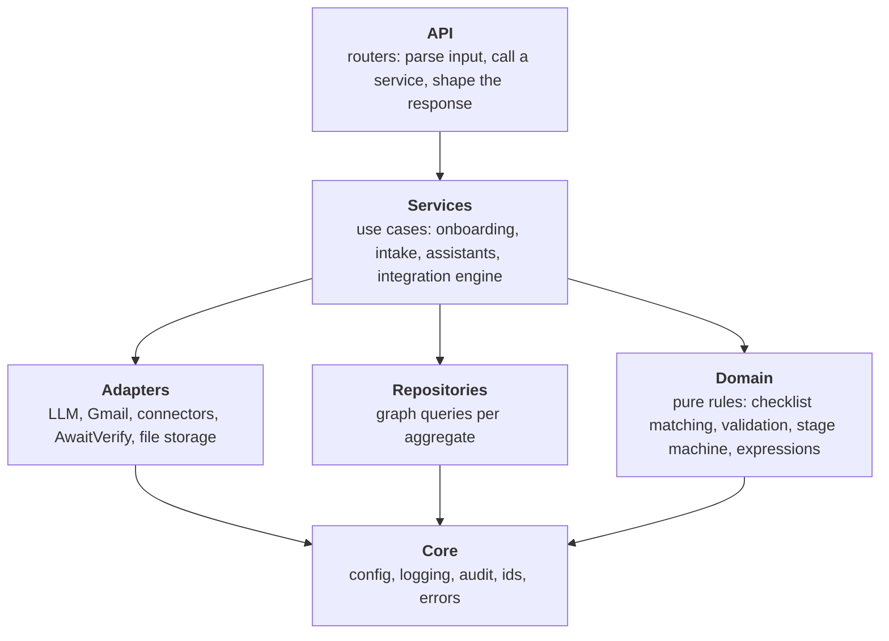

# Azentio Onboard: Project Architecture

Part of the [design docs](README.md). This covers how the code is organised today, the layering rules we follow, and the modular structure we're moving to. Module-by-module detail is in the [LLD](lld.md#32-backend-modules).

## 1. Repository layout today

```
azentio-hr/
├── backend/                     FastAPI app (Python 3.12, uv)
│   ├── main.py                  app setup, lifespan, onboarding/portal/rules/template routes
│   ├── connector_routes.py      /api/connectors/*
│   ├── integration_routes.py    /api/integrations/*, /approvals, /logs/*
│   ├── quality_routes.py        /api/quality/*
│   ├── checklist.py             rules engine
│   ├── validate.py              deterministic document checks
│   ├── extract.py · llm.py      vision extraction, LLM client
│   ├── pipeline.py              shared document intake
│   ├── gmail.py                 send, poll, corrections
│   ├── chat.py · guardrails.py  assistants and their guardrails
│   ├── ingest.py                CSV/Excel/JSON import, seeding
│   ├── evals.py                 Ragas evaluation
│   ├── audit.py · logging_setup.py
│   ├── graph.py                 FalkorDB client and helpers
│   ├── connectors/              base, registry, candidates, hr_portal, apps, sync, seed
│   ├── integrations/            store, service, chat, agent, engine, mapping, expr, delivery, run_log
│   ├── seed/                    sample data, policies, eval set
│   └── test_core.py             assert-based self-checks
├── frontend/                    Next.js 16 app
│   ├── app/(hr)/<page>/         HR pages, one folder per route
│   ├── app/portal/[token]/      employee portal
│   ├── components/              feature components + ui/ (shadcn primitives)
│   └── lib/                     api client and types, utils
├── docs/                        these docs
└── docker-compose.yml           FalkorDB only
```

## 2. Layers

Every backend module belongs to one layer. A layer may only import the layers below it.



| Rule | Why |
|---|---|
| Domain code imports nothing from FastAPI, the graph or any adapter | It stays pure and unit-testable in milliseconds |
| Only repositories run Cypher | The database can change (see [production §5](production-architecture.md#5-data-architecture)) without touching business logic |
| Only adapters talk to the outside world | Every external call has one place for timeouts, retries and fakes in tests |
| Routers hold no business logic | The same use case can run from HTTP, a worker or the setup agent |
| Settings are read once, in `core/config` | No `os.getenv` scattered through the code |
| Errors raised below the API layer are domain errors | The API layer maps them to HTTP status codes |

## 3. Where the code stands against these rules

| Finding | Evidence | Effect |
|---|---|---|
| Graph queries everywhere | 23 modules import `graph` directly | Moving off FalkorDB means touching nearly every file |
| `main.py` mixes app setup and use cases | 555 lines, 27 routes, plus `create_joiner`, summaries and flags | Hard to reuse `create_joiner` without importing the app |
| Settings read ad hoc | 24 `os.getenv` calls across modules | Configuration isn't validated at startup |
| Engine depends on the web framework | `integrations/engine.py` imports `fastapi.HTTPException` | The engine can't run cleanly in a worker |
| Flat module namespace | `chat.py` exists at the top level and in `integrations/` | Confusing imports |
| Tests in one file against a live graph | `test_core.py` defaults to the `hr` graph unless `FALKORDB_GRAPH=test` | A careless run can write to dev data |

What's already in good shape:
- `integrations/service.py` is a real service layer, and the agent's tools and the UI both go through it.
- `connectors/base.py` is a clean adapter interface.
- `validate.py` and `checklist.build_items` are pure.
- `expr.py` is a sandboxed domain module.

## 4. Target structure

```
backend/
├── app/
│   ├── main.py                   create_app(): routers, middleware, lifespan only
│   ├── core/
│   │   ├── config.py             pydantic-settings; every env var, validated at startup
│   │   ├── logging.py            (logging_setup.py)
│   │   ├── audit.py
│   │   └── errors.py             NotFound, Conflict, Rejected → mapped to HTTP in api/
│   ├── api/                      one router per area; no business logic
│   │   ├── employees.py · portal.py · rules.py · templates.py · ingest.py
│   │   ├── connectors.py · integrations.py · approvals.py · logs.py · quality.py
│   │   └── deps.py               auth, tenant, request id
│   ├── domain/                   pure: no I/O
│   │   ├── checklist.py          match_rule, build_items, view_state
│   │   ├── validation.py         (validate.py)
│   │   ├── integration_stages.py stage transitions as a table
│   │   └── expressions.py        (integrations/expr.py)
│   ├── services/                 use cases
│   │   ├── onboarding.py         create_joiner, regenerate, recompute, escalate
│   │   ├── documents.py          (pipeline.py) intake → extract → validate → act
│   │   ├── assistant.py          retrieval, prompts, streaming, guardrails
│   │   ├── integrations/         service, engine, setup agent, chat tools
│   │   └── evaluation.py         (evals.py)
│   ├── adapters/
│   │   ├── llm.py · gmail.py · storage.py · verification.py
│   │   └── connectors/           base, registry, candidates, hr_portal, apps
│   ├── repositories/             the only Cypher (later SQL) in the codebase
│   │   ├── employees.py · items.py · documents.py · rules.py
│   │   ├── integrations.py · logs.py · quality.py
│   │   └── db.py                 (graph.py) connection, q, q1
│   └── workers/                  entry points for background work
│       ├── gmail_poller.py · scheduler.py · eval_runner.py
├── tests/
│   ├── unit/                     domain, no DB
│   ├── integration/              services against a throwaway graph
│   └── contract/                 one suite every connector must pass
└── pyproject.toml

frontend/
├── app/                          routes only: thin pages that compose features
├── features/                     one folder per area
│   ├── employees/ · portal/ · integrations/ · connectors/ · quality/ · logs/
│   │   ├── components/
│   │   ├── api.ts                calls for this feature only
│   │   └── types.ts
├── components/ui/                shared primitives (shadcn)
└── lib/                          fetch wrapper, formatting
```

## 5. Migration plan

We'll move in small, separately shippable steps. Each step keeps `test_core.py` green and changes no behaviour.

| Step | Change | Done when |
|---|---|---|
| 1 | Add `core/config.py` and replace every `os.getenv` | The app refuses to start with a clear message when required config is missing |
| 2 | Move `create_joiner`, summaries and flags out of `main.py` into `services/onboarding.py` | `main.py` holds only app setup and routers |
| 3 | Split `main.py` routes into `api/` routers | Each router is under 200 lines |
| 4 | Add domain errors; remove `HTTPException` below the API layer | `grep -r HTTPException app/services app/domain` is empty |
| 5 | Introduce repositories one aggregate at a time, starting with integrations (already behind `store.py`) | Only `repositories/` imports `db` |
| 6 | Split `test_core.py` into `tests/unit` and `tests/integration` with pytest; force a throwaway graph per run | CI runs unit tests without a database |
| 7 | Move background loops into `workers/` with their own entry points | Workers can run as separate processes ([production §4](production-architecture.md#4-target-topology)) |
| 8 | Frontend: move feature components and API calls into `features/` | Pages are thin composition |

Steps 1–4 are mechanical and low risk. Step 5 is the one that pays for the PostgreSQL move. Don't do steps in parallel with large feature work on the same files.

## 6. Conventions

| Area | Convention |
|---|---|
| Python | Ruff for lint and format; type hints on public functions; mypy in CI on `domain/` and `services/` first |
| TypeScript | `tsc --noEmit` and ESLint in CI; API types live with their feature |
| Naming | Modules are nouns (`onboarding.py`), functions are verbs (`create_joiner`) |
| Errors | Raise a domain error with a message HR can act on; never swallow without logging |
| Logging | `log_event(log, "area.event", id=…, count=…)`: ids and counts only, never personal data |
| Simplifications | Mark deliberate shortcuts with a `ponytail:` comment that names the limit and the upgrade path |
| Tests | One runnable check for every branch, loop or parser that matters; pure domain code gets unit tests |
