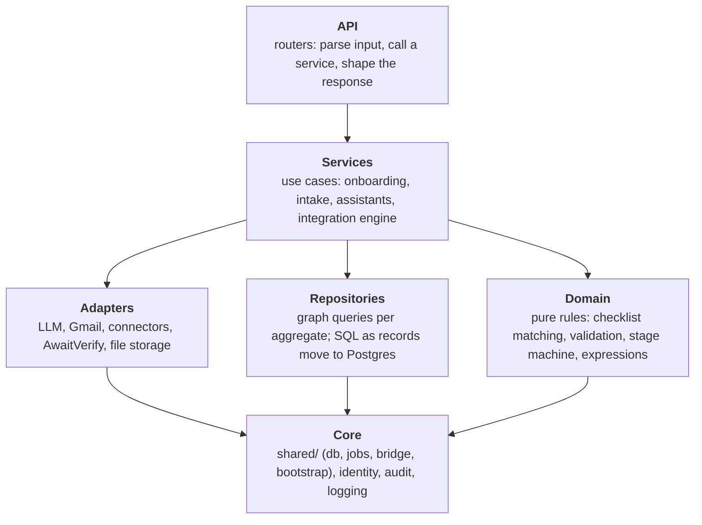

# Azentio Onboard: Project Architecture

Part of the [design docs](README.md). This covers how the code is organised today, the boundary rules we enforce, and the modular structure we're moving to. Module-by-module detail is in the [LLD](lld.md#32-backend-modules); the phase plan is in the [hardening design](plans/2026-11-01-hardening-design.md).

Parts are labelled **Built** (on `main`) or **Planned (Phase N)**.

## 1. Repository layout today

```
azentio-hr/
├── AGENTS.md · CLAUDE.md        brief for coding agents (kept current with every structural change)
├── backend/                     FastAPI app (Python 3.12, uv)
│   ├── main.py                  app setup, lifespan, auth middleware, manager scoping, /health, /ready,
│   │                            onboarding/portal/template routes, GET /api/rules (active version)
│   ├── shared/                  Built (Phase 0): cross-cutting foundation
│   │   ├── db.py                Postgres pool, tx(), fetch/fetch1/execute, migrate(), use_test_database()
│   │   ├── jobs.py              transactional outbox + short-task queue (enqueue, @handler, worker)
│   │   ├── bridge.py            which store each migrating record type is read from; parity gate
│   │   └── bootstrap.py         idempotent startup: config check, DB wait, migrations, users, records migration gate
│   ├── migrations/              001–004 (Phase 0), 005_core_records, 006_policy_versions, 007_item_notices (Phase 1)
│   ├── records.py               Built (Phase 1): every Employee/Item read and write; graph projection; backfill + parity
│   ├── policy/                  Built (Phase 1): store (versions, drafts, diff), replay (pure plan_diff + apply),
│   │                            service (preview, submit/approve/reject/rollback, publish + notify jobs), routes
│   ├── identity/                Built (Phase 0): perms.py (the one permission table), service.py, routes.py
│   ├── audit_log/service.py     Built (Phase 0): hash-chained audit log in Postgres
│   ├── audit.py                 audit entry point used everywhere (actor from the signed-in user)
│   ├── work_queue.py            Built (Phase 0): exception queue + routes
│   ├── connector_routes.py      /api/connectors/*
│   ├── integration_routes.py    /api/integrations/*, /approvals, /logs/*
│   ├── quality_routes.py        /api/quality/*
│   ├── checklist.py             rules engine (pure build_items/view_state; reads the active rule-set version)
│   ├── validate.py              deterministic document checks
│   ├── extract.py · llm.py      vision extraction, LLM client
│   ├── pipeline.py              shared document intake
│   ├── gmail.py                 send, poll, corrections
│   ├── chat.py · guardrails.py  assistants and their guardrails
│   ├── ingest.py                CSV/Excel/JSON import, seeding
│   ├── evals.py                 Ragas evaluation
│   ├── logging_setup.py
│   ├── graph.py                 FalkorDB client and helpers
│   ├── connectors/              base, registry, candidates, hr_portal, apps, sync, seed
│   ├── integrations/            store, service, chat, agent, engine, mapping, expr, delivery, run_log
│   ├── seed/                    sample data, policies, eval set
│   └── test_core.py · test_phase0.py · test_phase1.py   assert-based self-checks on throwaway databases
├── frontend/                    Next.js 16 app
│   ├── next.config.ts           rewrites /api/* to BACKEND_URL (same origin, httpOnly cookie)
│   ├── app/login/               sign-in
│   ├── app/(hr)/<page>/         HR pages, one folder per route (incl. users/, rules/draft, rules/draft/preview, rules/history)
│   ├── app/portal/[token]/      employee portal (public, token-scoped)
│   ├── components/              feature components, auth.tsx (MeProvider, can, RoleGate), app-shell.tsx,
│   │                            rule-form.tsx, policy-diff.tsx, impact-preview.tsx, ui/
│   └── lib/                     api client (401 → /login) and types, policy.ts (openDraft), utils
├── scripts/smoke.py             UI smoke test: every role signs in, navigates, runs a workflow; full policy flow
├── docs/                        these docs, plans/, adr/, screenshots/
└── docker-compose.yml           Postgres 17 + FalkorDB
```

## 2. Boundary rules (enforced today)

These hold now and are checked in review. The first column says where each rule lives in the code.

| Rule | Where | Why |
|---|---|---|
| **Permissions are defined once.** Every `/api` call passes one middleware (`main.authenticate`) and one ordered table (`identity/perms.py`); unlisted paths are denied. Routes never check roles; the only exception is data scoping (`main._visible` for managers) | `identity/perms.py`, `main.py` | One place to review, one matrix test (`test_phase0.py`) covers every role |
| **Every human action is audited** through `audit.record_audit(...)`. Pass `conn=` so the entry commits with the change | `audit.py` → `audit_log/service.py` | The actor is resolved from the request; the chain stays continuous |
| **Follow-up work is enqueued in the same transaction** as the change that caused it (`jobs.enqueue(..., conn=c)`), with an idempotency key on every external side effect | `shared/jobs.py` | The outbox can't lose work; retries can't duplicate side effects |
| **Background work has one owner** ([ADR 0011](adr/0011-temporal-orchestration.md)) | see the table below | No double retries; it's clear which system is responsible |
| **Employees and items go through `records.py`.** No direct Cypher writes to `Employee`/`Item`; after a write, the graph projection is refreshed in place in the same request. Queries that join documents, events or connector records may read the projection | `records.py` | One write path keeps Postgres and the projection identical |
| **Rules change only by publishing a version.** No code writes rules for live joiners; replay never deletes items (cancel or keep as evidence) | `policy/` | Policy changes are reviewable, reversible and never lose evidence |
| **Read migrating records through the bridge.** A record type is read from exactly one store; it switches to Postgres only after `parity()` passes; graph writes stop only after every read path has switched | `shared/bridge.py` | Two stores never answer the same question differently |
| **Postgres schema changes are new numbered migrations.** Never edit an applied file; each must run inside a transaction | `backend/migrations/` | Startup applies them automatically on every environment |
| **Anything that needs a person opens an exception** in `work_queue`, assigned to a role, deduplicated by cause | `work_queue.py` | Humans act at policy gates, not by watching dashboards |
| **Required config fails fast** at startup with a clear message | `shared/bootstrap.py` | A missing secret is a startup error, not a half-working app |
| **The frontend never calls the backend directly**; it calls `/api/*` on its own origin | `next.config.ts`, `lib/api.ts` | The session cookie stays httpOnly; the backend can stay private |
| **Write buttons are hidden with `can()`**, but the backend is the authority | `components/auth.tsx` | No dead clicks, no security in the UI |

**Ownership of background work**

| Work | Owner | Status |
|---|---|---|
| A single side effect outside any workflow; local ops tasks (audit import, graph rebuild, alert evaluation) | Postgres job | Built |
| Handing a committed change to Temporal | Outbox row (`temporal.start` / `temporal.signal`), relayed by the jobs worker; idempotency key = workflow id | Planned (Phase 4) |
| Waiting on people, timers, multi-day state machines | Temporal workflow | Planned (Phase 4) |
| A single side effect inside a workflow | Temporal activity with a retry policy | Planned (Phase 4) |

Business state always lives in Postgres. Neither the jobs table nor Temporal is an authority on HR data.

## 3. Layers

Every backend module belongs to one layer. A layer may only import the layers below it.



| Rule | Why |
|---|---|
| Domain code imports nothing from FastAPI, the databases or any adapter | It stays pure and testable in milliseconds |
| Only repositories (and `shared/db.py`) run queries | The storage move to Postgres touches repositories, not business logic |
| Only adapters talk to the outside world | Every external call has one place for timeouts, retries and fakes in tests |
| Routers hold no business logic | The same use case can run from HTTP, a job, a Temporal activity or the setup agent |
| Errors raised below the API layer are domain errors | The API layer maps them to HTTP status codes |

## 4. Where the code stands against these rules

| Finding | Evidence | Effect | Fixed by |
|---|---|---|---|
| Graph queries everywhere | 24 modules import `graph` directly | Moving records to Postgres touches many files | Phases 1–3, one record type at a time behind the bridge |
| `main.py` mixes app setup and use cases | 621 lines, 28 routes, plus `create_joiner`, summaries, flags and the auth middleware | Hard to reuse `create_joiner` without importing the app | Phase 1 (`lifecycle/`, `policy/` services) |
| Settings read ad hoc | 42 `os.getenv`/`os.environ` reads | Only the production-required ones are validated (by bootstrap) | Gradually, as modules move |
| Engine depends on the web framework | `integrations/engine.py` imports `fastapi.HTTPException` | Can't run cleanly as a job or Temporal activity | Phase 4 |
| Gmail poller and scheduler are bare loops | `gmail.poll_forever`, `main._scheduler` | No retries or dead-lettering | Phase 4 (Temporal schedules, job-backed calls) |

What's in good shape:
- **Permissions and audit** each have exactly one entry point.
- **Tests** run on throwaway databases (`azentio_test*` and the `test` graph), so a careless run can't touch dev data.
- **`integrations/service.py`** is a real service layer: the agent's tools and the UI both go through it.
- **`connectors/base.py`** is a clean adapter interface.
- **Pure code:** `validate.py` and `checklist.build_items` are pure, and `expr.py` is a sandboxed domain module.

## 5. Target structure (Planned)

Modules follow the hardening design: a modular monolith where each module owns its tables and exposes a `service.py` (the only thing other modules call) and a `routes.py`. The module boundaries are where services would be split off later, if team ownership or load ever demand it.

```
backend/
├── shared/          Built: db (pool, tx, migrate), jobs (outbox), bridge, bootstrap · Planned: clock, config
├── identity/        Built: users, roles, sessions, perms table
├── audit_log/       Built: hash-chained log, verify_chain · Planned: lineage queries
├── work_queue.py    Built: exception inbox (becomes a module with its own screen in Phase 1)
├── policy/          Planned (Phase 1): rule and threshold versions, drafts, impact preview, approvals, rollback
│                    (wraps checklist.build_items / match_rule unchanged)
├── documents/       Planned (Phase 2): intake, extraction, validation, risk tiers, review queue
│                    (absorbs pipeline.py, extract.py, validate.py)
├── lifecycle/       Planned (Phase 1 start, Phase 5 full): onboard, transfer, leave, offboard,
│                    rechecks, rehire, worker type
├── notifications/   Planned (Phase 4): Gmail send/poll as jobs or activities, reminders, escalations
├── integrations/    Existing; moves to Postgres in Phase 3; idempotent upserts kept
├── workflows/       Planned (Phase 4): Temporal workflows and activities; activities call module services
└── analytics/       Planned (Phase 6): readiness, SLA, exceptions, AI quality

frontend/
├── app/             routes only: thin pages that compose features
├── components/      shared feature components, auth.tsx, ui/ (shadcn primitives)
└── lib/             fetch wrapper (same-origin, 401 → login), types, formatting
```

| Module rule | Why |
|---|---|
| Other modules call a module's `service.py`, never its tables or internals | One owner per table; the boundary is where a service could later be split out |
| Workflows and activities (Phase 4) write state only through module services | Temporal orchestrates; Postgres stays the system of record |
| `checklist.py`'s rules logic moves under `policy/` unchanged | It's the strongest part of the codebase and already pure |

## 6. Migration plan

Each step keeps `test_core.py` and the current `test_phaseN.py` green, and ships behind its own phase's exit criteria ([phase plans](plans/)).

| Phase | Structural change | Done when |
|---|---|---|
| 0 | `shared/`, `identity/`, `audit_log/`, `work_queue.py`, migrations, bootstrap, auth middleware | **Built.** Every API call authorised; every action audited with a user; startup needs no manual steps |
| 1 | `policy/` and `lifecycle/` services; Employee, Item, Rule tables; reads switched through the bridge | `main.py` holds no rule or joiner logic; parity passes; the exception inbox screen exists |
| 2 | `documents/` module; Document and review-decision tables | The pipeline runs through `documents/service.py`; no high-risk document is auto-accepted |
| 3 | Connectors, integrations and runs in Postgres; graph writes for records removed; `rebuild_graph()` | Only rebuild code writes to the graph |
| 4 | `notifications/`, `workflows/`; Temporal; no `HTTPException` below routers; CI | The poller and scheduler are Temporal schedules; every external call is job- or activity-backed |
| 5–6 | `lifecycle/` complete; `analytics/` | Per the phase plans |

## 7. Conventions

| Area | Convention |
|---|---|
| Python | Type hints on public functions; plain SQL through `shared/db.py`; no ORM. Lint and type checks in CI arrive with Phase 4 |
| TypeScript | `tsc --noEmit` and `eslint app components` before every frontend commit |
| Naming | Modules are nouns (`onboarding.py`), functions are verbs (`create_joiner`) |
| Errors | Raise an error with a message HR can act on; never swallow without logging |
| Logging | `log_event(log, "area.event", id=…, count=…)`: ids and counts only, never personal data |
| Simplifications | Mark deliberate shortcuts with a `ponytail:` comment that names the limit and the upgrade path |
| Tests | Plain `assert` self-checks: `test_core.py`, one `test_phaseN.py` per phase, and `scripts/smoke.py` for the UI. One runnable check for every branch, loop or parser that matters |
| Docs | Behaviour changes update the LLD and the phase doc; boundary changes add an ADR; structure, command or phase changes update `AGENTS.md` and `CLAUDE.md` |
| Commits | Small, imperative mood, no co-author or AI attribution lines |
