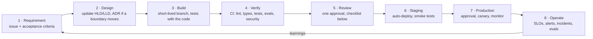
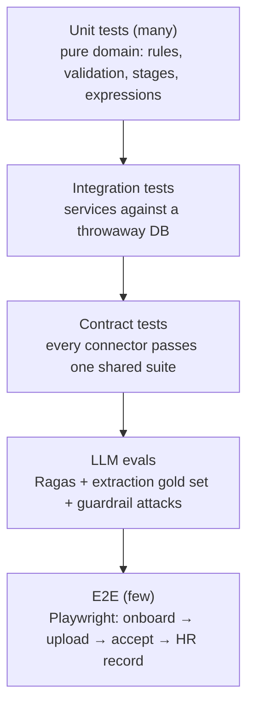

# Azentio Onboard: SDLC

Part of the [design docs](README.md). This is how work moves from an idea to production. Items marked **gap** aren't in place yet; the table in §9 lists them in order.

The current work is the [hardening roadmap](plans/2026-11-01-hardening-design.md): seven phases, each with its own plan in `docs/plans/`. [`AGENTS.md`](../AGENTS.md) is the short version of this document for anyone (human or coding agent) making a change.

## 1. Lifecycle



| Stage | Output | Owner |
|---|---|---|
| Requirement | An issue with the user flow it changes ([user flows](user-flows.md)) and testable acceptance criteria | Product / requester |
| Design | For phase work, the phase doc in `docs/plans/` is written before code. Updated [HLD](hld.md) or [LLD](lld.md) in the same PR; an [ADR](adr/) for new stores, services, external dependencies or trust boundaries | Engineer |
| Build | Code + tests + docs on a branch | Engineer |
| Verify | Green CI | CI |
| Review | Approved PR | Reviewer |
| Release | Deployed, monitored, changelog entry | Engineer on release |

## 2. Branching and commits

- **`main` is always deployable.**
- **Branches:**
  - Hardening work happens on one branch per phase, `phase-N-<name>` (e.g. `phase-0-trust-foundation`), with small commits for each sub-step. A phase merges to `main` only when every exit criterion in its phase doc passes.
  - Other work uses `feature/<short-name>` or `fix/<short-name>` branches that live for days, not weeks.
- **Pull requests:** small (under about 400 changed lines where possible), one concern each.
- **Commits:** imperative and focused, e.g. `Phase 0: auth, roles, audit chain, job queue, bootstrap` or `fix(pipeline): keep accepted items on re-upload`. **No `Co-Authored-By` lines or AI attribution in commits or PR bodies.**
- **Unfinished work** that has to land on `main` mid-phase sits behind an env switch (e.g. `POLICY_APPROVALS=on`). The switch is removed when the phase completes; there's no flag framework.
- **Never commit:**
  - `.env`, credentials or tokens,
  - `uploads/`,
  - `__pycache__/` or `*.pyc` (ignored),
  - `node_modules/`, `.next/`, logs.

## 3. Environments

| Environment | Purpose | Data | Deploys |
|---|---|---|---|
| Local | Development | `docker compose up -d` (Postgres and FalkorDB). The backend sets itself up on start: migrations, the admin from env, one dev account per role, sample joiners | — |
| Preview | Per-PR review of UI changes | Seeded, throwaway | On every PR (Vercel preview + ephemeral API) — gap |
| Staging | Release candidate, integration with real Gmail test mailbox and paid LLM | Synthetic only, never real joiner data | On merge to `main` — gap |
| Production | Customers | Real | Manual approval after staging smoke tests — gap |

Configuration differs only by environment variables. The same build artifact (container image) moves from staging to production.
- `ENV=production` makes `DATABASE_URL`, `ADMIN_EMAIL` and `ADMIN_PASSWORD` required and turns off dev accounts. Startup fails fast with a message naming what's missing.
- Every new variable is documented in `.env.example`.

## 4. Testing strategy



| Layer | What it covers | Today | Runs |
|---|---|---|---|
| Unit | `checklist.match_rule`, `validate.evaluate`, `expr`, guardrail regexes, mapping, the permission table | Assert checks in `test_core.py`, `test_phase0.py`, `guardrails.py` | Before every commit |
| Integration | Pipeline intake, regenerate/recompute, integration engine end to end, idempotent upserts; sessions, audit chain and tamper detection, job retry/dead-letter/no double claim, bootstrap re-runs | `test_core.py` and `test_phase0.py` (need Postgres and FalkorDB) | Before every commit |
| Phase checks | Each phase's named assertions from its plan, e.g. Phase 1's rollback test | `test_phaseN.py`, one per phase | Before every commit in that phase |
| UI smoke | Every role signs in through the real form, gets the right navigation, allowed pages render, forbidden pages are gated, plus one workflow per role | `scripts/smoke.py` (headless Chrome over DevTools; no Playwright) | Before committing a frontend change |
| Contract | Each connector: schema, list, get, upsert idempotency, rejection reasons | Partly in `test_core.py` — gap | Every push |
| LLM evals | Assistant faithfulness and retrieval (Ragas), injection blocking, extraction field accuracy | Assistant + guardrails built; extraction gold set — gap | Nightly on staging; on PRs touching prompts, retrieval or models |
| E2E | The core flows in [user flows §7](user-flows.md#7-acceptance-criteria-for-the-core-flows), beyond the smoke test | gap | Before production deploy |
| Security | Dependency audit (`pip-audit`, `npm audit`), secret scan (gitleaks), SAST (Semgrep/Bandit) | gap | Every push |

**Run these before every commit:**
```bash
cd backend && uv run python test_core.py        # throwaway graph "test" + database azentio_test_core
cd backend && uv run python test_phase0.py      # throwaway database azentio_test (plus test_phaseN.py for the current phase)
cd frontend && npx tsc --noEmit && npx eslint app components
backend/.venv/Scripts/python scripts/smoke.py --base http://localhost:3000   # with the stack running; refreshes docs/screenshots/
```

Rules:
- **Tests never touch live data.**
  - `db.use_test_database()` recreates a throwaway Postgres database for each run.
  - `test_core.py` uses the `test` graph and refuses real Gmail.
  - Tests never use a real Gmail account.
- **Plain `assert` checks, no test framework.** Every non-trivial piece of logic leaves one runnable check behind.
- **Permissions:** a change to `backend/identity/perms.py` adds a row to the role × route matrix in `test_phase0.py`.
- **LLM-dependent tests use recorded responses or fakes.** Live model calls belong in the eval suite, not unit tests, so CI is fast and free.
- **Eval gate:** a PR that lowers faithfulness or context recall by more than 5 points, or lets any attack prompt through, fails.

## 5. CI/CD pipeline (built)

`.github/workflows/ci.yml` runs on every pull request and every push to `main`. A newer push cancels the older run.

| Job | What it checks |
|---|---|
| `backend` | `ruff check` (rules `F` + `E9`: undefined names, unused imports, syntax), the boundary guard (`scripts/check_boundaries.py --selftest`, then a real run), `test_core.py`, `test_phase0.py`, `test_phase1.py`, `test_phase2.py`. Postgres 17 and FalkorDB run as service containers |
| `frontend` | `tsc --noEmit`, `eslint app components` |
| `smoke` | After both: backend with the dev seed, `next build` + `next start` (a production build, never dev mode), then `scripts/smoke.py` for every role, the policy flow, rollback and document review. Screenshots and logs are uploaded as an artifact |
| `images` | After all three: builds `backend/Dockerfile` and `frontend/Dockerfile`. Pushes `ghcr.io/prateek1771/azentio-hr-{backend,frontend}:{sha,latest}` **only on a push to `main`**; on PRs it only builds, so a broken Dockerfile fails the PR |

CI has no secrets: `LLM_LOCAL_FALLBACK=0` and `LLM_KEYLESS_FALLBACK=0`, no Gmail credentials, so nothing calls a model or sends mail. Deployment is deliberately not automated yet. The diagram below is the target pipeline; security scans, evals in CI, staging and canary are still to come.



```mermaid
flowchart LR
    PR["Pull request"] --> L["Lint + format<br/>ruff · eslint"]
    L --> T["Types<br/>mypy (domain, services) · tsc"]
    T --> U["Unit + integration tests<br/>FalkorDB service container"]
    U --> SEC["Security<br/>pip-audit · npm audit · gitleaks · semgrep"]
    SEC --> EVQ{"Prompt, retrieval<br/>or model changed?"}
    EVQ -- yes --> EVL["Eval suite<br/>paid judge"]
    EVQ -- no --> BLD
    EVL --> BLD["Build images<br/>tag = git sha"]
    BLD --> MRG["Merge to main"]
    MRG --> STG["Deploy staging<br/>run migrations, smoke tests"]
    STG --> APR{"Release approval"}
    APR --> CAN["Production canary 10%<br/>watch SLOs 30 min"]
    CAN --> FULL["Full rollout"]
    CAN -->|"burn rate alert"| RB["Automatic rollback"]
```

Target times: PR checks under 10 minutes; staging deploy under 15 minutes after merge.

## 6. Code review checklist

- [ ] The change does what the issue's acceptance criteria say, and there's a test that would fail without it.
- [ ] Layering holds ([project architecture §2](project-architecture.md#2-layers)): no Cypher outside data access, no HTTP types below the API layer, no business logic in routers. Modules call each other's `service.py`, never each other's tables.
- [ ] Permissions: new routes have a rule in `identity/perms.py` and a matrix row in the tests; no role checks inside routes (except data scoping such as a manager's own reports).
- [ ] Data: migrating record types are read only through `shared/bridge.py`; a type switches to Postgres only after `parity()` passes.
- [ ] Background work follows the one-owner rule ([ADR 0011](adr/0011-temporal-orchestration.md)) and is enqueued inside the transaction that caused it.
- [ ] Untrusted input is validated at the boundary: uploads, portal and chat messages, imported files, connector data, HR-written expressions.
- [ ] The LLM still only perceives: no model output decides acceptance, writes, emails or approvals without deterministic checks.
- [ ] Repeat-safe: retries or re-runs don't duplicate emails, records or access.
- [ ] Logs carry ids and counts only; audit entries exist for user-visible actions.
- [ ] Errors give HR a reason they can act on.
- [ ] Docs updated in the same change: the phase doc, the LLD for behaviour, the HLD and an ADR for boundaries, user flows for screens, and `AGENTS.md` and `CLAUDE.md` for commands, structure, conventions or phase status.
- [ ] No new dependency where the standard library or an existing one does the job; new dependencies are pinned and licence-checked.

## 7. Releases and changes

- **Versioning:** semantic versions for the product, with git tags `vMAJOR.MINOR.PATCH` and a `CHANGELOG.md` entry per release.
- **Database migrations** are numbered plain-SQL files in `backend/migrations/` (`NNN_name.sql`).
  - They're applied automatically at startup, each in its own transaction, and recorded in `schema_migrations`.
  - They're **append-only**: never edit one that has been applied; add the next number instead. There's no Alembic.
  - Changes use expand → migrate → contract:
    - Add new columns or tables first.
    - Deploy code that writes both.
    - Backfill.
    - Switch reads.
    - Remove the old structure in a later release.
  - Never a destructive migration in the same release as the code that stops using it.
  - Graph-to-Postgres moves follow the same shape: dual-write, backfill, a bridge switch gated on parity, then stop graph writes.
- **Model and prompt changes are releases.** They go through the eval gate, are noted in the changelog, and are pinned by exact model id in config.
- **Rollback:** redeploy the previous image tag. Migrations are backward-compatible for one release, so rollback never needs a down-migration.
- **Feature flags** guard risky changes (a new extraction model, a new connector) and are removed within two releases of full rollout.

## 8. Operating and incidents

| Severity | Example | Response |
|---|---|---|
| SEV1 | Portal or HR app down; cross-tenant data exposure; documents lost | Page on-call immediately; status page; fix or roll back; post-mortem within 3 working days |
| SEV2 | Extraction or email queue stalled; LLM provider outage without failover | On-call within 30 minutes; post-mortem |
| SEV3 | One connector failing; eval scores dropped | Next working day; tracked issue |

**Post-mortems** are blameless. Each one records:
- a timeline,
- the impact (joiners affected, delays),
- the root cause,
- what detected it,
- action items with owners.

Every SEV1 or SEV2 action item that changes a boundary gets an ADR.

**Routine operations:**
- Nightly evals; weekly review of guardrail hits and documents sent to *Under Review*.
- Monthly dependency updates; quarterly restore drill and access review.

## 9. Gaps to close, in order

| # | Gap | Effort |
|---|---|---|
Done: `.pyc` files untracked; tests use throwaway databases and graphs; a UI smoke test covers every role; GitHub Actions runs lint, the boundary guard, every test suite and the smoke test against a production build, and publishes images to GHCR (§5).

| # | Gap | When |
|---|---|---|
| 2 | Security scans in CI (pip-audit, npm audit, gitleaks) | Phase 4 |
| 3 | Nightly `pg_dump` and a tested restore runbook | Phase 4 |
| 4 | Extraction gold set (about 20 sample documents with expected fields) in the eval suite | Phase 2 |
| 6 | Staging environment with a paid LLM and a test Gmail mailbox | Before the P1 pilot |
