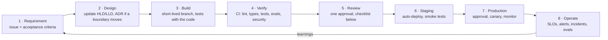
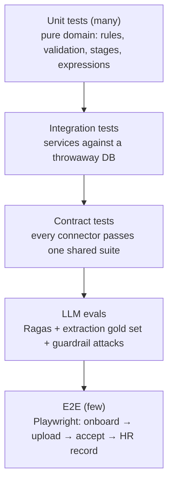

# Azentio Onboard: SDLC

Part of the [design docs](README.md). This is how work moves from an idea to production. Items marked **gap** aren't in place yet; the table in §9 lists them in order.

## 1. Lifecycle

| Stage | Output | Owner |
|---|---|---|
| Requirement | An issue with the user flow it changes ([user flows](user-flows.md)) and testable acceptance criteria | Product / requester |
| Design | Updated [HLD](hld.md) or [LLD](lld.md) in the same PR; an [ADR](adr/) for new stores, services, external dependencies or trust boundaries | Engineer |
| Build | Code + tests + docs on a branch | Engineer |
| Verify | Green CI | CI |
| Review | Approved PR | Reviewer |
| Release | Deployed, monitored, changelog entry | Engineer on release |

## 2. Branching and commits

- **Trunk-based.** `main` is always deployable. Feature branches are named `feature/<short-name>` or `fix/<short-name>`, and live for days, not weeks.
- **Pull requests:** small (under about 400 changed lines where possible), one concern each, squash-merged.
- **Commits** follow Conventional Commits: `feat(integrations): add offer approval`, `fix(pipeline): keep accepted items on re-upload`.
- **Unfinished work** ships behind a feature flag (an env setting today, a flag service later), not on a long branch.
- **Never commit:**
  - `.env`, credentials or tokens,
  - `uploads/`,
  - `__pycache__/` (gap: `.pyc` files are currently tracked; add `__pycache__/` to `.gitignore` and remove them from the index),
  - `node_modules/`, `.next/`, logs.

## 3. Environments

| Environment | Purpose | Data | Deploys |
|---|---|---|---|
| Local | Development | Seeded sample data; separate `FALKORDB_GRAPH` per developer | — |
| Preview | Per-PR review of UI changes | Seeded, throwaway | On every PR (Vercel preview + ephemeral API) — gap |
| Staging | Release candidate, integration with real Gmail test mailbox and paid LLM | Synthetic only, never real joiner data | On merge to `main` — gap |
| Production | Customers | Real | Manual approval after staging smoke tests — gap |

Configuration differs only by environment variables. The same build artifact (container image) moves from staging to production.

## 4. Testing strategy

| Layer | What it covers | Today | Runs |
|---|---|---|---|
| Unit | `checklist.match_rule`, `validate.evaluate`, `expr`, guardrail regexes, mapping | Assert checks in `test_core.py`, `guardrails.py` | Every push |
| Integration | Pipeline intake, regenerate/recompute, integration engine end to end, idempotent upserts | `test_core.py` (needs FalkorDB) | Every push |
| Contract | Each connector: schema, list, get, upsert idempotency, rejection reasons | Partly in `test_core.py` — gap | Every push |
| LLM evals | Assistant faithfulness and retrieval (Ragas), injection blocking, extraction field accuracy | Assistant + guardrails built; extraction gold set — gap | Nightly on staging; on PRs touching prompts, retrieval or models |
| E2E | The five core flows in [user flows §5](user-flows.md#5-acceptance-criteria-for-the-core-flows) | gap | Before production deploy |
| Security | Dependency audit (`pip-audit`, `npm audit`), secret scan (gitleaks), SAST (Semgrep/Bandit) | gap | Every push |

Rules:
- **Tests must never use a real Gmail account or the shared dev graph.** `test_core.py` already refuses real Gmail. Force a throwaway graph name per run (gap: it defaults to `hr`).
- **LLM-dependent tests use recorded responses or fakes.** Live model calls belong in the eval suite, not unit tests, so CI is fast and free.
- **Eval gate:** a PR that lowers faithfulness or context recall by more than 5 points, or lets any attack prompt through, fails.

## 5. CI/CD pipeline (gap: to be built as GitHub Actions)

```mermaid
flowchart LR
    PR["Pull request"] --> L["Lint + format<br/>ruff · eslint"]
    L --> T["Types<br/>mypy (domain, services) · tsc"]
    T --> U["Unit + integration tests<br/>FalkorDB service container"]
    U --> SEC["Security<br/>pip-audit · npm audit · gitleaks · semgrep"]
    SEC --> EVQ{"Prompt, retrieval<br/>or model changed?"}
    EVQ -- yes --> EVL["Eval suite<br/>paid judge"]
    EVQ -- no --> BLD
    EVL --> BLD["Build images<br/>tag = git sha"]
    BLD --> MRG["Merge to main"]
    MRG --> STG["Deploy staging<br/>run migrations, smoke tests"]
    STG --> APR{"Release approval"}
    APR --> CAN["Production canary 10%<br/>watch SLOs 30 min"]
    CAN --> FULL["Full rollout"]
    CAN -->|"burn rate alert"| RB["Automatic rollback"]
```

Target times: PR checks under 10 minutes; staging deploy under 15 minutes after merge.

## 6. Code review checklist

- [ ] The change does what the issue's acceptance criteria say, and there's a test that would fail without it.
- [ ] Layering holds ([project architecture §2](project-architecture.md#2-layers)): no Cypher outside data access, no HTTP types below the API layer, no business logic in routers.
- [ ] Untrusted input is validated at the boundary: uploads, portal and chat messages, imported files, connector data, HR-written expressions.
- [ ] The LLM still only perceives: no model output decides acceptance, writes, emails or approvals without deterministic checks.
- [ ] Repeat-safe: retries or re-runs don't duplicate emails, records or access.
- [ ] Logs carry ids and counts only; audit entries exist for user-visible actions.
- [ ] Errors give HR a reason they can act on.
- [ ] Docs updated: LLD for behaviour, HLD and an ADR for boundaries, user flows for screens.
- [ ] No new dependency where the standard library or an existing one does the job; new dependencies are pinned and licence-checked.

## 7. Releases and changes

- **Versioning:** semantic versions for the product, with git tags `vMAJOR.MINOR.PATCH` and a `CHANGELOG.md` entry per release.
- **Database migrations** (Alembic, once on PostgreSQL) use expand → migrate → contract:
  - Add new columns or tables first.
  - Deploy code that writes both.
  - Backfill.
  - Switch reads.
  - Remove the old structure in a later release.
  - Never a destructive migration in the same release as the code that stops using it.
- **Model and prompt changes are releases.** They go through the eval gate, are noted in the changelog, and are pinned by exact model id in config.
- **Rollback:** redeploy the previous image tag. Migrations are backward-compatible for one release, so rollback never needs a down-migration.
- **Feature flags** guard risky changes (a new extraction model, a new connector) and are removed within two releases of full rollout.

## 8. Operating and incidents

| Severity | Example | Response |
|---|---|---|
| SEV1 | Portal or HR app down; cross-tenant data exposure; documents lost | Page on-call immediately; status page; fix or roll back; post-mortem within 3 working days |
| SEV2 | Extraction or email queue stalled; LLM provider outage without failover | On-call within 30 minutes; post-mortem |
| SEV3 | One connector failing; eval scores dropped | Next working day; tracked issue |

**Post-mortems** are blameless. Each one records:
- a timeline,
- the impact (joiners affected, delays),
- the root cause,
- what detected it,
- action items with owners.

Every SEV1 or SEV2 action item that changes a boundary gets an ADR.

**Routine operations:**
- Nightly evals; weekly review of guardrail hits and documents sent to *Under Review*.
- Monthly dependency updates; quarterly restore drill and access review.

## 9. Gaps to close, in order

| # | Gap | Effort |
|---|---|---|
| 1 | Add `__pycache__/` to `.gitignore` and untrack the `.pyc` files | Minutes |
| 2 | Make `test_core.py` refuse to run against the `hr` graph | Minutes |
| 3 | GitHub Actions: ruff, eslint, tsc, tests with a FalkorDB service container | Half a day |
| 4 | Security scans in CI (pip-audit, npm audit, gitleaks) | Hours |
| 5 | Split tests into unit and integration with pytest ([project architecture step 6](project-architecture.md#5-migration-plan)) | A day |
| 6 | Extraction gold set (about 20 sample documents with expected fields) in the eval suite | A day |
| 7 | Staging environment with paid LLM and a test Gmail mailbox | Depends on P0 infrastructure |
| 8 | Playwright E2E for the five core flows | Two days |
