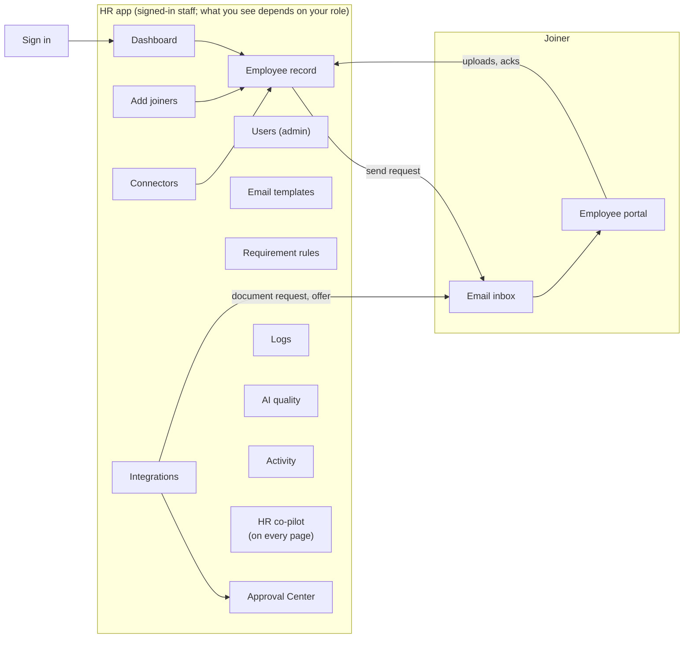
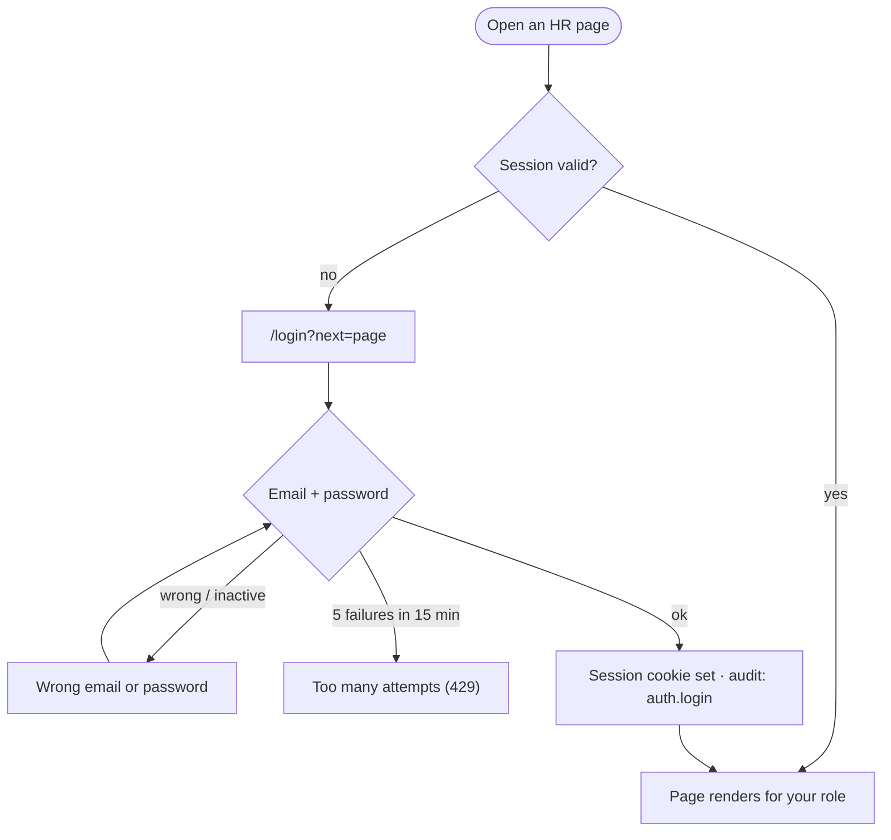
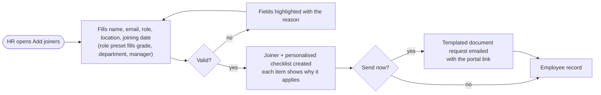
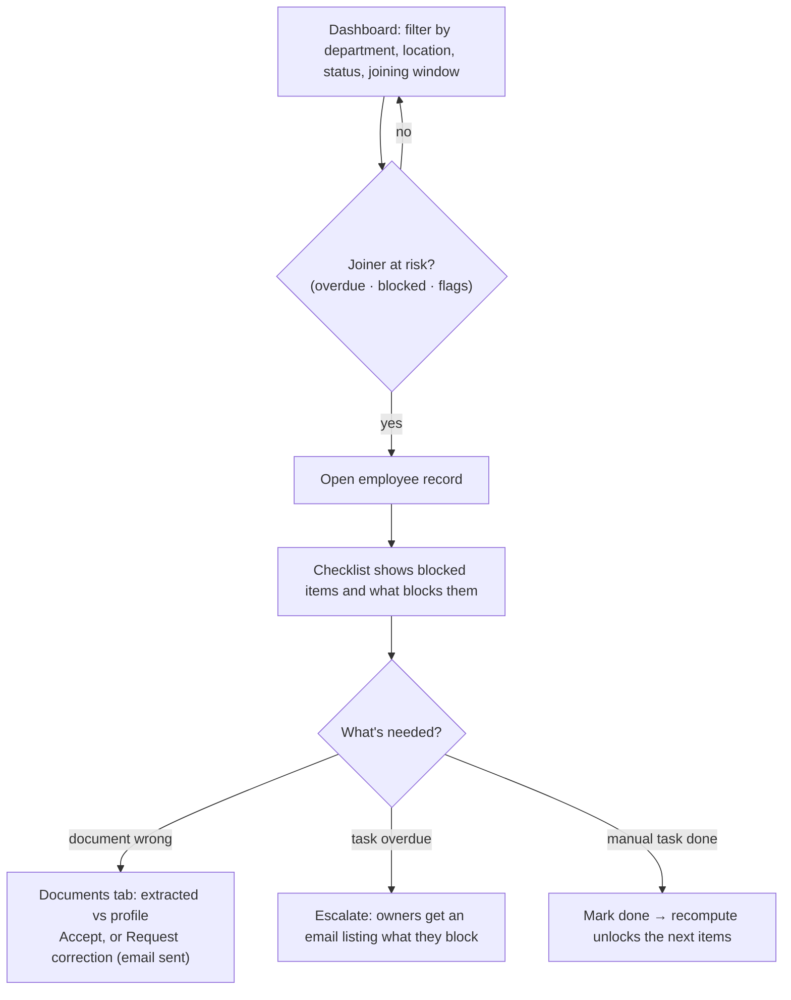
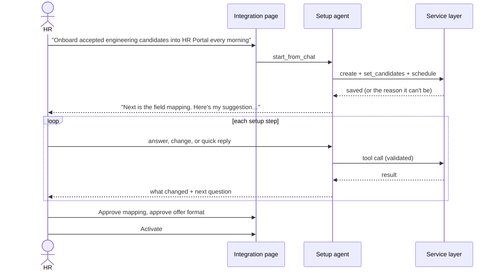
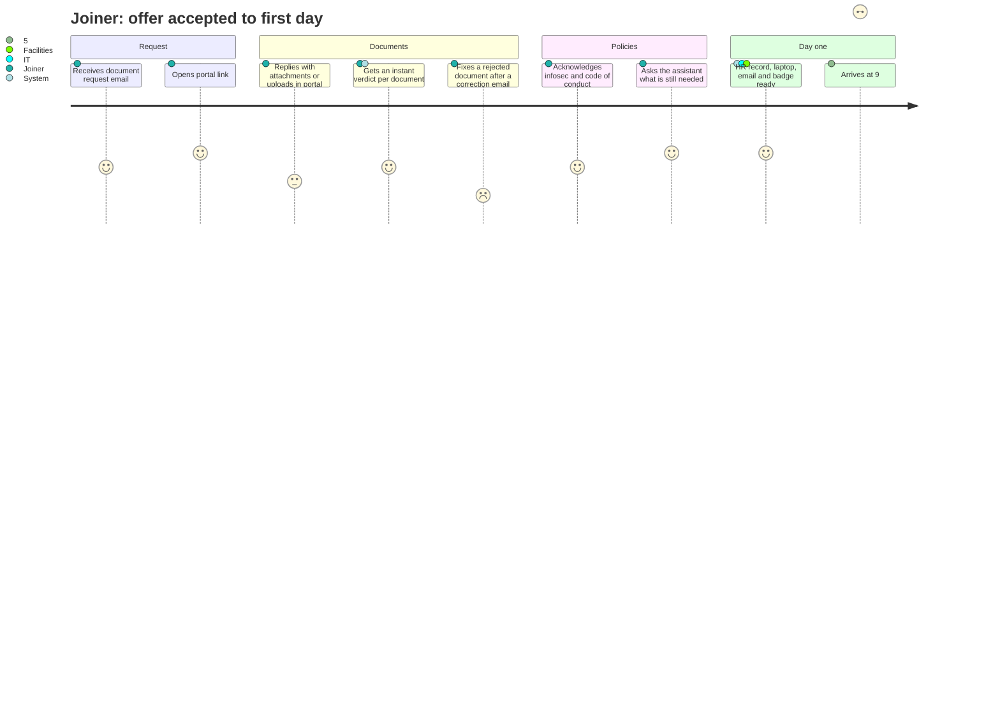
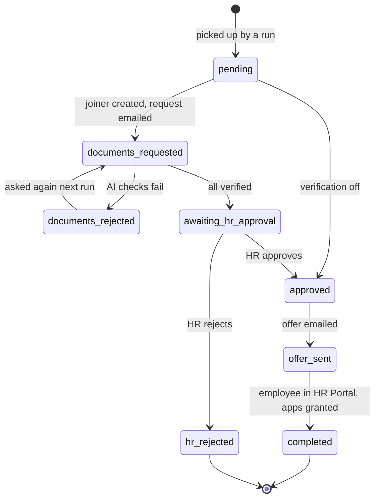

# Azentio Onboard: User Flows

Part of the [design docs](README.md). Each flow names the screens involved and what the system does behind them; the [LLD](lld.md) has the sequence detail.

Flows marked **Planned (Phase N)** are designed in the [hardening roadmap](plans/2026-11-01-hardening-design.md) but not built yet. Everything else is built.

## 1. Map of the product

## 2. Access flows

### 2.1 Staff sign-in
**Screen:** `/login` (public).
1. Any HR page opened without a session redirects to `/login?next=<page>`. So does any API call that gets a `401`.
2. The person enters their work email and password. The login page lists the dev accounts in development only.
3. **On success**, the backend creates a server-side session and sets an `httpOnly` cookie. The browser returns to `next`, which must be a same-site path, otherwise `/dashboard`.
4. **On failure**, an inline error appears:
   - "Wrong email or password". The same message is used for unknown emails and deactivated accounts, so the page doesn't reveal which accounts exist.
   - "Too many attempts. Try again in 15 minutes." This appears after 5 failed attempts for one email.
5. Opening `/login` while already signed in skips straight to `next`.

Every sign-in, failed sign-in and sign-out is written to the audit log.

### 2.2 Sign out and change password
**Where:** the account menu at the bottom of the sidebar (name and role badge).
- **Sign out** revokes the session on the server and returns to `/login`.
- **Change password** asks for the current password and a new one of at least 10 characters. All the person's other sessions are signed out.

### 2.3 What each role sees
Every role sees only the navigation it can use. A page outside your role shows "You don't have access to this page". Buttons you can't use are hidden. The backend enforces every rule itself, so hiding a button is never the only protection.

| Page | Admin | HR Ops | Approver | Manager | Auditor |
|---|---|---|---|---|---|
| Dashboard, Activity | ✓ | ✓ | ✓ | own reports only | ✓ |
| Add joiners | | ✓ | | | |
| Email templates, Requirement rules | view | edit | view | | view |
| Connectors, Integrations | edit | view (import joiners) | view | | view |
| Approvals | view | view | **decide** | | view |
| Logs (integration + audit), AI quality | ✓ | ✓ | ✓ | | ✓ |
| Users | ✓ | | | | |
| HR co-pilot | ✓ | ✓ | ✓ | | ✓ |

Joiners don't have accounts. They keep using the secure portal link in their email ([§4](#4-joiner-flows)). Only HR Ops can fetch or copy a portal link, because whoever holds it can act as that joiner.

### 2.4 Manage users (admin)
**Screen:** Users.
- **The page shows** a count per role with what each role does, and a searchable table: person, role, status, last sign-in, date added.
- **Add user:** name, work email, role (with a one-line description) and a generated temporary password. The password is shown once with a copy button. The person changes it after first sign-in.
- **Change role:** inline select. The person's sessions end, so the new role applies on their next sign-in.
- **Reset password:** generates a new temporary password and ends their sessions.
- **Deactivate or reactivate:** with confirmation. Deactivation signs them out everywhere at once; their history stays in the audit log.
- **Guards:**
  - The last active admin can't be demoted or deactivated (`409`, and the controls are disabled with an explanation).
  - Admins can't deactivate themselves.

### 2.5 Manager view
A manager signs in and sees Dashboard and Activity, limited to joiners whose `manager_email` is theirs.
- They can open those joiners' records read-only.
- Any other joiner's record shows "Joiner not found". The API returns `404`, not `403`, so it doesn't reveal that the joiner exists.
- Managers can't reach rules, templates, logs, the co-pilot or portal links.
- **Planned (Phase 6):** comments on their reports' items, and SLA and escalation visibility.

### 2.6 Auditor
An auditor sees every read-only page, including **Logs → Audit log**. That's who did what, under the real user's email (or `system` for background work), in a tamper-evident chain. They can't change anything.

## 3. HR flows

HR flows are done by **HR Ops** unless stated otherwise.

### 3.1 Onboard one joiner
**Screens:** Add joiners → Employee record

**Edge cases**
- A duplicate email updates the existing joiner.
- Gmail not configured: the joiner is still created, and the page says the email wasn't sent.

### 3.2 Bulk import
**Screen:** Add joiners → Import. HR uploads CSV, Excel or JSON for joiners, owners, requirement rules or policies. Valid rows are imported and invalid rows come back with a row number and reason. Policies are chunked and indexed for the assistants.

### 3.3 Track and unblock
**Screens:** Dashboard → Employee record

### 3.4 Change joining date or role
**Screen:** Employee record → Edit. HR changes the date, role, grade, department or location.
- The checklist is rebuilt: items that no longer apply are removed and new ones are added.
- Due dates and owners are recalculated, and progress on items that still apply is kept.
- A toast lists every changed due date, and each change is logged with its reason.

### 3.5 Review a document
**Screen:** Employee record → Documents. HR sees the file, the fields the model extracted next to the profile values, the confidence and any issues. HR either accepts, or requests a correction, which emails the joiner in the same thread. Documents under review wait here; nothing is accepted automatically when the model is unsure.

**Planned (Phase 2):**
- Each document type gets a risk tier. Low-risk documents are auto-accepted only if every check passes and confidence is ≥ 0.9.
- ID, visa or work authorisation, I-9 and BGV documents always go to an Approver in a review queue. The queue shows the file beside the extracted fields and mismatches, and needs a reason to approve or reject.
- 10% of auto-accepted documents are spot-checked.

### 3.6 Maintain rules and templates
**Screens:** Requirement rules, Email templates.
- **Rule edits** take effect at once today: saving re-derives every joiner's checklist and logs why each item changed.
  - **Planned (Phase 1):** HR Ops edits a *draft*, and an impact preview shows which joiners gain or lose items and which dates move.
  - A different person (an Approver) publishes it; compliance rules need two approvers.
  - Joiners starting within a few days are flagged for HR instead of changed, completed items and documents are never removed, and any version can be rolled back.
- **Template edits** show a live preview with a sample joiner.

### 3.7 Set up an integration with the agent
**Screens:** Integrations → New → Integration (Agent tab)

The steps are: candidates → mapping → notifications → documents → offer → access → schedule → review. HR can also change any setting with the buttons on the page. Both routes go through the same validation.

### 3.8 Approve candidates
**Screen:** Approval Center. A candidate appears here once the AI checks have verified all their documents. Everyone on staff can see the queue; only an **Approver** can approve or reject (others see "Waiting on an approver"). The approver sees each document's result and reason, then decides; a rejection needs a reason. On approval, the next run (or the immediate callback) sends the offer, creates the employee in the HR Portal and grants app access.

### 3.9 Investigate what happened
**Screens:**
- **Logs → Integration log:** per run and per candidate, what was done and how each field was filled, minus anything HR excluded.
- **Logs → Audit log:** who did what, searchable.
- **Activity:** every event across joiners.
- **AI quality:** assistant scores and guardrail hits, with a Run evaluation button.

### 3.10 Ask the HR co-pilot
The floating co-pilot is available on every HR page. Questions like "who is at risk this week?" are answered from live data with `[joiner: Name]` and policy citations. On an employee record, it knows who "they" refers to.

## 4. Joiner flows

### 4.1 From email to day one

### 4.2 Document submission and correction

### 4.3 Ask the assistant
**Screen:** Portal → Assistant.
1. The joiner asks, for example, "Which documents do I need before joining?"
2. Guardrails check the message. An injection attempt gets a fixed reply and never reaches the model.
3. The answer streams with citations to the policy section or to `[checklist]`, and is specific to the joiner's role and location.
4. If a citation can't be matched to a retrieved policy, a note asks the joiner to confirm with HR.
5. If the policies don't cover the question, the assistant says so and names the HR contact.

## 5. Candidate lifecycle through an integration

## 6. Planned lifecycle flows (Phase 5)

Each case type runs as a Temporal workflow ([ADR 0011](adr/0011-temporal-orchestration.md)). Its state stays in Postgres.

| Flow | What happens |
|---|---|
| Role or department transfer | The checklist is re-planned for the new role; access is granted and revoked to match; new policy acknowledgements are collected |
| Offboarding | Access revoked in connected apps, assets returned, exit documents collected, timers up to the last working day |
| Compliance recheck | Expiring visas, permits and certifications are re-requested N days before expiry |
| Contractor vs employee, rehire | Worker type selects the rule set; rehires reuse documents that are still valid |
| Leave and return | Obligations pause during leave and are re-checked on return |

## 7. Acceptance criteria for the core flows

| Flow | Done when |
|---|---|
| Onboard one joiner | Checklist created with a reason on every item; request email sent or a clear reason why not |
| Document correction | A mismatched name produces a correction email naming the field, and the item shows *Correction Requested* |
| Date change | Every affected due date moves, each change is logged with its cause, accepted items stay accepted |
| Integration setup | An integration can be configured end to end through chat alone, and every setting is visible on the page |
| Approval | An approved candidate reaches *completed* without further HR action, and a re-run creates no duplicate |
| Assistant | Answers cite a real retrieved section; injection prompts are blocked; unknown topics get the HR contact |
| Sign-in and roles | Signed out, every HR page redirects to sign-in; each role sees exactly its navigation; forbidden pages are gated; a manager can't open someone else's report (all checked by `scripts/smoke.py`) |
| User management | Deactivating a user ends their sessions immediately; the last admin can't be removed; every change is in the audit log under the admin's email |
