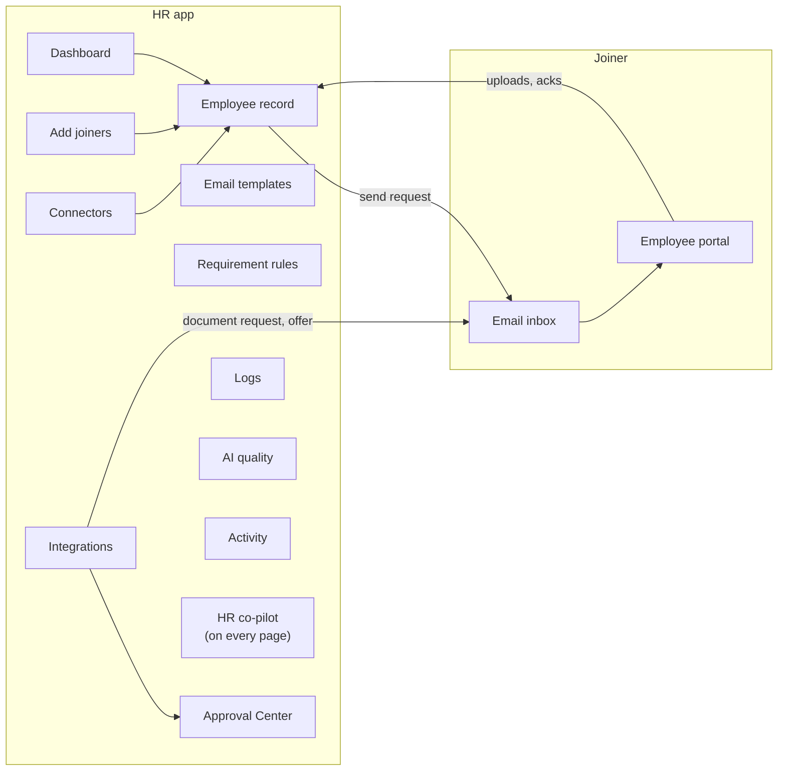
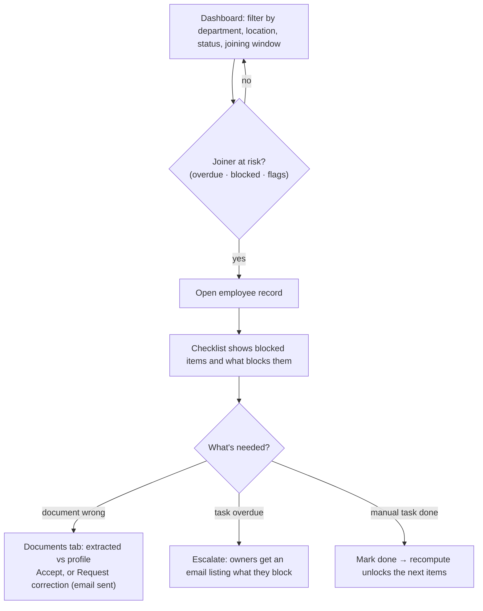
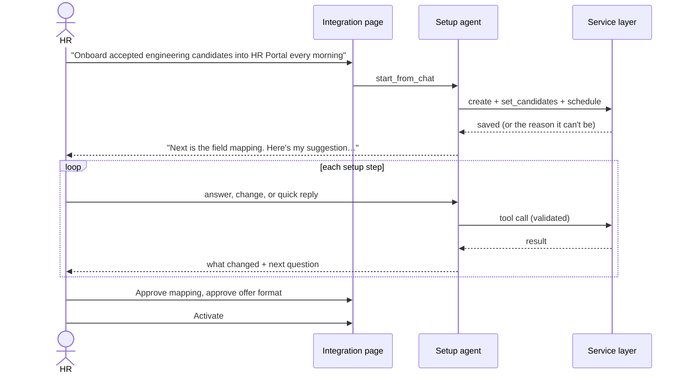
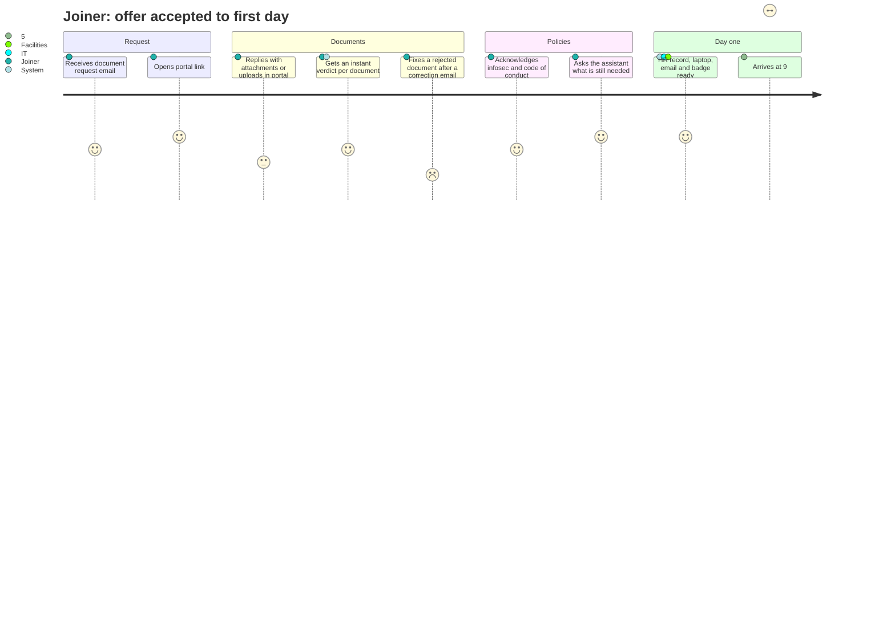
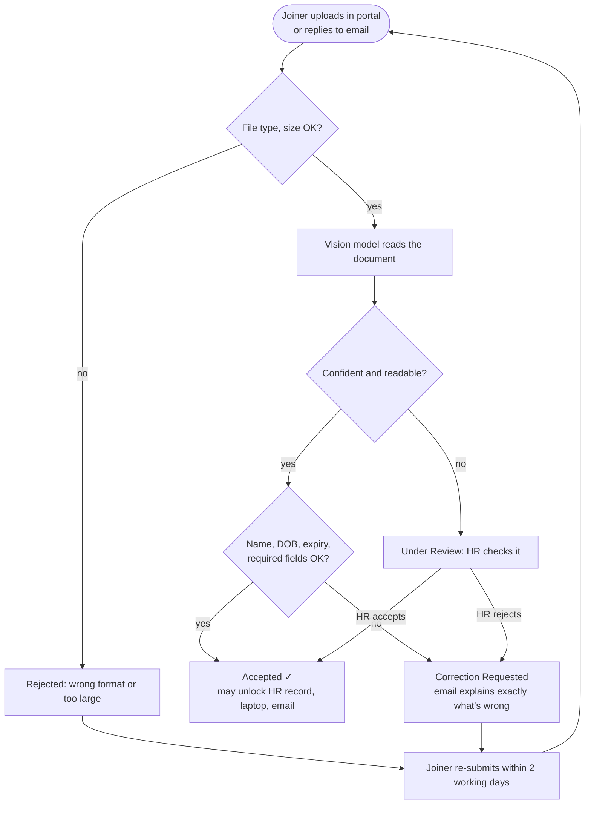
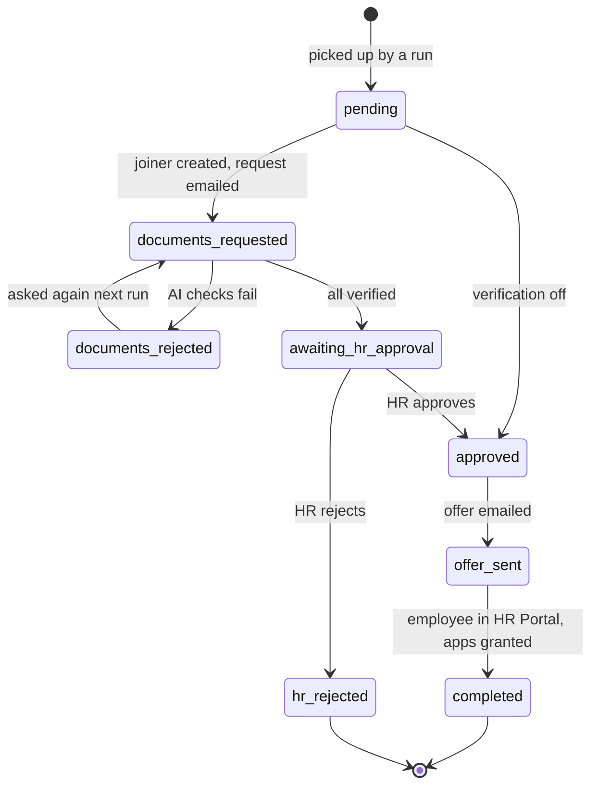

# Azentio Onboard: User Flows

Part of the [design docs](README.md). Each flow names the screens involved and what the system does behind them; the [LLD](lld.md) has the sequence detail.

## 1. Map of the product

## 2. HR flows

### 2.1 Onboard one joiner
**Screens:** Add joiners → Employee record

**Edge cases**
- A duplicate email updates the existing joiner.
- Gmail not configured: the joiner is still created, and the page says the email wasn't sent.

### 2.2 Bulk import
**Screen:** Add joiners → Import. HR uploads CSV, Excel or JSON for joiners, owners, requirement rules or policies. Valid rows are imported and invalid rows come back with a row number and reason. Policies are chunked and indexed for the assistants.

### 2.3 Track and unblock
**Screens:** Dashboard → Employee record

### 2.4 Change joining date or role
**Screen:** Employee record → Edit. HR changes the date, role, grade, department or location.
- The checklist is rebuilt: items that no longer apply are removed and new ones are added.
- Due dates and owners are recalculated, and progress on items that still apply is kept.
- A toast lists every changed due date, and each change is logged with its reason.

### 2.5 Review a document
**Screen:** Employee record → Documents. HR sees the file, the fields the model extracted next to the profile values, the confidence and any issues. HR either accepts, or requests a correction, which emails the joiner in the same thread. Documents under review wait here; nothing is accepted automatically when the model is unsure.

### 2.6 Maintain rules and templates
**Screens:** Requirement rules, Email templates.
- **Rule edits** take effect at once: saving re-derives every joiner's checklist and logs why each item changed.
- **Template edits** show a live preview with a sample joiner.

### 2.7 Set up an integration with the agent
**Screens:** Integrations → New → Integration (Agent tab)

The steps are: candidates → mapping → notifications → documents → offer → access → schedule → review. HR can also change any setting with the buttons on the page. Both routes go through the same validation.

### 2.8 Approve candidates
**Screen:** Approval Center. A candidate appears here once the AI checks have verified all their documents. HR sees each document's result and reason, then approves or rejects. On approval, the next run (or the immediate callback) sends the offer, creates the employee in the HR Portal and grants app access.

### 2.9 Investigate what happened
**Screens:**
- **Logs → Integration log:** per run and per candidate, what was done and how each field was filled, minus anything HR excluded.
- **Logs → Audit log:** who did what, searchable.
- **Activity:** every event across joiners.
- **AI quality:** assistant scores and guardrail hits, with a Run evaluation button.

### 2.10 Ask the HR co-pilot
The floating co-pilot is available on every HR page. Questions like "who is at risk this week?" are answered from live data with `[joiner: Name]` and policy citations. On an employee record, it knows who "they" refers to.

## 3. Joiner flows

### 3.1 From email to day one

### 3.2 Document submission and correction

### 3.3 Ask the assistant
**Screen:** Portal → Assistant.
1. The joiner asks, for example, "Which documents do I need before joining?"
2. Guardrails check the message. An injection attempt gets a fixed reply and never reaches the model.
3. The answer streams with citations to the policy section or to `[checklist]`, and is specific to the joiner's role and location.
4. If a citation can't be matched to a retrieved policy, a note asks the joiner to confirm with HR.
5. If the policies don't cover the question, the assistant says so and names the HR contact.

## 4. Candidate lifecycle through an integration

## 5. Acceptance criteria for the core flows

| Flow | Done when |
|---|---|
| Onboard one joiner | Checklist created with a reason on every item; request email sent or a clear reason why not |
| Document correction | A mismatched name produces a correction email naming the field, and the item shows *Correction Requested* |
| Date change | Every affected due date moves, each change is logged with its cause, accepted items stay accepted |
| Integration setup | An integration can be configured end to end through chat alone, and every setting is visible on the page |
| Approval | An approved candidate reaches *completed* without further HR action, and a re-run creates no duplicate |
| Assistant | Answers cite a real retrieved section; injection prompts are blocked; unknown topics get the HR contact |
